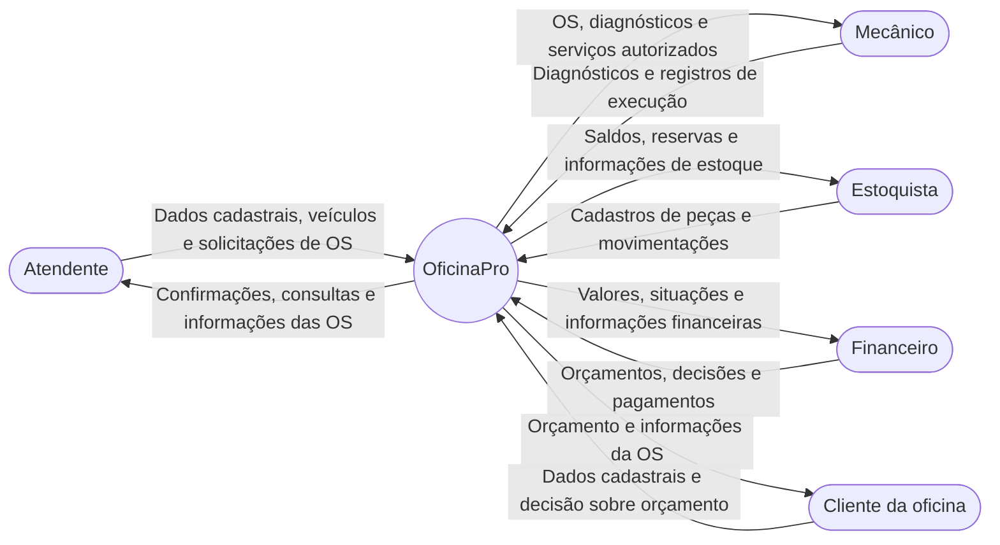
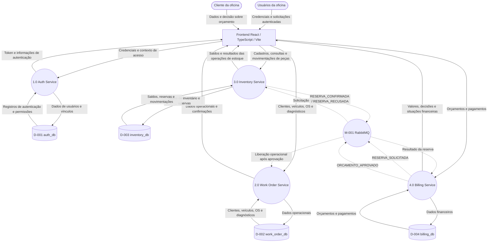

# Diagrama de Fluxo de Dados (DFD) — OficinaPro

> **Documento oficial de trabalho — Grupo GarageOps**
>
> Este documento apresenta o fluxo de dados do OficinaPro, identificando os atores externos, os processos internos, os microsserviços responsáveis pelo processamento das informações, os armazenamentos e os mecanismos de comunicação.
>
> A arquitetura descrita representa a proposta técnica consolidada para o MVP. Contratos detalhados de APIs e eventos, assim como decisões ainda não formalizadas, poderão ser refinados durante o desenvolvimento e submetidos à validação do grupo e do professor.

---

**Projeto:** OficinaPro  
**Grupo:** GarageOps  
**Data:** 16/11/2026  
**Versão:** 1.0

---

## 1. Objetivo

Este documento apresenta o Diagrama de Fluxo de Dados (DFD) do OficinaPro, demonstrando como as informações entram, são processadas, armazenadas e transmitidas entre os usuários, os microsserviços e os componentes internos do sistema.

O DFD tem como objetivos:

- Identificar as entidades externas que interagem com o sistema.
- Representar os principais processos responsáveis pelo tratamento dos dados.
- Demonstrar os fluxos de informação entre os processos.
- Identificar os armazenamentos de dados e os microsserviços responsáveis por eles.
- Documentar a comunicação síncrona e assíncrona.
- Demonstrar os mecanismos de integridade, isolamento entre oficinas e confiabilidade das operações.

O OficinaPro será desenvolvido como um SaaS de gestão para oficinas mecânicas, utilizando uma arquitetura baseada em microsserviços e isolamento de dados por oficina (*multi-tenancy*).

## 2. Notação Utilizada

| Símbolo | Significado |
|---|---|
| Retângulo | Entidade externa, como usuário ou sistema externo |
| Círculo / Elipse | Processo responsável por transformar ou processar dados |
| Setas | Fluxo de dados, indicando origem, destino e direção |
| Cilindro | Armazenamento persistente de dados |
| Fila / Broker | Componente responsável pela comunicação assíncrona entre processos |

Os diagramas foram elaborados em Mermaid para permitir visualização e manutenção diretamente em Markdown.

## 3. DFD Nível 0 — Diagrama de Contexto

O DFD de Nível 0 representa o OficinaPro como um único processo, demonstrando as interações entre o sistema e as entidades externas, sem detalhar os microsserviços internos.

### 3.1 Entidades Externas

| Entidade | Descrição | Principais informações fornecidas |
|---|---|---|
| Atendente | Usuário responsável pelo atendimento e abertura de ordens de serviço. | Dados de clientes, veículos e solicitações de OS. |
| Mecânico | Usuário responsável pelo diagnóstico e execução dos serviços autorizados. | Diagnósticos, observações técnicas e registros de execução. |
| Estoquista | Usuário responsável pelo controle de peças e movimentações do inventário. | Cadastros de peças, entradas e demais movimentações. |
| Financeiro | Usuário responsável pela elaboração de orçamentos e pelo controle financeiro. | Orçamentos, decisões relacionadas a eles e registros de pagamentos. |
| Cliente da oficina | Pessoa externa à equipe da oficina que solicita serviços e avalia os orçamentos. | Dados cadastrais e decisão sobre o orçamento apresentado. |

**Observação:** os perfis Atendente, Mecânico, Estoquista e Financeiro representam os papéis operacionais previstos para o MVP. As permissões específicas devem respeitar as regras de autorização definidas no documento de requisitos.

O cliente da oficina é representado como entidade externa. O canal pelo qual ele receberá e aceitará orçamentos — atendimento presencial, link ou outra interface — ainda deverá ser definido pelo grupo. O diagrama representa a troca lógica de informações, não uma funcionalidade de portal do cliente já confirmada.

## 4. DFD Nível 1 — Processos Principais

O DFD de Nível 1 decompõe o OficinaPro em seus quatro microsserviços principais, demonstrando os processos, os armazenamentos e os fluxos de dados entre eles.

A arquitetura adota o padrão **Database-per-Service**: cada microsserviço é responsável pelos próprios dados e não realiza acesso direto ao banco de dados de outro serviço.

### 4.1 Descrição dos Processos

| Processo | Microsserviço | Responsabilidade |
|---|---|---|
| 1.0 | Auth Service | Autenticar usuários, gerenciar vínculos com oficinas e aplicar controle de acesso e permissões. |
| 2.0 | Work Order Service | Gerenciar clientes, veículos, ordens de serviço, diagnósticos e informações de execução. |
| 3.0 | Inventory Service | Gerenciar peças, saldos físicos, reservas, consumo, liberações e movimentações de estoque. |
| 4.0 | Billing Service | Gerenciar orçamentos, itens, decisões relacionadas aos orçamentos e registros de pagamentos. |

### 4.2 Fluxo de Autenticação e Identificação da Oficina

1. O usuário informa suas credenciais pelo frontend.
2. O Auth Service valida as credenciais e verifica os vínculos do usuário com as oficinas.
3. Após a autenticação, o serviço disponibiliza um mecanismo seguro de identificação do usuário e do contexto de acesso.
4. O frontend utiliza as informações de autenticação nas requisições aos demais microsserviços.
5. Cada serviço valida a identidade, as permissões e o contexto da oficina antes de executar a operação solicitada.
6. Os registros e as respostas devem respeitar o isolamento entre oficinas.

**Regra de segurança:** o `tenant_id` deve ser obtido ou validado a partir do contexto autenticado no backend. O sistema não deverá confiar exclusivamente em um identificador de oficina enviado pelo frontend.

### 4.3 Fluxo de Cadastro de Clientes, Veículos e Abertura de OS

1. O Atendente informa os dados do cliente pelo frontend.
2. O frontend encaminha a solicitação ao Work Order Service, por meio de uma requisição de cadastro.
3. O serviço valida os dados e registra o cliente associado à oficina.
4. O veículo é cadastrado e associado ao cliente correspondente.
5. O Atendente solicita a abertura da ordem de serviço.
6. O Work Order Service valida os vínculos entre oficina, cliente e veículo.
7. A OS é registrada com seu status inicial, conforme as regras de negócio.
8. Os registros permanecem associados à oficina responsável.

Os dados de clientes, veículos e ordens de serviço são de responsabilidade do Work Order Service no MVP.

### 4.4 Fluxo de Diagnóstico

1. O Mecânico consulta as ordens de serviço disponíveis.
2. O Work Order Service verifica se o usuário possui autorização para acessar a OS.
3. O Mecânico registra o diagnóstico técnico.
4. O Work Order Service armazena as informações do diagnóstico, identificando o responsável e a data do registro.
5. A situação da OS é atualizada conforme a transição de status prevista nas regras de negócio.
6. O diagnóstico permanece associado à OS correspondente para consulta no histórico.

### 4.5 Fluxo de Orçamento, Aceitação do Cliente e Reserva de Estoque

Este fluxo envolve principalmente o Billing Service, o Inventory Service e o Work Order Service.

A aceitação do orçamento pelo cliente inicia o processo de reserva das peças necessárias. A aprovação definitiva no sistema e a liberação da execução dependem da confirmação de todas as reservas necessárias.

1. O Financeiro elabora o orçamento no Billing Service, vinculando-o à OS por meio de uma referência identificadora.
2. O orçamento recebe os serviços, as peças, as quantidades e os valores correspondentes.
3. O orçamento é apresentado ao cliente para avaliação.
4. O cliente aceita ou recusa o orçamento.
5. O sistema registra a decisão, identificando o responsável, a data e o horário.
6. Quando aceito, o orçamento passa para a situação `PENDENTE_RESERVA`.
7. O Billing Service publica o evento `RESERVA_SOLICITADA` no RabbitMQ, contendo:
   - Identificador único da solicitação.
   - Identificador da oficina (`tenant_id`).
   - Identificador do orçamento e da OS.
   - Relação de peças e respectivas quantidades.
8. O Inventory Service consome o evento e inicia uma transação em seu próprio banco de dados.
9. O serviço verifica a disponibilidade de todas as peças, aplicando controle de concorrência para impedir reservas superiores ao saldo disponível.
10. O processamento é realizado de maneira atômica:
    - Se todas as peças estiverem disponíveis, todas as reservas serão registradas e a transação será confirmada por `COMMIT`.
    - Se uma ou mais peças estiverem indisponíveis, nenhuma reserva parcial será efetivada.
    - Se ocorrer uma falha técnica durante as alterações, a transação será revertida por `ROLLBACK`.
11. O Inventory Service registra o resultado da solicitação e o evento correspondente:
    - `RESERVA_CONFIRMADA`, quando todas as peças forem reservadas.
    - `RESERVA_RECUSADA`, quando não houver disponibilidade suficiente para todas as peças.
12. O resultado e o evento pendente de publicação são registrados de forma consistente por meio do padrão Transactional Outbox.
13. O Inventory Service publica o evento de resultado no RabbitMQ.
14. O Billing Service consome o resultado:
    - Em caso de confirmação, registra a aprovação definitiva do orçamento e publica `ORCAMENTO_APROVADO`.
    - Em caso de recusa, mantém o orçamento pendente de regularização e disponibiliza a informação para a oficina.
15. O Work Order Service recebe `ORCAMENTO_APROVADO` e atualiza a situação da OS, liberando a execução conforme as regras de negócio.

**Regra fundamental:** a aceitação do cliente não representa, isoladamente, a aprovação definitiva do orçamento no sistema. A execução só poderá ser liberada após a confirmação da reserva integral das peças necessárias.

### 4.6 Fluxo de Tratamento de Indisponibilidade de Peças

Quando o Inventory Service informar `RESERVA_RECUSADA`, a oficina deverá tratar a pendência antes de liberar a execução.

As alternativas previstas são:

1. **Aguardar reposição:** providenciar a aquisição das peças e solicitar uma nova tentativa de reserva.
2. **Alterar o orçamento:** substituir peças ou modificar os serviços. Se a alteração modificar as condições anteriormente aceitas, será necessária uma nova autorização do cliente.
3. **Cancelar a solicitação:** registrar o cancelamento do orçamento ou da solicitação, conforme as regras de negócio.

Enquanto a pendência não for resolvida:

- O orçamento não poderá ser considerado definitivamente aprovado.
- A OS permanecerá bloqueada para execução.
- Nenhuma reserva parcial deverá permanecer efetivada.
- A indisponibilidade deverá ser registrada para consulta e rastreabilidade.

### 4.7 Fluxo de Execução dos Serviços e Movimentação de Estoque

1. Após a aprovação definitiva do orçamento e a confirmação das reservas necessárias, a OS poderá avançar para `EM_EXECUCAO`.
2. O Mecânico realiza os serviços autorizados.
3. Quando uma peça reservada for efetivamente utilizada, o sistema registra sua utilização.
4. O Inventory Service converte a quantidade reservada em saída definitiva, atualizando os saldos correspondentes.
5. Caso uma peça reservada não seja utilizada, a reserva deverá ser liberada, retornando a quantidade ao saldo disponível sem aumentar o estoque físico.
6. Em caso de perda operacional ou inutilização, deverá ser registrada uma movimentação específica, preservando o histórico e a condição física da peça.
7. As movimentações deverão possuir identificadores únicos para impedir baixas duplicadas.

**Distinção importante:**

- Estoque físico: quantidade de peças efetivamente existente.
- Estoque reservado: quantidade comprometida em reservas ainda não consumidas.
- Estoque disponível: quantidade física menos a quantidade reservada.

A liberação de uma reserva não representa uma entrada física de estoque. Ela apenas desfaz o comprometimento anterior da quantidade.

### 4.8 Fluxo Financeiro e Conclusão da OS

1. O Financeiro registra os pagamentos recebidos no Billing Service.
2. O serviço associa cada pagamento à OS correspondente.
3. O sistema acompanha os valores pagos e o saldo restante.
4. Quando todos os valores forem quitados, a situação financeira poderá ser registrada como `QUITADA`.
5. O Work Order Service registra a conclusão operacional da OS quando os serviços forem finalizados e as regras de negócio forem atendidas.
6. As informações da OS, dos serviços e das movimentações permanecem disponíveis para consulta no histórico de manutenção do veículo.

A conclusão operacional e a quitação financeira são informações independentes:

- `CONCLUIDA`: indica que os serviços da OS foram finalizados.
- `QUITADA`: indica que os valores financeiros foram integralmente pagos.

O status financeiro não deverá ser utilizado como substituto do status operacional da OS.

## 5. Comunicação entre os Componentes

### 5.1 Comunicação Síncrona — API REST

A comunicação síncrona será utilizada quando um componente precisar enviar uma solicitação e receber uma resposta diretamente.

Exemplos:

- Autenticação de usuários.
- Consulta de vínculos e permissões.
- Cadastro e consulta de clientes.
- Cadastro e consulta de veículos.
- Abertura e consulta de ordens de serviço.
- Registro de diagnósticos.
- Cadastro e consulta de peças.
- Consulta de disponibilidade de estoque.
- Elaboração e consulta de orçamentos.
- Registro e consulta de pagamentos.

A comunicação entre frontend e microsserviços será realizada por APIs REST, respeitando a autenticação, a autorização e o isolamento de dados por oficina.

### 5.2 Comunicação Assíncrona — RabbitMQ

A comunicação assíncrona será utilizada nas operações que envolvam processamento entre microsserviços e não precisem ser concluídas dentro da mesma requisição HTTP.

Eventos propostos para o MVP:

| Evento | Serviço publicador | Serviço consumidor | Finalidade |
|---|---|---|---|
| `RESERVA_SOLICITADA` | Billing Service | Inventory Service | Solicitar a reserva integral das peças do orçamento aceito. |
| `RESERVA_CONFIRMADA` | Inventory Service | Billing Service | Informar que todas as peças foram reservadas. |
| `RESERVA_RECUSADA` | Inventory Service | Billing Service | Informar que não foi possível reservar todas as peças. |
| `ORCAMENTO_APROVADO` | Billing Service | Work Order Service | Informar a aprovação definitiva e permitir a liberação operacional da OS. |

Os nomes e contratos definitivos dos eventos deverão ser padronizados durante o desenvolvimento.

### 5.3 Requisitos de Confiabilidade da Mensageria

A comunicação assíncrona deverá considerar:

- Identificadores únicos para solicitações e eventos.
- Identificação da oficina por `tenant_id`.
- Identificadores de correlação para rastrear operações entre serviços.
- Consumidores idempotentes, evitando processamento duplicado.
- Estratégias de retentativa para falhas temporárias.
- Tratamento de mensagens que não puderem ser processadas, incluindo mecanismo de fila de mensagens não processadas (DLQ).
- Registro de falhas e possibilidade de recuperação.
- Transactional Outbox para persistir alterações e eventos relacionados de forma consistente.
- Inbox ou mecanismo equivalente para registrar mensagens já processadas.

O RabbitMQ poderá entregar uma mesma mensagem mais de uma vez. Portanto, a confiabilidade não deverá depender de uma entrega única, mas da combinação entre persistência, idempotência, controle de concorrência e tratamento de retentativas.

## 6. Dicionário de Fluxos de Dados

O dicionário identifica os principais fluxos de informação entre entidades externas, processos, armazenamentos e componentes de comunicação.

| ID Fluxo | Nome | Origem | Destino | Descrição | Formato |
|---|---|---|---|---|---|
| F-001 | Credenciais | Usuário | Auth Service | Dados utilizados para autenticação. | JSON / HTTPS |
| F-002 | Token e contexto de acesso | Auth Service | Frontend / demais serviços | Identificação autenticada do usuário e contexto de acesso. | Bearer Token |
| F-003 | Dados de clientes | Atendente / Frontend | Work Order Service | Informações cadastrais do cliente associadas à oficina. | JSON / REST |
| F-004 | Dados de veículos | Atendente / Frontend | Work Order Service | Informações do veículo e vínculo com o cliente. | JSON / REST |
| F-005 | Dados da OS | Atendente / Frontend | Work Order Service | Solicitação de abertura e atualização de ordem de serviço. | JSON / REST |
| F-006 | Diagnóstico | Mecânico / Frontend | Work Order Service | Informações técnicas e registros do diagnóstico. | JSON / REST |
| F-007 | Dados de peças | Estoquista / Frontend | Inventory Service | Cadastro e atualização de peças. | JSON / REST |
| F-008 | Movimentação de estoque | Estoquista / Frontend | Inventory Service | Registros de entrada, reserva, consumo, liberação e perda. | JSON / REST |
| F-009 | Consulta de estoque | Inventory Service | Frontend | Saldos físicos, reservados e disponíveis. | JSON / REST |
| F-010 | Dados do orçamento | Financeiro / Frontend | Billing Service | Serviços, peças, quantidades e valores do orçamento. | JSON / REST |
| F-011 | Decisão do cliente | Cliente / Frontend | Billing Service | Aceitação ou recusa do orçamento, com responsável e data/hora. | JSON / REST |
| F-012 | Solicitação de reserva | Billing Service | Inventory Service | Solicitação de reserva integral das peças necessárias. | Evento JSON / RabbitMQ |
| F-013 | Resultado da reserva | Inventory Service | Billing Service | Confirmação ou recusa da reserva integral. | Evento JSON / RabbitMQ |
| F-014 | Aprovação definitiva do orçamento | Billing Service | Work Order Service | Informação de que o orçamento foi aprovado após a confirmação da reserva. | Evento JSON / RabbitMQ |
| F-015 | Dados de pagamento | Financeiro / Frontend | Billing Service | Registro dos pagamentos associados à OS. | JSON / REST |
| F-016 | Situação financeira | Billing Service | Frontend | Valores pagos, saldo restante e situação financeira. | JSON / REST |
| F-017 | Dados operacionais | Work Order Service | Frontend | Situação da OS, diagnósticos e informações de execução. | JSON / REST |
| F-018 | Dados de histórico | Work Order Service | Frontend | Informações de manutenção associadas ao veículo e às OS. | JSON / REST |
| F-019 | Identificação da oficina | Auth Service / contexto autenticado | Microsserviços | Contexto validado utilizado para isolamento dos dados. | Claim / contexto autenticado |
| F-020 | Eventos de rastreabilidade | Microsserviços | RabbitMQ / consumidores | Identificadores de correlação, oficina e operação para rastrear processamento assíncrono. | Evento JSON |

**Observação:** os formatos indicados representam a proposta de comunicação. Os contratos definitivos, os campos obrigatórios e os esquemas de validação deverão ser documentados durante a implementação das APIs e dos eventos.

## 7. Dicionário de Armazenamentos

Cada microsserviço será responsável pelo próprio armazenamento persistente, respeitando o padrão Database-per-Service.

| ID | Nome | Tipo | Descrição | Microsserviço Responsável |
|---|---|---|---|---|
| D-001 | `auth_db` | Relacional (PostgreSQL) | Armazena usuários, credenciais, vínculos com oficinas, perfis e informações de autorização. | Auth Service |
| D-002 | `work_order_db` | Relacional (PostgreSQL) | Armazena clientes, veículos, ordens de serviço, diagnósticos e informações operacionais. | Work Order Service |
| D-003 | `inventory_db` | Relacional (PostgreSQL) | Armazena peças, saldos físicos, quantidades reservadas, solicitações de reserva e movimentações de estoque. | Inventory Service |
| D-004 | `billing_db` | Relacional (PostgreSQL) | Armazena orçamentos, itens, decisões relacionadas aos orçamentos e registros de pagamentos. | Billing Service |
| D-005 | Outbox / Inbox | Tabelas relacionais (PostgreSQL) | Armazena eventos pendentes de publicação e registros de mensagens processadas, conforme a responsabilidade de cada serviço. | Microsserviços responsáveis |
| M-001 | RabbitMQ | Message Broker | Transporta eventos assíncronos entre os microsserviços, incluindo solicitações e resultados de reserva. | Infraestrutura de mensageria |

**Observações sobre os armazenamentos:**

1. Cada serviço deverá acessar exclusivamente seu próprio banco de dados.
2. As referências entre dados de serviços diferentes deverão utilizar identificadores, como UUID, sem chaves estrangeiras entre bancos de microsserviços distintos.
3. As validações de referências externas deverão ocorrer por meio de APIs ou eventos.
4. O `tenant_id` deverá ser aplicado aos registros pertencentes a uma oficina, garantindo o isolamento entre os clientes do SaaS.
5. A utilização de bancos lógicos separados na mesma instância PostgreSQL poderá ser considerada no MVP, desde que o isolamento e a responsabilidade de cada serviço sejam preservados.
6. Outbox e Inbox representam mecanismos de persistência associados aos serviços, não um banco compartilhado acessado diretamente por todos eles.
7. O RabbitMQ é um componente de mensageria e não substitui os armazenamentos persistentes dos microsserviços.

## 8. Integridade, Segurança e Rastreabilidade dos Dados

A comunicação entre os componentes deverá respeitar os seguintes princípios:

### 8.1 Isolamento entre Oficinas

- Cada oficina será identificada por um `tenant_id`.
- Os registros operacionais deverão estar associados à oficina correspondente.
- O backend deverá validar o contexto da oficina em cada operação.
- Consultas, atualizações, eventos e relatórios deverão respeitar o isolamento entre oficinas.
- O frontend não deverá ser considerado responsável pela garantia de isolamento dos dados.

### 8.2 Autenticação e Autorização

- As requisições deverão identificar o usuário autenticado.
- Cada operação deverá respeitar as permissões do perfil associado ao usuário.
- O acesso a clientes, veículos, OS, estoque e informações financeiras deverá ser autorizado conforme a responsabilidade do perfil.
- Senhas, tokens e segredos não deverão ser armazenados em logs.

### 8.3 Integridade e Idempotência

- Os serviços deverão validar os identificadores e vínculos entre registros.
- Operações sensíveis deverão possuir mecanismos de idempotência.
- Movimentações de estoque e pagamentos não poderão ser duplicadas por reenvio de requisições ou mensagens.
- As alterações de dados e os eventos relacionados deverão manter consistência.

### 8.4 Auditoria

Operações relevantes deverão permitir identificar:

- Usuário responsável.
- Oficina relacionada (`tenant_id`).
- Ação executada.
- Registro afetado.
- Data e horário.
- Identificador de correlação, quando aplicável.

### 8.5 Confiabilidade das Reservas de Estoque

O processamento das reservas deverá ocorrer dentro do banco de dados do Inventory Service, respeitando as seguintes condições:

1. Todas as peças de uma solicitação deverão ser verificadas e reservadas como uma única operação lógica.
2. A transação deverá ser confirmada somente quando todas as peças estiverem disponíveis.
3. Se uma ou mais peças estiverem indisponíveis, nenhuma reserva parcial deverá ser efetivada.
4. Em caso de falha técnica, as alterações deverão ser revertidas por meio de `ROLLBACK`.
5. O controle de concorrência deverá impedir que solicitações simultâneas comprometam quantidades superiores ao estoque disponível.
6. Poderá ser utilizado bloqueio de registros, como `SELECT ... FOR UPDATE`, durante a verificação e atualização dos saldos.
7. Solicitações de reserva deverão possuir identificadores únicos e mecanismos de idempotência.
8. O resultado da reserva e o evento correspondente deverão ser persistidos de forma consistente por meio do Transactional Outbox.
9. A repetição de uma mensagem já processada deverá retornar ou reconhecer o resultado anterior, sem gerar reservas ou movimentações duplicadas.

## 9. Histórico de Revisões

| Versão | Data | Autor | Descrição da Alteração |
|---|---|---|---|
| 1.0 | 16/11/2026 | Grupo GarageOps | Consolidação do DFD de contexto, processos principais, fluxos de dados, armazenamentos e comunicação entre microsserviços. |

---

**Aprovado por:**

___________________________________________________  
Professor(a) Orientador(a)

**Data:** ____/____/2026

**Status da aprovação:** Pendente de validação do grupo e do professor.
