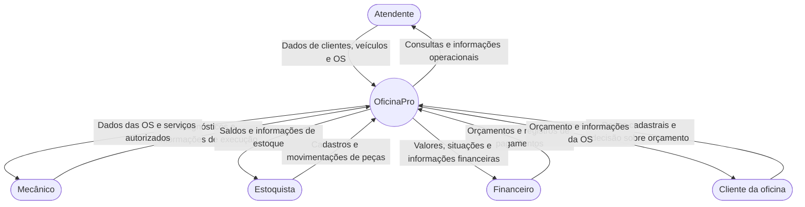
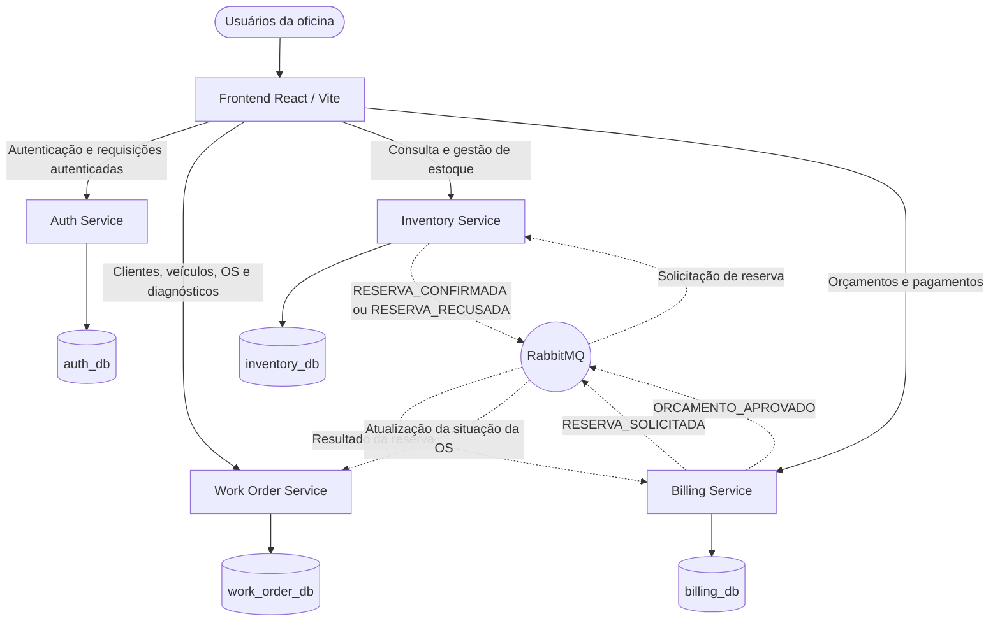

# Diagrama de Fluxo de Dados (DFD) e Comunicação — OficinaPro

> **Documento oficial de trabalho — Grupo GarageOps**
>
> Este documento apresenta a visão geral do fluxo de dados do OficinaPro, identificando os atores, os microsserviços, os bancos de dados e os mecanismos de comunicação entre os componentes.
>
> A arquitetura descrita é uma proposta técnica de trabalho, sujeita à validação do grupo e do professor.

---

## 1. Visão Geral da Arquitetura

O OficinaPro está sendo projetado como um sistema de gestão para oficinas mecânicas, com arquitetura baseada em microsserviços.

A proposta considera quatro microsserviços principais:

- **Auth Service:** responsável pela autenticação, usuários, vínculos com oficinas e controle de permissões.
- **Work Order Service:** responsável pelo cadastro de clientes, veículos, ordens de serviço e diagnósticos.
- **Inventory Service:** responsável pelo cadastro de peças, controle de estoque e movimentações.
- **Billing Service:** responsável pela elaboração de orçamentos, seus itens e pelo registro de pagamentos.

A arquitetura propõe o padrão **Database-per-Service**, no qual cada microsserviço possui responsabilidade exclusiva sobre seus próprios dados e não acessa diretamente o banco de dados de outro serviço.

A comunicação entre o frontend e os microsserviços ocorrerá por meio de APIs REST. Para operações que envolvam comunicação assíncrona, poderá ser utilizado o RabbitMQ.

### 1.1 Atores do Sistema

Os seguintes perfis são uma proposta inicial para o MVP:

| Ator | Responsabilidades |
|---|---|
| **Atendente** | Gerenciar clientes e veículos, além de abrir e consultar ordens de serviço. |
| **Mecânico** | Registrar diagnósticos e executar os serviços autorizados. |
| **Estoquista** | Gerenciar peças, consultar saldos e acompanhar movimentações de estoque. |
| **Financeiro** | Elaborar orçamentos, registrar decisões relacionadas a eles e controlar pagamentos. |

As permissões de cada perfil deverão ser definidas e validadas pelo grupo.

### 1.2 Isolamento entre Oficinas (Multi-tenancy)

Como proposta para a estrutura SaaS, o sistema deverá permitir que diferentes oficinas utilizem a mesma plataforma sem compartilhar indevidamente seus dados.

Para isso, recomenda-se:

- Identificar cada oficina por meio de um `tenant_id`.
- Associar os registros operacionais à oficina correspondente.
- Validar o vínculo do usuário com a oficina em cada operação.
- Impedir que um usuário consulte ou altere dados de outra oficina.
- Utilizar o contexto de oficina obtido da autenticação e validado no backend, sem confiar exclusivamente em valores enviados pelo frontend.

A implementação desse modelo ainda deverá ser validada pelo grupo.

---

## 2. Diagrama de Fluxo de Dados — Nível 0 (Contexto)

O DFD de contexto apresenta o OficinaPro como um único processo, destacando as interações entre os usuários e o sistema, sem detalhar o funcionamento interno dos microsserviços.

**Observação:** o cliente representa uma pessoa externa à equipe da oficina. A forma de interação com o sistema, como acesso por portal, link ou atendimento presencial, ainda deverá ser definida pelo grupo.

---

## 3. Diagrama de Comunicação entre os Componentes

O diagrama seguinte detalha a comunicação interna proposta entre o frontend, os microsserviços, os bancos de dados e o sistema de mensageria.

**Observações sobre a comunicação:**

- Cada microsserviço é responsável pelo próprio banco de dados.
- As referências entre registros de serviços diferentes são realizadas por identificadores, como UUID, e não por chaves estrangeiras entre bancos.
- O RabbitMQ será utilizado para comunicação assíncrona quando necessário.
- Os eventos deverão transportar o identificador da oficina (`tenant_id`) e os identificadores necessários para processar a operação.
- Os consumidores deverão ser idempotentes, evitando que a repetição de uma mensagem provoque movimentações duplicadas.
- O diagrama representa uma proposta lógica. Os contratos definitivos das APIs e dos eventos deverão ser especificados durante o desenvolvimento.

---

## 4. Descrição dos Principais Fluxos de Dados

### 4.1 Fluxo de Autenticação e Identificação da Oficina

1. O usuário informa suas credenciais pelo frontend.
2. O Auth Service valida as credenciais e verifica os vínculos do usuário com as oficinas.
3. Após a autenticação, o serviço disponibiliza um mecanismo seguro de identificação do usuário e do contexto de acesso.
4. As requisições aos demais microsserviços são autenticadas e autorizadas.
5. Cada serviço valida se o usuário possui permissão para executar a operação solicitada e se os dados pertencem à oficina correspondente.

**Regra importante:** o isolamento entre oficinas deve ser aplicado no backend, e não somente na interface.

### 4.2 Fluxo de Cadastro de Clientes, Veículos e Abertura de OS

1. O Atendente informa os dados do cliente pelo frontend.
2. O frontend encaminha a solicitação ao Work Order Service, por meio de uma requisição `POST /clientes`.
3. O serviço valida os dados e registra o cliente associado à oficina.
4. O veículo é cadastrado por meio de `POST /veiculos`, associado ao cliente correspondente.
5. O Atendente solicita a abertura da ordem de serviço por meio de `POST /ordens-servico`.
6. O Work Order Service valida os vínculos entre oficina, cliente e veículo.
7. A OS é registrada com seu status inicial, conforme as regras de negócio definidas para o sistema.

### 4.3 Fluxo de Diagnóstico

1. O Mecânico consulta as ordens de serviço disponíveis.
2. O Work Order Service verifica se o usuário possui autorização para acessar a OS.
3. O Mecânico registra o diagnóstico técnico por meio de `POST /diagnosticos`.
4. O Work Order Service armazena o diagnóstico, identificando o responsável e a data do registro.
5. A situação da OS é atualizada conforme a transição de status prevista nas regras de negócio.

Os diagnósticos deverão permanecer associados à OS correspondente, permitindo consultar seu histórico.

### 4.4 Fluxo de Orçamento, Aceitação do Cliente e Reserva de Estoque

Este fluxo envolve a comunicação entre o Billing Service e o Inventory Service. A aprovação definitiva do orçamento dependerá da confirmação da reserva de todas as peças necessárias.

1. O Financeiro elabora o orçamento por meio de `POST /orcamentos`, vinculando-o à OS por referência UUID.
2. O orçamento recebe os serviços e as peças necessários, com suas respectivas quantidades e valores.
3. O orçamento é apresentado ao cliente para avaliação.
4. O cliente aceita o orçamento, e o sistema registra a decisão com a identificação do responsável, a data e o horário.
5. O orçamento passa para a situação `PENDENTE_RESERVA`.
6. O Billing Service publica o evento `RESERVA_SOLICITADA` no RabbitMQ, contendo um identificador único da solicitação, o identificador da oficina, o orçamento e a relação de peças e quantidades necessárias.
7. O Inventory Service consome o evento e inicia uma transação no PostgreSQL para processar a reserva de todas as peças solicitadas.
8. Dentro da transação, o serviço controla o acesso aos registros de estoque e verifica a disponibilidade de cada peça, evitando que solicitações simultâneas reservem uma quantidade superior à disponível.

   - Se todas as peças possuírem saldo disponível suficiente, todas as reservas serão registradas e a transação será confirmada por meio de `COMMIT`.
   - Se uma ou mais peças não possuírem saldo suficiente, nenhuma reserva será efetivada. O resultado da recusa será registrado para posterior publicação.
   - Se ocorrer uma falha técnica durante o processamento, as alterações da transação serão revertidas por meio de `ROLLBACK`, permitindo o tratamento da falha sem manter reservas parciais.

9. Após o processamento, o Inventory Service registra o resultado da solicitação e o evento correspondente:

   - `RESERVA_CONFIRMADA`, quando todas as peças forem reservadas com sucesso.
   - `RESERVA_RECUSADA`, quando não houver disponibilidade suficiente para todas as peças.

10. O resultado e o evento pendente de publicação são armazenados de forma consistente por meio do padrão Transactional Outbox, conforme descrito na seção 6.1.
11. O Inventory Service publica o evento de resultado no RabbitMQ.
12. Ao receber `RESERVA_CONFIRMADA`, o Billing Service registra a aprovação definitiva do orçamento e publica `ORCAMENTO_APROVADO`.
13. O Work Order Service recebe o evento e atualiza a situação da OS, liberando a execução conforme as regras de negócio.
14. Ao receber `RESERVA_RECUSADA`, o Billing Service mantém o orçamento pendente de regularização e disponibiliza a informação para a oficina.

**Regra importante:** a aceitação do cliente não representa, por si só, a aprovação definitiva no sistema. A aprovação depende da confirmação da reserva de todas as peças necessárias.

### 4.5 Fluxo de Tratamento de Indisponibilidade de Peças

Quando a reserva for recusada, a oficina poderá escolher uma das seguintes alternativas:

1. **Aguardar reposição:** a oficina providencia a aquisição das peças e solicita uma nova tentativa de reserva.
2. **Alterar o orçamento:** a oficina substitui peças ou modifica os serviços. Caso a alteração modifique as condições anteriormente aceitas pelo cliente, será necessária uma nova autorização.
3. **Cancelar a solicitação:** a oficina registra o cancelamento do orçamento ou da solicitação, conforme as regras de negócio.

Enquanto a pendência não for resolvida:

- O orçamento não poderá ser considerado definitivamente aprovado.
- A OS permanecerá bloqueada para execução.
- Nenhuma peça deverá permanecer reservada parcialmente.
- A indisponibilidade deverá ser registrada para consulta e rastreabilidade.

### 4.6 Fluxo de Execução dos Serviços e Movimentação de Estoque

1. Após a aprovação definitiva do orçamento e a confirmação das reservas necessárias, a OS poderá avançar para a execução.
2. O Mecânico realiza os serviços autorizados.
3. Quando uma peça reservada for efetivamente utilizada, o sistema deverá registrar sua utilização.
4. O Inventory Service registra a movimentação correspondente, atualizando a quantidade disponível e a condição da peça.
5. Caso uma peça reservada não seja utilizada, deverá ser registrada a devolução ou o estorno da reserva, conforme a situação.
6. Em caso de perda operacional, deverá ser registrada uma movimentação específica, preservando o histórico.

As movimentações deverão possuir identificadores únicos para impedir baixas duplicadas e permitir rastreabilidade.

### 4.7 Fluxo Financeiro e Conclusão da OS

1. O Financeiro registra os pagamentos recebidos por meio de `POST /pagamentos`.
2. O Billing Service registra cada pagamento, associando-o à OS correspondente.
3. O sistema acompanha os valores pagos e o saldo restante.
4. Quando todos os valores forem quitados, o sistema poderá identificar a situação financeira da OS como quitada.
5. A conclusão operacional da OS deverá ser registrada pelo Work Order Service, conforme a finalização dos serviços e as regras de negócio.
6. As informações da OS e de sua movimentação deverão permanecer disponíveis para consulta no histórico de manutenção do veículo.

**Importante:** os estados `CONCLUIDA` e `QUITADA` representam informações diferentes. A primeira indica a conclusão operacional dos serviços; a segunda indica a quitação financeira. A obrigatoriedade de pagamento para encerramento da OS deverá ser definida pelo grupo.

---

## 5. Comunicação Síncrona e Assíncrona

### 5.1 Comunicação Síncrona — API REST

A comunicação síncrona será utilizada quando o sistema precisar enviar uma solicitação e receber uma resposta imediata.

Exemplos:

- Autenticação de usuários.
- Cadastro e consulta de clientes.
- Cadastro e consulta de veículos.
- Abertura e consulta de ordens de serviço.
- Registro de diagnósticos.
- Consulta de peças e estoque.
- Elaboração e consulta de orçamentos.
- Registro e consulta de pagamentos.

### 5.2 Comunicação Assíncrona — RabbitMQ

A comunicação assíncrona será utilizada em operações que envolvam processamento entre microsserviços e que não precisem ser concluídas dentro da mesma requisição HTTP.

Eventos propostos:

| Evento | Serviço responsável pela publicação | Serviço consumidor |
|---|---|---|
| `RESERVA_SOLICITADA` | Billing Service | Inventory Service |
| `RESERVA_CONFIRMADA` | Inventory Service | Billing Service |
| `RESERVA_RECUSADA` | Inventory Service | Billing Service |
| `ORCAMENTO_APROVADO` | Billing Service | Work Order Service |

Os nomes e contratos dos eventos ainda deverão ser padronizados pelo grupo.

**Requisitos para a mensageria:**

- Garantir que mensagens repetidas não provoquem operações duplicadas.
- Registrar e tratar falhas no processamento.
- Preservar o identificador da oficina e os identificadores dos registros envolvidos.
- Definir estratégias de retentativa e tratamento de mensagens que não puderem ser processadas.
- Aplicar mecanismos de publicação confiável, como o padrão Transactional Outbox, nos serviços que precisem persistir uma alteração no banco e publicar um evento relacionado a ela.
- Considerar mecanismos de controle de mensagens já processadas, como o padrão Inbox ou uma estrutura equivalente de idempotência.

---

## 6. Integridade, Segurança e Rastreabilidade dos Dados

A comunicação entre os componentes deverá respeitar os seguintes princípios:

- **Isolamento de dados:** cada oficina poderá acessar somente os registros aos quais possui autorização.
- **Autenticação:** as requisições deverão identificar o usuário autenticado.
- **Autorização:** cada operação deverá respeitar as permissões do perfil associado ao usuário.
- **Integridade:** os serviços deverão validar os identificadores e os vínculos entre registros.
- **Idempotência:** operações sensíveis, principalmente movimentações de estoque e pagamentos, deverão impedir duplicidade.
- **Auditoria:** operações relevantes deverão registrar o usuário responsável, a oficina, a ação e a data/hora.
- **Proteção de informações:** senhas, tokens e segredos não deverão ser armazenados em logs.
- **Consistência:** os serviços deverão possuir mecanismos para tratar falhas e divergências decorrentes da comunicação assíncrona.

### 6.1 Confiabilidade e Consistência das Reservas de Estoque

Para garantir que as reservas de peças sejam realizadas corretamente, mesmo quando houver solicitações simultâneas ou falhas na comunicação entre microsserviços, propõe-se a adoção dos seguintes mecanismos:

**1. Transações atômicas no Inventory Service**

- O processamento da reserva deverá ocorrer dentro de uma transação no banco de dados do Inventory Service.
- Todas as peças solicitadas deverão ser verificadas e reservadas como uma única operação lógica.
- Se todas as peças estiverem disponíveis, as reservas serão registradas e a transação será confirmada por meio de `COMMIT`.
- Se uma ou mais peças estiverem indisponíveis, nenhuma reserva parcial será efetivada.
- Em caso de falha técnica durante as alterações, a transação deverá ser revertida por meio de `ROLLBACK`.

**2. Controle de concorrência**

- O sistema deverá impedir que duas ou mais solicitações simultâneas reservem a mesma quantidade de estoque.
- Para isso, poderá ser utilizado bloqueio de registros no banco de dados, como `SELECT ... FOR UPDATE`, durante a verificação e atualização das quantidades.
- Quando uma solicitação envolver várias peças, recomenda-se bloquear os registros em uma ordem consistente para reduzir o risco de deadlocks.
- As validações e atualizações deverão ocorrer dentro da mesma transação.

**3. Idempotência das solicitações**

- Cada solicitação de reserva deverá possuir um identificador único, como `id_solicitacao`.
- O identificador deverá ser armazenado no Inventory Service e possuir uma restrição de unicidade adequada, considerando também a oficina.
- Se o RabbitMQ entregar novamente uma mensagem já processada, o serviço deverá reconhecer a solicitação e retornar o resultado anteriormente registrado.
- A repetição da mensagem não poderá gerar reservas ou movimentações duplicadas.

**4. Publicação confiável de eventos — Transactional Outbox**

- O Inventory Service deverá utilizar o padrão Transactional Outbox para evitar divergências entre os dados armazenados e os eventos publicados.
- O resultado do processamento da reserva e o evento correspondente deverão ser registrados na mesma transação do banco de dados.
- Após a confirmação da transação, um processo separado será responsável por localizar os eventos pendentes e publicá-los no RabbitMQ.
- Depois da confirmação de recebimento pelo broker, o evento poderá ser marcado como publicado.
- Se ocorrer uma falha durante a publicação, o evento deverá permanecer disponível para uma nova tentativa.
- O mesmo princípio deverá ser considerado no Billing Service ao registrar a aprovação definitiva do orçamento e publicar o evento `ORCAMENTO_APROVADO`.

**5. Registro e rastreabilidade**

As solicitações de reserva deverão permitir identificar:

- O identificador único da solicitação.
- A oficina relacionada (`tenant_id`).
- O orçamento e a OS correspondentes.
- As peças e quantidades solicitadas.
- O resultado do processamento.
- A data e o horário do processamento.
- O evento relacionado e sua situação de publicação.

**Observação técnica:** o RabbitMQ poderá entregar uma mesma mensagem mais de uma vez. Portanto, a confiabilidade não deverá depender de uma entrega única, mas da combinação entre persistência, idempotência, controle de concorrência e tratamento de retentativas.

---

## 7. Pontos Pendentes de Validação

Os seguintes pontos deverão ser discutidos com o grupo antes de serem considerados decisões definitivas:

1. Confirmação da arquitetura multi-tenant e da utilização do `tenant_id`.
2. Definição dos perfis e respectivas permissões.
3. Confirmação da utilização dos quatro microsserviços propostos.
4. Definição dos contratos das APIs REST.
5. Padronização dos eventos e de seus respectivos dados.
6. Definição dos status e das transições de uma OS.
7. Confirmação do fluxo de reserva, baixa definitiva e estorno de peças.
8. Definição do comportamento do orçamento quando a reserva de estoque for recusada.
9. Definição da relação entre conclusão operacional da OS e quitação financeira.
10. Definição da estratégia de retentativas e do tratamento de mensagens que não puderem ser processadas.
11. Definição do prazo de validade das reservas de estoque.
12. Definição dos mecanismos de recuperação e monitoramento de falhas na publicação e no consumo de eventos.
13. Avaliação da utilização do padrão Saga para operações que envolvam etapas distribuídas entre microsserviços.

---

**Última atualização:** 15/11/2026

**Responsável:** Product Owner — Grupo GarageOps

**Status:** Documento de trabalho sujeito à validação do grupo e do professor.