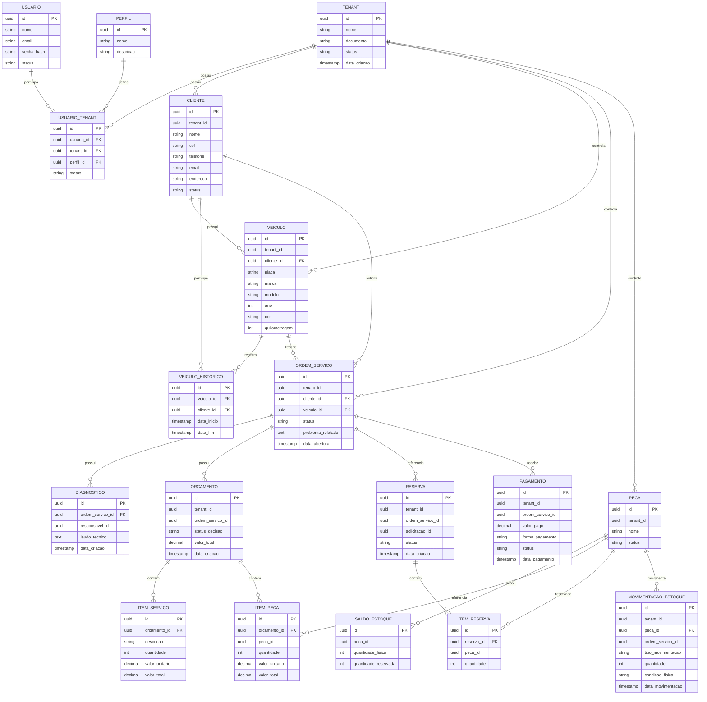
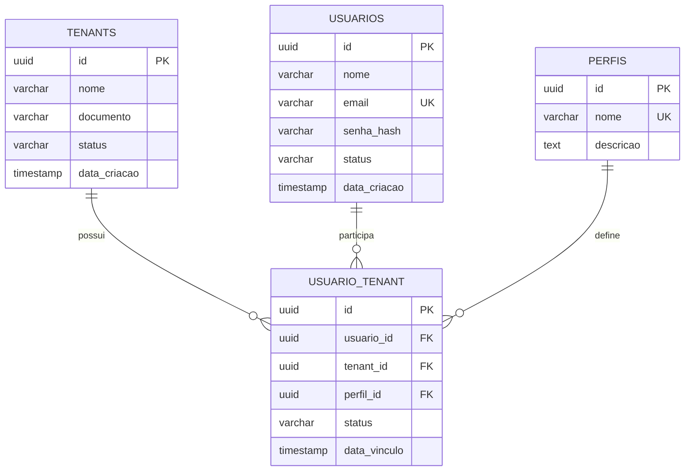
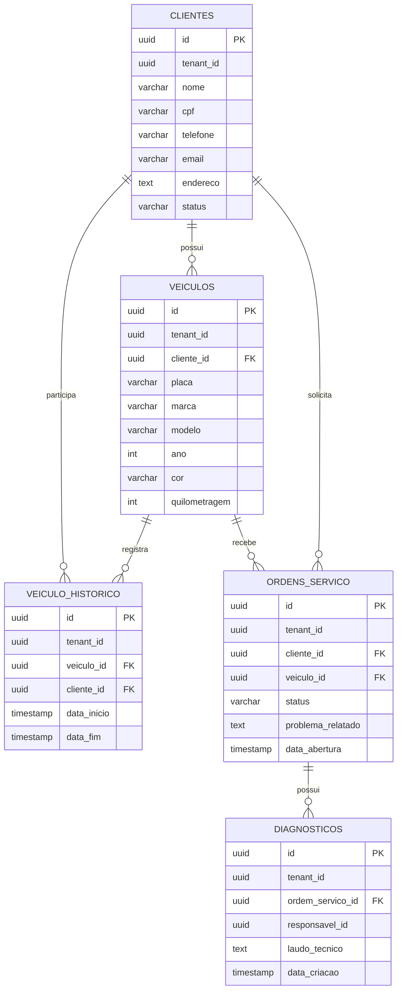
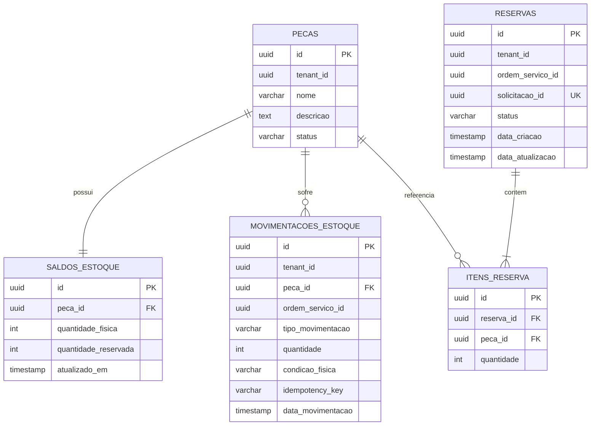
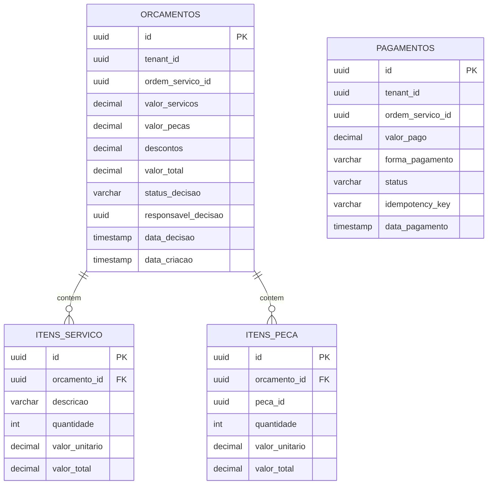

# Modelo Entidade-Relacionamento (MER) — OficinaPro

> **Documento oficial de trabalho — Grupo GarageOps**
>
> Este documento apresenta a modelagem conceitual e lógica dos dados do OficinaPro, considerando sua utilização como uma plataforma SaaS de gestão para oficinas mecânicas.
>
> A proposta utiliza quatro microsserviços no MVP, cada um responsável por seu próprio banco de dados. Os relacionamentos entre serviços são realizados por referências lógicas e mecanismos de comunicação, sem dependências de chaves estrangeiras entre bancos distintos.

---

**Projeto:** OficinaPro  
**Grupo:** GarageOps  
**Data:** 16/11/2026  
**Versão:** 1.0

## 1. Objetivo

Este documento apresenta a estrutura de dados do OficinaPro, identificando as entidades, seus atributos, relacionamentos, cardinalidades e restrições necessárias para a implementação do sistema.

A modelagem tem como objetivos:

- Representar os dados utilizados pelos principais processos do sistema.
- Definir as entidades e seus atributos.
- Estabelecer os relacionamentos e as cardinalidades.
- Documentar as restrições de integridade.
- Organizar os dados de acordo com os quatro microsserviços do MVP.
- Garantir o isolamento das informações entre oficinas.
- Preservar a integridade e a rastreabilidade das operações.
- Servir como referência para a implementação dos bancos de dados.

## 2. Justificativa da Escolha do Banco de Dados

| Critério | Definição proposta |
|---|---|
| **Tipo escolhido** | Relacional (SQL) |
| **Tecnologia** | PostgreSQL |
| **Volume de dados esperado** | Volume inicial pequeno a moderado, com crescimento conforme a quantidade de oficinas e operações cadastradas. Não há estimativa quantitativa validada. |
| **Padrão de acesso** | Balanceado, com operações de leitura e escrita. |
| **Consistência vs. disponibilidade** | Integridade transacional e propriedades ACID são importantes, especialmente para reservas e movimentações de estoque e registros financeiros. |
| **Formato dos dados** | Predominantemente estruturado, com possibilidade de utilização de JSONB para informações complementares. |
| **Escalabilidade** | Vertical inicialmente, com possibilidade de evolução para estratégias horizontais conforme a demanda. |

### 2.1 Justificativa resumida

O PostgreSQL foi escolhido como tecnologia proposta para os bancos de dados do OficinaPro por ser um sistema gerenciador de banco de dados relacional que oferece integridade referencial, transações ACID, restrições, índices e mecanismos de controle de concorrência.

Essas características são importantes para os processos do sistema, especialmente para o controle de estoque, no qual uma reserva deve ser realizada integralmente ou não ser efetivada, evitando inconsistências entre quantidades físicas, reservadas e disponíveis.

A estrutura relacional também atende à necessidade de representar os vínculos entre clientes, veículos, ordens de serviço, diagnósticos, orçamentos, itens e pagamentos.

A arquitetura adotará o padrão **Database-per-Service**, no qual cada microsserviço possui responsabilidade exclusiva sobre seus dados. No MVP, poderão ser utilizados bancos lógicos separados em uma mesma instância PostgreSQL, desde que sejam preservadas a separação de responsabilidades e a impossibilidade de acesso direto de um serviço aos dados de outro.

## 3. Diagrama Entidade-Relacionamento (DER)

### 3.1 Diagrama conceitual integrado

O diagrama abaixo apresenta as principais entidades de negócio do OficinaPro. Ele oferece uma visão conceitual integrada, não representando um banco de dados único.

**Observações sobre o diagrama:**

1. O diagrama apresenta uma visão conceitual dos domínios e não representa a existência de chaves estrangeiras entre bancos de microsserviços diferentes.
2. As relações entre entidades do mesmo microsserviço poderão utilizar chaves estrangeiras físicas.
3. As relações entre serviços diferentes deverão utilizar identificadores UUID como referências lógicas.
4. `TENANT`, `USUARIO`, `PERFIL` e `USUARIO_TENANT` pertencem ao Auth Service.
5. `CLIENTE`, `VEICULO`, `VEICULO_HISTORICO`, `ORDEM_SERVICO` e `DIAGNOSTICO` pertencem ao Work Order Service.
6. `PECA`, `SALDO_ESTOQUE`, `RESERVA`, `ITEM_RESERVA` e `MOVIMENTACAO_ESTOQUE` pertencem ao Inventory Service.
7. `ORCAMENTO`, `ITEM_SERVICO`, `ITEM_PECA` e `PAGAMENTO` pertencem ao Billing Service.
8. As entidades de reserva foram separadas das movimentações para representar o ciclo de reserva e consumo sem confundir quantidade comprometida com saída física definitiva.

### 3.2 DER lógico do Auth Service

### 3.3 DER lógico do Work Order Service

### 3.4 DER lógico do Inventory Service

### 3.5 DER lógico do Billing Service

## 4. Dicionário de Dados

Os tipos apresentados são propostas de implementação para PostgreSQL. As chaves estrangeiras indicadas são físicas somente quando as entidades pertencem ao mesmo banco. Identificadores externos representam referências lógicas.

### 4.1 Auth Service (`auth_db`)

Responsável pela autenticação, identificação dos usuários, oficinas e controle de acesso.

#### 4.1.1 Tabela `tenants`

Representa as oficinas contratantes da plataforma.

| Atributo | Tipo | Nulo? | Restrição | Descrição |
|---|---|---|---|---|
| `id` | UUID | Não | PK | Identificador único da oficina |
| `nome` | VARCHAR(150) | Não | - | Nome da oficina ou empresa |
| `documento` | VARCHAR(20) | Sim | - | Documento fiscal, quando aplicável |
| `status` | VARCHAR(20) | Não | CHECK | Situação da oficina: ATIVO, INATIVO ou SUSPENSO |
| `data_criacao` | TIMESTAMP | Não | DEFAULT NOW() | Data de criação |

**Regras:**

- Cada tenant representa uma oficina ou empresa contratante.
- O status deverá controlar a disponibilidade de acesso à plataforma.
- A cobrança de assinatura deverá ser separada dos pagamentos das ordens de serviço.

#### 4.1.2 Tabela `usuarios`

Armazena os dados de identificação e autenticação.

| Atributo | Tipo | Nulo? | Restrição | Descrição |
|---|---|---|---|---|
| `id` | UUID | Não | PK | Identificador único |
| `nome` | VARCHAR(150) | Não | - | Nome completo |
| `email` | VARCHAR(150) | Não | UNIQUE* | E-mail de autenticação |
| `senha_hash` | VARCHAR(255) | Não | - | Hash seguro da senha |
| `data_criacao` | TIMESTAMP | Não | DEFAULT NOW() | Data de criação |
| `status` | VARCHAR(20) | Não | CHECK | Situação: ATIVO ou INATIVO |

**Regras:**

- Senhas nunca deverão ser armazenadas em texto puro.
- O e-mail deverá possuir uma regra de unicidade definida para a estratégia de contas.
- A possibilidade de um usuário participar de várias oficinas será suportada pelo relacionamento com `usuario_tenant`, caso essa regra seja validada.

\* A unicidade global do e-mail é uma proposta a confirmar conforme a estratégia de identidade do sistema.

#### 4.1.3 Tabela `perfis`

Armazena os perfis de acesso.

| Atributo | Tipo | Nulo? | Restrição | Descrição |
|---|---|---|---|---|
| `id` | UUID | Não | PK | Identificador único |
| `nome` | VARCHAR(50) | Não | UNIQUE | Nome do perfil |
| `descricao` | TEXT | Sim | - | Descrição das responsabilidades |

**Perfis previstos para o MVP:**

- Atendente;
- Mecânico;
- Estoque;
- Financeiro.

Não está previsto um perfil genérico de administrador da oficina.

#### 4.1.4 Tabela `usuario_tenant`

Relaciona os usuários às oficinas nas quais possuem acesso.

| Atributo | Tipo | Nulo? | Restrição | Descrição |
|---|---|---|---|---|
| `id` | UUID | Não | PK | Identificador do vínculo |
| `usuario_id` | UUID | Não | FK | Referência a `usuarios.id` |
| `tenant_id` | UUID | Não | FK | Referência a `tenants.id` |
| `perfil_id` | UUID | Não | FK | Referência a `perfis.id` |
| `status` | VARCHAR(20) | Não | CHECK | Situação do vínculo |
| `data_vinculo` | TIMESTAMP | Não | DEFAULT NOW() | Data de criação do vínculo |

**Restrições propostas:**

- Os campos `usuario_id`, `tenant_id` e `perfil_id` deverão referenciar registros existentes no mesmo banco.
- A combinação `usuario_id` + `tenant_id` deverá ser única caso seja adotado um único perfil por usuário em cada oficina.
- O usuário somente poderá acessar uma oficina quando possuir vínculo ativo.
- As permissões deverão ser verificadas em cada operação protegida.

### 4.2 Work Order Service (`work_order_db`)

Responsável pelo cadastro de clientes, veículos, histórico de propriedade, ordens de serviço e diagnósticos.

#### 4.2.1 Tabela `clientes`

| Atributo | Tipo | Nulo? | Restrição | Descrição |
|---|---|---|---|---|
| `id` | UUID | Não | PK | Identificador do cliente |
| `tenant_id` | UUID | Não | Índice | Referência lógica à oficina |
| `nome` | VARCHAR(150) | Não | - | Nome completo |
| `cpf` | VARCHAR(14) | Não | UNIQUE (`tenant_id`, `cpf`) | CPF do cliente |
| `telefone` | VARCHAR(20) | Não | - | Telefone de contato |
| `email` | VARCHAR(150) | Não | - | E-mail |
| `endereco` | TEXT | Não | - | Endereço |
| `status` | VARCHAR(20) | Não | CHECK | ATIVO ou INATIVO |

**Regras:**

- O CPF será obrigatório e único dentro de cada oficina.
- Telefone, e-mail e endereço poderão ser atualizados.
- Clientes com histórico de atendimento não deverão ser excluídos definitivamente.
- A inativação deverá preservar o histórico.
- O mesmo CPF poderá existir em oficinas diferentes.

#### 4.2.2 Tabela `veiculos`

| Atributo | Tipo | Nulo? | Restrição | Descrição |
|---|---|---|---|---|
| `id` | UUID | Não | PK | Identificador do veículo |
| `tenant_id` | UUID | Não | Índice | Referência lógica à oficina |
| `cliente_id` | UUID | Não | FK | Proprietário atual no cadastro |
| `placa` | VARCHAR(10) | Não | UNIQUE (`tenant_id`, `placa`) | Placa |
| `marca` | VARCHAR(50) | Não | - | Marca |
| `modelo` | VARCHAR(50) | Não | - | Modelo |
| `ano` | INT | Não | CHECK | Ano do veículo |
| `cor` | VARCHAR(30) | Não | - | Cor |
| `quilometragem` | INT | Não | CHECK | Quilometragem atual |

**Regras:**

- A placa deverá ser única dentro de cada oficina.
- Todo veículo deverá possuir um proprietário atual.
- Um cliente poderá possuir vários veículos.
- A quilometragem não poderá ser negativa.
- A alteração de proprietário deverá preservar o histórico anterior.

#### 4.2.3 Tabela `veiculo_historico`

Registra o histórico de associação entre veículos e seus proprietários.

| Atributo | Tipo | Nulo? | Restrição | Descrição |
|---|---|---|---|---|
| `id` | UUID | Não | PK | Identificador do histórico |
| `tenant_id` | UUID | Não | Índice | Referência lógica à oficina |
| `veiculo_id` | UUID | Não | FK | Referência a `veiculos.id` |
| `cliente_id` | UUID | Não | FK | Referência a `clientes.id` |
| `data_inicio` | TIMESTAMP | Não | - | Início da propriedade |
| `data_fim` | TIMESTAMP | Sim | - | Fim da propriedade |

**Regras:**

- A mudança de proprietário deverá encerrar o vínculo anterior.
- Um novo vínculo deverá ser registrado.
- O histórico anterior não deverá ser apagado.
- Deverá existir apenas um vínculo vigente por veículo.
- Os registros deverão pertencer ao mesmo tenant.

#### 4.2.4 Tabela `ordens_servico`

Controla o fluxo operacional dos atendimentos.

| Atributo | Tipo | Nulo? | Restrição | Descrição |
|---|---|---|---|---|
| `id` | UUID | Não | PK | Identificador da OS |
| `tenant_id` | UUID | Não | Índice | Referência lógica à oficina |
| `cliente_id` | UUID | Não | FK | Cliente associado |
| `veiculo_id` | UUID | Não | FK | Veículo associado |
| `problema_relatado` | TEXT | Não | - | Descrição do problema informado |
| `status` | VARCHAR(30) | Não | CHECK | Situação operacional |
| `data_abertura` | TIMESTAMP | Não | DEFAULT NOW() | Data de abertura |

**Status operacionais previstos:**

- `ABERTA`;
- `EM_DIAGNOSTICO`;
- `AGUARDANDO_APROVACAO`;
- `AGUARDANDO_RESERVA`;
- `EM_EXECUCAO`;
- `CONCLUIDA`;
- `CANCELADA`.

**Regras:**

- Cliente e veículo deverão pertencer ao mesmo tenant da OS.
- A OS deverá preservar a identificação do cliente e do veículo no momento da abertura.
- A execução será bloqueada até que o orçamento esteja definitivamente aprovado.
- A aprovação e a recusa são decisões do orçamento, não status da OS.
- A conclusão operacional não dependerá da quitação financeira.
- A alteração de proprietário do veículo não deverá modificar os atendimentos anteriores.

#### 4.2.5 Tabela `diagnosticos`

Armazena os diagnósticos técnicos associados às ordens de serviço.

| Atributo | Tipo | Nulo? | Restrição | Descrição |
|---|---|---|---|---|
| `id` | UUID | Não | PK | Identificador do diagnóstico |
| `tenant_id` | UUID | Não | Índice | Referência lógica à oficina |
| `ordem_servico_id` | UUID | Não | FK | Referência a `ordens_servico.id` |
| `laudo_tecnico` | TEXT | Não | - | Descrição técnica |
| `responsavel_id` | UUID | Não | Referência lógica | Usuário responsável no Auth Service |
| `data_criacao` | TIMESTAMP | Não | DEFAULT NOW() | Data do diagnóstico |

**Regras:**

- Cada diagnóstico deverá estar associado a uma OS.
- Deverá ser possível identificar o responsável pelo registro.
- O histórico de diagnósticos deverá ser preservado.
- O modelo permite múltiplos diagnósticos por OS, mantendo registros separados.

### 4.3 Inventory Service (`inventory_db`)

Responsável pelo cadastro de peças, controle de saldos, reservas e movimentações de estoque.

#### 4.3.1 Tabela `pecas`

| Atributo | Tipo | Nulo? | Restrição | Descrição |
|---|---|---|---|---|
| `id` | UUID | Não | PK | Identificador da peça |
| `tenant_id` | UUID | Não | Índice | Referência lógica à oficina |
| `nome` | VARCHAR(100) | Não | - | Nome da peça |
| `descricao` | TEXT | Sim | - | Descrição complementar |
| `status` | VARCHAR(20) | Não | CHECK | ATIVA ou INATIVA |

**Regras:**

- Cada peça deverá pertencer a uma oficina.
- A inativação deverá preservar o histórico de movimentações.
- O cadastro da peça não deverá ser confundido com o controle de seu saldo.

#### 4.3.2 Tabela `saldos_estoque`

Armazena os saldos físicos e reservados de cada peça.

| Atributo | Tipo | Nulo? | Restrição | Descrição |
|---|---|---|---|---|
| `id` | UUID | Não | PK | Identificador do saldo |
| `peca_id` | UUID | Não | FK / UNIQUE | Referência a `pecas.id` |
| `quantidade_fisica` | INT | Não | CHECK >= 0 | Quantidade fisicamente existente |
| `quantidade_reservada` | INT | Não | CHECK >= 0 | Quantidade comprometida em reservas |
| `atualizado_em` | TIMESTAMP | Não | DEFAULT NOW() | Data da última atualização |

O saldo disponível será calculado por:

`quantidade_disponivel = quantidade_fisica - quantidade_reservada`

**Regras:**

- O saldo físico não poderá ser negativo.
- A quantidade reservada não poderá ser negativa.
- A quantidade reservada não poderá superar a quantidade física.
- A quantidade disponível não deverá ser armazenada como fonte independente de verdade; deverá ser calculada a partir dos dois saldos.
- A atualização dos saldos deverá ocorrer de forma transacional.

#### 4.3.3 Tabela `reservas`

Representa uma solicitação de reserva de peças associada a uma OS.

| Atributo | Tipo | Nulo? | Restrição | Descrição |
|---|---|---|---|---|
| `id` | UUID | Não | PK | Identificador da reserva |
| `tenant_id` | UUID | Não | Índice | Referência lógica à oficina |
| `ordem_servico_id` | UUID | Não | Referência lógica | OS relacionada |
| `solicitacao_id` | UUID | Não | UNIQUE | Identificador idempotente da solicitação |
| `status` | VARCHAR(30) | Não | CHECK | Situação da reserva |
| `data_criacao` | TIMESTAMP | Não | DEFAULT NOW() | Data de criação |
| `data_atualizacao` | TIMESTAMP | Não | DEFAULT NOW() | Última atualização |

**Status propostos:**

- `CONFIRMADA`;
- `RECUSADA`;
- `CONSUMIDA`;
- `LIBERADA`;
- `CANCELADA`.

**Regras:**

- Uma solicitação deverá possuir identificador único.
- A reserva deverá estar associada à oficina e à OS correspondentes.
- A confirmação deverá ocorrer somente quando todas as peças forem reservadas.
- Uma reserva recusada não poderá manter quantidades parcialmente comprometidas.
- A liberação não deverá gerar entrada física de estoque.

#### 4.3.4 Tabela `itens_reserva`

Armazena as peças e quantidades de cada reserva.

| Atributo | Tipo | Nulo? | Restrição | Descrição |
|---|---|---|---|---|
| `id` | UUID | Não | PK | Identificador do item |
| `reserva_id` | UUID | Não | FK | Referência a `reservas.id` |
| `peca_id` | UUID | Não | FK | Referência a `pecas.id` |
| `quantidade` | INT | Não | CHECK > 0 | Quantidade solicitada |

**Regras:**

- Cada item deverá pertencer a uma reserva.
- A quantidade deverá ser maior que zero.
- A peça deverá pertencer ao mesmo tenant da reserva.
- A confirmação da reserva deverá contemplar todos os itens.

#### 4.3.5 Tabela `movimentacoes_estoque`

Registra as movimentações e alterações efetivas no estoque.

| Atributo | Tipo | Nulo? | Restrição | Descrição |
|---|---|---|---|---|
| `id` | UUID | Não | PK | Identificador da movimentação |
| `tenant_id` | UUID | Não | Índice | Referência lógica à oficina |
| `peca_id` | UUID | Não | FK | Referência a `pecas.id` |
| `ordem_servico_id` | UUID | Sim | Referência lógica | OS relacionada, quando aplicável |
| `tipo_movimentacao` | VARCHAR(30) | Não | CHECK | Tipo de movimentação |
| `quantidade` | INT | Não | CHECK > 0 | Quantidade movimentada |
| `condicao_fisica` | VARCHAR(30) | Sim | CHECK | Condição física, quando aplicável |
| `idempotency_key` | VARCHAR(100) | Não | UNIQUE | Chave para impedir duplicidade |
| `data_movimentacao` | TIMESTAMP | Não | DEFAULT NOW() | Data da movimentação |

**Tipos de movimentação propostos:**

- `ENTRADA`;
- `CONSUMO`;
- `ESTORNO`;
- `PERDA_OPERACIONAL`.

**Condições físicas inicialmente consideradas:**

- `PENDENTE_INSTALACAO`;
- `INSTALADA`;
- `INUTILIZAVEL`.

**Regras:**

- Toda movimentação deverá registrar peça, quantidade, data e tipo.
- A utilização de peça reservada deverá converter a quantidade reservada em saída definitiva.
- A liberação de peça não utilizada deverá reduzir a quantidade reservada, sem alterar a quantidade física.
- Perdas operacionais deverão ser registradas de maneira específica.
- O estorno deverá preservar o histórico da movimentação original.
- Uma mesma operação não poderá gerar baixas duplicadas.
- Peças instaladas ou inutilizáveis não deverão ser contabilizadas como disponíveis.

### 4.4 Billing Service (`billing_db`)

Responsável pelos orçamentos, seus itens e os pagamentos relacionados às ordens de serviço.

#### 4.4.1 Tabela `orcamentos`

Armazena os orçamentos associados às ordens de serviço.

| Atributo | Tipo | Nulo? | Restrição | Descrição |
|---|---|---|---|---|
| `id` | UUID | Não | PK | Identificador do orçamento |
| `tenant_id` | UUID | Não | Índice | Referência lógica à oficina |
| `ordem_servico_id` | UUID | Não | Referência lógica | OS relacionada |
| `valor_servicos` | DECIMAL(10,2) | Não | CHECK >= 0 | Total dos serviços |
| `valor_pecas` | DECIMAL(10,2) | Não | CHECK >= 0 | Total das peças |
| `descontos` | DECIMAL(10,2) | Não | DEFAULT 0.00 | Valor de descontos |
| `valor_total` | DECIMAL(10,2) | Não | CHECK >= 0 | Total do orçamento |
| `status_decisao` | VARCHAR(30) | Não | CHECK | Situação da decisão e aprovação |
| `responsavel_decisao` | UUID | Sim | Referência lógica | Responsável pela decisão registrada |
| `data_decisao` | TIMESTAMP | Sim | - | Data e horário da decisão |
| `data_criacao` | TIMESTAMP | Não | DEFAULT NOW() | Data de criação |

**Status propostos para o orçamento:**

- `AGUARDANDO`: aguardando decisão do cliente.
- `RECUSADO`: orçamento recusado pelo cliente.
- `PENDENTE_RESERVA`: cliente aceitou, mas a reserva ainda está em processamento.
- `RESERVA_RECUSADA`: não foi possível reservar todas as peças.
- `APROVADO`: reserva integral confirmada e aprovação definitiva registrada.

**Regras:**

- Cada orçamento deverá possuir uma referência lógica à OS.
- A aceitação do cliente deverá ser registrada com responsável e data/hora.
- A aceitação do cliente não representa, isoladamente, aprovação definitiva.
- A aprovação definitiva dependerá da confirmação integral da reserva.
- Alterações relevantes em orçamento já aceito deverão exigir nova autorização do cliente.
- Os valores deverão ser preservados para manter o histórico.
- A aprovação deverá ser registrada de maneira idempotente.

#### 4.4.2 Tabela `itens_servico`

Armazena os serviços incluídos no orçamento.

| Atributo | Tipo | Nulo? | Restrição | Descrição |
|---|---|---|---|---|
| `id` | UUID | Não | PK | Identificador do item |
| `orcamento_id` | UUID | Não | FK | Referência a `orcamentos.id` |
| `descricao` | VARCHAR(255) | Não | - | Descrição do serviço |
| `quantidade` | INT | Não | CHECK > 0 | Quantidade |
| `valor_unitario` | DECIMAL(10,2) | Não | CHECK >= 0 | Valor unitário |
| `valor_total` | DECIMAL(10,2) | Não | CHECK >= 0 | Valor total do item |

**Regras:**

- Cada item deverá estar associado a um orçamento.
- A quantidade deverá ser maior que zero.
- O valor unitário deverá ser preservado no momento da elaboração.
- O valor total deverá corresponder à quantidade multiplicada pelo valor unitário, respeitando as regras de arredondamento.

#### 4.4.3 Tabela `itens_peca`

Armazena as peças previstas em cada orçamento.

| Atributo | Tipo | Nulo? | Restrição | Descrição |
|---|---|---|---|---|
| `id` | UUID | Não | PK | Identificador do item |
| `orcamento_id` | UUID | Não | FK | Referência a `orcamentos.id` |
| `peca_id` | UUID | Não | Referência lógica | Identificador da peça no Inventory Service |
| `quantidade` | INT | Não | CHECK > 0 | Quantidade solicitada |
| `valor_unitario` | DECIMAL(10,2) | Não | CHECK >= 0 | Valor unitário registrado |
| `valor_total` | DECIMAL(10,2) | Não | CHECK >= 0 | Valor total do item |

**Regras:**

- Cada item deverá estar associado a um orçamento.
- A referência da peça deverá pertencer ao mesmo tenant do orçamento.
- A quantidade deverá ser maior que zero.
- O valor unitário deverá ser preservado no momento da elaboração.
- A existência e a disponibilidade da peça deverão ser verificadas pelo Inventory Service.
- `peca_id` é uma referência lógica, não uma chave estrangeira física.

#### 4.4.4 Tabela `pagamentos`

Registra os pagamentos realizados em relação às ordens de serviço.

| Atributo | Tipo | Nulo? | Restrição | Descrição |
|---|---|---|---|---|
| `id` | UUID | Não | PK | Identificador do pagamento |
| `tenant_id` | UUID | Não | Índice | Referência lógica à oficina |
| `ordem_servico_id` | UUID | Não | Referência lógica | OS relacionada |
| `valor_pago` | DECIMAL(10,2) | Não | CHECK > 0 | Valor do pagamento |
| `forma_pagamento` | VARCHAR(50) | Não | - | Forma de pagamento |
| `status` | VARCHAR(20) | Não | CHECK | Situação do pagamento |
| `idempotency_key` | VARCHAR(100) | Não | UNIQUE | Identificador contra duplicidade |
| `data_pagamento` | TIMESTAMP | Não | DEFAULT NOW() | Data do registro |

**Status propostos:**

- `PENDENTE`;
- `CONFIRMADO`;
- `ESTORNADO`;
- `FALHOU`.

**Regras:**

- Cada pagamento deverá estar associado a uma OS.
- O sistema deverá preservar o histórico de pagamentos e estornos.
- O modelo permite múltiplos pagamentos por OS.
- A situação financeira deverá considerar o conjunto de pagamentos confirmados.
- A situação financeira será independente do status operacional da OS.
- A implementação deverá validar que os pagamentos não ultrapassem indevidamente o valor devido.

## 5. Relacionamentos e Cardinalidades

| Entidade A | Entidade B | Cardinalidade | Descrição |
|---|---|---|---|
| `TENANTS` | `USUARIOS_TENANT` | 1:N | Uma oficina pode possuir vários vínculos de usuários. |
| `USUARIOS` | `USUARIOS_TENANT` | 1:N | Um usuário pode possuir vínculos com oficinas. |
| `PERFIS` | `USUARIOS_TENANT` | 1:N | Um perfil pode ser associado a vários vínculos. |
| `CLIENTES` | `VEICULOS` | 1:N | Um cliente pode possuir vários veículos. |
| `VEICULOS` | `VEICULO_HISTORICO` | 1:N | Um veículo pode possuir vários registros de propriedade. |
| `CLIENTES` | `VEICULO_HISTORICO` | 1:N | Um cliente pode constar no histórico de vários veículos. |
| `CLIENTES` | `ORDENS_SERVICO` | 1:N | Um cliente pode solicitar várias OS. |
| `VEICULOS` | `ORDENS_SERVICO` | 1:N | Um veículo pode possuir várias OS ao longo do tempo. |
| `ORDENS_SERVICO` | `DIAGNOSTICOS` | 1:N | Uma OS pode possuir vários diagnósticos. |
| `ORDENS_SERVICO` | `ORCAMENTOS` | 1:N | Uma OS pode possuir orçamentos e revisões. |
| `ORCAMENTOS` | `ITENS_SERVICO` | 1:N | Um orçamento pode possuir vários serviços. |
| `ORCAMENTOS` | `ITENS_PECA` | 1:N | Um orçamento pode possuir várias peças. |
| `PECAS` | `SALDOS_ESTOQUE` | 1:1 | Cada peça possui um registro de saldo. |
| `RESERVAS` | `ITENS_RESERVA` | 1:N | Uma reserva contém um ou mais itens. |
| `PECAS` | `ITENS_RESERVA` | 1:N | Uma peça pode constar em várias reservas. |
| `PECAS` | `MOVIMENTACOES_ESTOQUE` | 1:N | Uma peça pode possuir várias movimentações. |
| `ORDENS_SERVICO` | `PAGAMENTOS` | 1:N | Uma OS pode possuir vários pagamentos. |

**Importante:** as cardinalidades da tabela apresentam os relacionamentos conceituais. Quando as entidades pertencem a bancos diferentes, a associação será lógica e validada por APIs ou eventos.

## 6. Índices Planejados

Os índices abaixo são propostas para melhorar consultas frequentes e aplicar restrições de unicidade.

| Banco | Tabela | Coluna(s) | Tipo | Justificativa |
|---|---|---|---|---|
| `auth_db` | `usuarios` | `email` | UNIQUE | Busca por autenticação |
| `auth_db` | `usuario_tenant` | `usuario_id`, `tenant_id` | UNIQUE | Evitar vínculos duplicados, conforme a regra de perfil |
| `auth_db` | `usuario_tenant` | `tenant_id`, `status` | COMPOSTO | Consultar usuários ativos de uma oficina |
| `work_order_db` | `clientes` | `tenant_id`, `cpf` | UNIQUE | Evitar CPF duplicado dentro da oficina |
| `work_order_db` | `clientes` | `tenant_id`, `nome` | INDEX | Consulta de clientes por oficina |
| `work_order_db` | `veiculos` | `tenant_id`, `placa` | UNIQUE | Evitar placa duplicada dentro da oficina |
| `work_order_db` | `veiculos` | `cliente_id` | INDEX | Consultar veículos de um cliente |
| `work_order_db` | `ordens_servico` | `tenant_id`, `status` | COMPOSTO | Listagem de OS por oficina e situação |
| `work_order_db` | `ordens_servico` | `veiculo_id`, `data_abertura` | COMPOSTO | Histórico de manutenção do veículo |
| `work_order_db` | `diagnosticos` | `ordem_servico_id`, `data_criacao` | COMPOSTO | Consultar diagnósticos de uma OS |
| `inventory_db` | `pecas` | `tenant_id`, `nome` | INDEX | Pesquisa de peças por oficina |
| `inventory_db` | `saldos_estoque` | `peca_id` | UNIQUE | Garantir um saldo por peça |
| `inventory_db` | `reservas` | `solicitacao_id` | UNIQUE | Impedir solicitação duplicada |
| `inventory_db` | `reservas` | `tenant_id`, `status` | COMPOSTO | Consultar reservas por oficina e situação |
| `inventory_db` | `movimentacoes_estoque` | `peca_id`, `data_movimentacao` | COMPOSTO | Consultar histórico de movimentações |
| `inventory_db` | `movimentacoes_estoque` | `idempotency_key` | UNIQUE | Impedir movimentação duplicada |
| `billing_db` | `orcamentos` | `tenant_id`, `ordem_servico_id` | INDEX | Consultar orçamentos da OS |
| `billing_db` | `orcamentos` | `tenant_id`, `status_decisao` | COMPOSTO | Consultar orçamentos por situação |
| `billing_db` | `itens_servico` | `orcamento_id` | INDEX | Consultar serviços do orçamento |
| `billing_db` | `itens_peca` | `orcamento_id` | INDEX | Consultar peças do orçamento |
| `billing_db` | `pagamentos` | `idempotency_key` | UNIQUE | Impedir pagamentos duplicados |
| `billing_db` | `pagamentos` | `tenant_id`, `ordem_servico_id` | COMPOSTO | Consultar pagamentos de uma OS |

Os índices definitivos deverão ser confirmados a partir das consultas implementadas e dos testes de desempenho. Índices adicionais deverão ser avaliados conforme a necessidade, evitando sobrecarga desnecessária em operações de escrita.

## 7. Considerações sobre Microsserviços

O OficinaPro adotará o padrão Database-per-Service. Cada microsserviço será responsável por suas próprias entidades e operações de persistência.

| Microsserviço | Banco | Entidades principais | Justificativa |
|---|---|---|---|
| Auth Service | `auth_db` | `tenants`, `usuarios`, `perfis`, `usuario_tenant` | Centraliza autenticação, vínculos com oficinas e controle de acesso. |
| Work Order Service | `work_order_db` | `clientes`, `veiculos`, `veiculo_historico`, `ordens_servico`, `diagnosticos` | Gerencia o núcleo operacional e o histórico dos atendimentos. |
| Inventory Service | `inventory_db` | `pecas`, `saldos_estoque`, `reservas`, `itens_reserva`, `movimentacoes_estoque` | Mantém o controle transacional do inventário e das reservas. |
| Billing Service | `billing_db` | `orcamentos`, `itens_servico`, `itens_peca`, `pagamentos` | Gerencia os valores, decisões dos orçamentos e pagamentos das OS. |

### 7.1 Regras de separação dos bancos

1. Cada microsserviço deverá acessar exclusivamente seu próprio banco.
2. Não deverão existir chaves estrangeiras físicas entre bancos de microsserviços diferentes.
3. Referências externas deverão utilizar identificadores UUID.
4. A existência e a correspondência de referências externas deverão ser verificadas por APIs ou eventos.
5. Cada banco deverá manter suas próprias restrições e transações.
6. Os serviços não deverão realizar consultas diretas às tabelas de outros serviços.
7. A consistência entre serviços deverá ser tratada por comunicação síncrona ou assíncrona.

### 7.2 Auditoria e rastreabilidade

As operações relevantes deverão permitir identificar o usuário, a oficina, a entidade afetada, a ação e o momento da execução.

A proposta é manter os registros de auditoria sob responsabilidade dos serviços que executam as operações, evitando um banco compartilhado para escrita direta por todos os microsserviços.

Os registros poderão utilizar os seguintes atributos:

| Atributo | Tipo | Descrição |
|---|---|---|
| `id` | UUID | Identificador do registro |
| `tenant_id` | UUID | Oficina relacionada |
| `usuario_id` | UUID | Referência lógica ao usuário responsável |
| `entidade` | VARCHAR(100) | Tipo de entidade afetada |
| `entidade_id` | UUID | Identificador do registro afetado |
| `acao` | VARCHAR(50) | Operação executada |
| `data_hora` | TIMESTAMP | Data e horário |
| `detalhes` | JSONB | Informações complementares, sem segredos |

A implementação poderá utilizar tabelas de auditoria específicas por serviço ou outro mecanismo equivalente, conforme a definição técnica.

### 7.3 Outbox e Inbox

Cada serviço que publicar eventos deverá considerar o padrão Transactional Outbox, persistindo a alteração de domínio e o evento pendente de publicação na mesma transação local.

Os consumidores deverão utilizar Inbox ou mecanismo equivalente para registrar mensagens processadas, evitando efeitos duplicados em caso de reentrega.

Essas estruturas deverão pertencer aos bancos dos respectivos microsserviços. Não deverão ser implementadas como tabelas compartilhadas entre serviços.

## 8. Segurança e Isolamento dos Dados

O modelo deverá considerar os seguintes controles:

1. Todo registro operacional pertencente a uma oficina deverá possuir `tenant_id`.
2. O backend deverá aplicar o filtro de tenant nas operações de leitura e escrita.
3. O tenant deverá ser obtido ou validado a partir do contexto autenticado.
4. O frontend não deverá ser considerado responsável pela garantia de isolamento.
5. O usuário deverá possuir vínculo ativo com a oficina para acessar seus dados.
6. As permissões deverão ser verificadas em cada operação protegida.
7. As referências lógicas entre serviços deverão validar a correspondência do tenant.
8. Senhas deverão ser armazenadas por meio de hash seguro.
9. Segredos, tokens e credenciais não deverão ser expostos em logs.
10. O sistema deverá possuir estratégias de backup e recuperação.
11. Row-Level Security (RLS) poderá ser avaliada como camada adicional de proteção, desde que sua utilização seja compatível com a estratégia de conexão e o contexto de tenant.

### 8.1 Restrições de integridade

| Domínio | Restrição |
|---|---|
| Tenants | Identificação única da oficina |
| Usuários | Regra de unicidade do e-mail definida |
| Usuários e oficinas | Vínculo de acesso controlado |
| Clientes | CPF obrigatório e único por tenant |
| Veículos | Placa obrigatória e única por tenant |
| Veículos | Histórico de propriedade preservado |
| Ordens de serviço | Cliente e veículo pertencentes ao mesmo tenant |
| Diagnósticos | Associação válida com uma OS |
| Orçamentos | Referência lógica à OS do mesmo tenant |
| Itens de orçamento | Quantidade maior que zero |
| Peças | Saldo físico não negativo |
| Reservas | Operação integral, sem reserva parcial |
| Movimentações | Registro rastreável e sem duplicidade |
| Pagamentos | Histórico preservado e operações idempotentes |
| Auditoria | Identificação da oficina e do usuário responsável |

## 9. Separação entre pagamentos operacionais e cobrança do SaaS

É importante diferenciar dois domínios financeiros:

### 9.1 Pagamentos das ordens de serviço

São os valores pagos pelos clientes das oficinas pelos serviços e peças utilizados.

Esses registros pertencem ao Billing Service e estão relacionados às ordens de serviço.

O status financeiro poderá assumir situações como:

- `PENDENTE`;
- `PARCIAL`;
- `QUITADA`.

A situação financeira deverá ser calculada a partir dos pagamentos confirmados e do valor devido, sem alterar diretamente o status operacional da OS.

### 9.2 Assinaturas do OficinaPro

São os valores pagos pelas oficinas para utilizar a plataforma SaaS.

Esse domínio poderá incluir futuramente:

- Planos;
- Assinaturas;
- Períodos de cobrança;
- Situação da assinatura;
- Histórico de faturas;
- Pagamentos da assinatura.

**Status:** a cobrança recorrente do SaaS não está definida como parte do MVP. Caso seja implementada, deverá possuir modelagem própria, sem misturar seus registros com os pagamentos das ordens de serviço.

## 10. Pontos Pendentes para Validação

Os seguintes pontos deverão ser confirmados pelo grupo ou durante a definição técnica:

1. Confirmar a estratégia de isolamento multi-tenant.
2. Definir se cada usuário poderá participar de mais de uma oficina.
3. Confirmar a regra de unicidade global ou por tenant para o e-mail dos usuários.
4. Confirmar a estrutura definitiva dos perfis e permissões.
5. Avaliar a utilização de Row-Level Security no PostgreSQL.
6. Validar a regra de histórico de propriedade dos veículos.
7. Confirmar se uma OS poderá possuir vários orçamentos ou revisões.
8. Definir o tratamento de alterações em orçamento após a aceitação do cliente.
9. Definir o ciclo operacional de reserva, consumo, liberação, estorno e perda de peças.
10. Definir as regras para devolução de peças após retirada física.
11. Definir as formas de pagamento aceitas.
12. Definir se haverá pagamentos parciais e parcelamentos no MVP.
13. Definir a estrutura e a retenção dos registros de auditoria.
14. Definir os contratos definitivos dos eventos entre microsserviços.
15. Confirmar a estratégia de Transactional Outbox e Inbox.
16. Definir se o gerenciamento de assinaturas e cobrança do SaaS fará parte de uma etapa posterior.
17. Confirmar a estrutura física dos bancos e a estratégia de implantação no ambiente de nuvem.

## 11. Histórico de Revisões

| Versão | Data | Autor | Descrição da Alteração |
|---|---|---|---|
| 1.0 | 16/11/2026 | Grupo GarageOps | Consolidação do MER conceitual e lógico, dicionário de dados, relacionamentos, índices e separação por microsserviço. |

---

**Aprovado por:**

___________________________________________________

Professor(a) Orientador(a)

**Data:** ____/____/2026

**Status da aprovação:** Pendente de validação do grupo e do professor.
