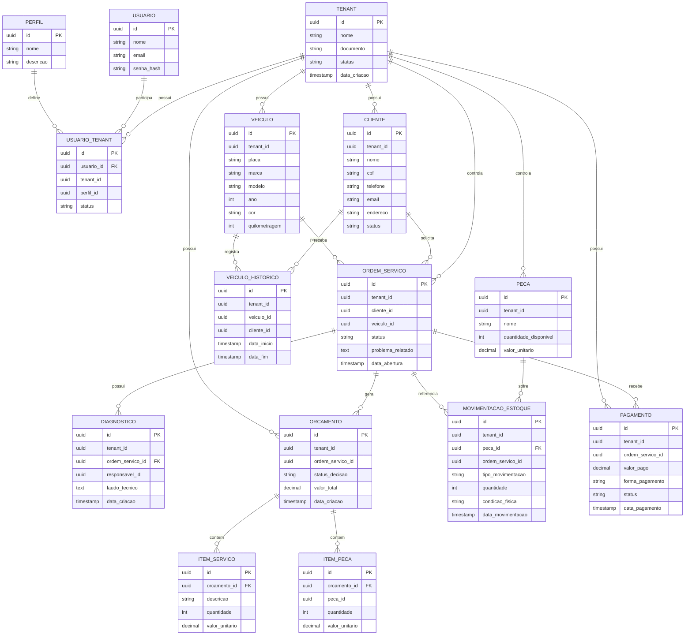

# Modelo Entidade-Relacionamento e Arquitetura de Dados — OficinaPro

> **Documento histórico — não usar na entrega.** Este arquivo foi escrito para o modelo anterior do OficinaPro, com controle de estoque, reserva de peças e perfil de estoque, retirados do escopo pelo grupo em 13/11/2026. Ele não reflete os serviços, papéis e fluxos atuais. A versão vigente está em [`entrega/Projetos/OficinaPro/`](../../entrega/Projetos/OficinaPro/README.md) (Documento 04). Mantido apenas como registro do levantamento.

> **Documento oficial de trabalho — Grupo GarageOps**
>
> **Status:** Em discussão, sujeito à validação do grupo e do professor.
>
> Este documento apresenta a proposta de modelagem de dados do OficinaPro, considerando sua utilização como um sistema SaaS (Software as a Service) voltado à gestão operacional de oficinas mecânicas.
>
> A arquitetura proposta utiliza microsserviços com bancos de dados independentes (*Database-per-Service*), respeitando a responsabilidade de cada serviço sobre seus próprios dados.
>
> O modelo também considera a necessidade de isolamento dos dados entre diferentes oficinas contratantes (*multi-tenancy*), integridade das informações, rastreabilidade das operações e comunicação entre microsserviços.

---

## 1. Visão geral da arquitetura de dados

A proposta considera quatro microsserviços principais para o MVP:

| Microsserviço | Banco de dados | Responsabilidade |
|---|---|---|
| Auth Service | `auth_db` | Autenticação, usuários, oficinas e controle de acesso |
| Work Order Service | `work_order_db` | Clientes, veículos, histórico de propriedade, ordens de serviço e diagnósticos |
| Inventory Service | `inventory_db` | Cadastro de peças, saldos e movimentações de estoque |
| Billing Service | `billing_db` | Orçamentos, itens de orçamento e pagamentos |

### 1.1. Estratégia Database-per-Service

Cada microsserviço será responsável por seu próprio banco de dados.

As tabelas pertencentes ao mesmo serviço poderão utilizar chaves estrangeiras físicas para garantir a integridade referencial.

Já os relacionamentos entre serviços diferentes deverão utilizar referências lógicas por UUID e mecanismos de comunicação entre microsserviços.

**Exemplo:**

- O `Billing Service` armazena o identificador da OS relacionado a um orçamento.
- O `Inventory Service` armazena o identificador da OS relacionada a uma movimentação.
- Esses identificadores representam referências aos registros do `Work Order Service`, sem criar chaves estrangeiras físicas entre bancos independentes.

### 1.2. Multi-tenancy

O OficinaPro deverá permitir que diferentes oficinas utilizem a mesma plataforma.

Para isso, será adotada inicialmente a proposta de isolamento lógico por identificador de tenant (`tenant_id`).

Cada oficina será representada por um tenant, e os registros operacionais deverão estar associados à oficina responsável por seus dados.

Exemplo:

- Oficina A possui seus próprios clientes, veículos, ordens de serviço e estoque.
- Oficina B possui seus próprios clientes, veículos, ordens de serviço e estoque.
- Os usuários de uma oficina não poderão consultar ou modificar informações pertencentes a outra.

O isolamento deverá ser aplicado no backend, nas consultas ao banco de dados, nas APIs e na comunicação entre microsserviços.

> **Status:** Estratégia proposta. A utilização de bancos compartilhados por serviço com isolamento por `tenant_id`, bem como o uso complementar de Row-Level Security (RLS), deverá ser validada tecnicamente.

---

## 2. Diagrama conceitual de relacionamentos

O diagrama abaixo representa uma visão integrada dos principais domínios do sistema.

> **Nota:** O diagrama é uma representação conceitual integrada. As relações entre entidades de microsserviços diferentes representam referências lógicas, não chaves estrangeiras físicas.
>
> O diagrama também não substitui os diagramas físicos individuais de cada banco de dados.

---

## 3. Dicionário de dados por microsserviço

### 3.1. Auth Service (`auth_db`)

Responsável pela autenticação, identificação dos usuários e controle de acesso às oficinas.

#### Tabela `tenants`

Representa as oficinas contratantes da plataforma.

- `id`: UUID (Chave Primária).
- `nome`: VARCHAR(150) (Not Null).
- `documento`: VARCHAR(20) (Null — identificação fiscal da oficina, quando aplicável).
- `status`: VARCHAR(20) (Not Null — ATIVO / INATIVO / SUSPENSO).
- `data_criacao`: TIMESTAMP (Not Null, Default: NOW()).

**Regras e observações:**

- Cada tenant representa uma oficina ou empresa contratante.
- O tenant deverá possuir identificação única.
- O status deverá controlar a disponibilidade de acesso à plataforma.
- A definição de planos, limites e cobrança da assinatura deverá ser tratada separadamente das operações financeiras das oficinas.

#### Tabela `usuarios`

Armazena os dados de identificação e autenticação dos usuários.

- `id`: UUID (Chave Primária).
- `nome`: VARCHAR(150) (Not Null).
- `email`: VARCHAR(150) (Not Null).
- `senha_hash`: VARCHAR(255) (Not Null — armazenamento de hash seguro).
- `data_criacao`: TIMESTAMP (Not Null, Default: NOW()).
- `status`: VARCHAR(20) (Not Null — ATIVO / INATIVO).

**Regras e observações:**

- A senha nunca deverá ser armazenada em texto puro.
- O e-mail deverá possuir uma regra de unicidade compatível com a estratégia de contas adotada.
- Um usuário poderá participar de uma ou mais oficinas, caso essa possibilidade seja aprovada.

#### Tabela `perfis`

Armazena os perfis de acesso disponíveis.

- `id`: UUID (Chave Primária).
- `nome`: VARCHAR(50) (Not Null).
- `descricao`: TEXT (Null).

**Perfis inicialmente considerados:**

- Atendente;
- Mecânico;
- Estoque;
- Financeiro.

> **Status:** Proposta. Os perfis e suas permissões deverão ser validados pela equipe. Não considerar o perfil de administrador da oficina como decisão aprovada.

#### Tabela `usuario_tenant`

Relaciona os usuários às oficinas nas quais possuem acesso.

- `id`: UUID (Chave Primária).
- `usuario_id`: UUID (Chave Estrangeira referenciando `usuarios.id`).
- `tenant_id`: UUID (Chave Estrangeira referenciando `tenants.id`).
- `perfil_id`: UUID (Chave Estrangeira referenciando `perfis.id`).
- `status`: VARCHAR(20) (Not Null — ATIVO / INATIVO).
- `data_vinculo`: TIMESTAMP (Not Null, Default: NOW()).

**Restrições propostas:**

- Combinação de `usuario_id` e `tenant_id` deverá ser única, caso seja adotada uma associação por usuário e oficina.
- O usuário somente poderá acessar os dados de uma oficina quando possuir vínculo ativo com ela.
- O perfil deverá determinar as permissões disponíveis dentro daquela oficina.

---

### 3.2. Work Order Service (`work_order_db`)

Responsável pelo núcleo operacional do OficinaPro.

#### Tabela `clientes`

Armazena os dados cadastrais dos clientes de cada oficina.

- `id`: UUID (Chave Primária).
- `tenant_id`: UUID (Referência lógica ao tenant do Auth Service).
- `nome`: VARCHAR(150) (Not Null).
- `cpf`: VARCHAR(14) (Not Null).
- `telefone`: VARCHAR(20) (Not Null).
- `email`: VARCHAR(150) (Not Null).
- `endereco`: TEXT (Not Null).
- `status`: VARCHAR(20) (Not Null — ATIVO / INATIVO).

**Restrições e regras:**

- O CPF deverá ser obrigatório.
- O CPF deverá ser único dentro de cada oficina, considerando a combinação `tenant_id` + `cpf`.
- Telefone, e-mail e endereço poderão ser atualizados após o cadastro.
- Clientes com histórico de atendimentos não deverão ser excluídos definitivamente.
- A inativação deverá preservar o histórico.
- O sistema deverá evitar cadastros duplicados.

#### Tabela `veiculos`

Armazena os veículos atendidos pelas oficinas.

- `id`: UUID (Chave Primária).
- `tenant_id`: UUID (Referência lógica ao tenant).
- `cliente_id`: UUID (Chave Estrangeira referenciando `clientes.id`).
- `placa`: VARCHAR(10) (Not Null).
- `marca`: VARCHAR(50) (Not Null).
- `modelo`: VARCHAR(50) (Not Null).
- `ano`: INT (Not Null).
- `cor`: VARCHAR(30) (Not Null).
- `quilometragem`: INT (Not Null).

**Restrições e regras:**

- A placa deverá ser obrigatória e única dentro de cada oficina, considerando `tenant_id` + `placa`.
- Todo veículo deverá possuir um proprietário atual associado.
- Um cliente poderá possuir vários veículos.
- A mudança de proprietário deverá preservar o histórico anterior.
- A quilometragem deverá ser validada para impedir valores negativos.

#### Tabela `veiculo_historico`

Registra o histórico de associação entre veículos e seus proprietários.

- `id`: UUID (Chave Primária).
- `tenant_id`: UUID (Referência lógica ao tenant).
- `veiculo_id`: UUID (Chave Estrangeira referenciando `veiculos.id`).
- `cliente_id`: UUID (Chave Estrangeira referenciando `clientes.id`).
- `data_inicio`: TIMESTAMP (Not Null).
- `data_fim`: TIMESTAMP (Null enquanto a associação estiver vigente).

**Restrições e regras:**

- A mudança de proprietário deverá encerrar o vínculo anterior.
- Um novo vínculo deverá ser registrado para o proprietário atual.
- O histórico anterior não deverá ser apagado.
- Deverá existir apenas um vínculo vigente por veículo.
- Os relacionamentos deverão respeitar o mesmo `tenant_id`.

#### Tabela `ordens_servico`

Controla o fluxo principal dos atendimentos.

- `id`: UUID (Chave Primária).
- `tenant_id`: UUID (Referência lógica ao tenant).
- `cliente_id`: UUID (Chave Estrangeira referenciando `clientes.id`).
- `veiculo_id`: UUID (Chave Estrangeira referenciando `veiculos.id`).
- `problema_relatado`: TEXT (Not Null).
- `status`: VARCHAR(30) (Not Null).
- `data_abertura`: TIMESTAMP (Not Null, Default: NOW()).

**Status inicialmente propostos:**

- `ABERTA`;
- `EM_DIAGNOSTICO`;
- `AGUARDANDO_APROVACAO`;
- `APROVADA`;
- `RECUSADA`;
- `EM_EXECUCAO`;
- `AGUARDANDO_PAGAMENTO`;
- `CONCLUIDA`;
- `CANCELADA`.

**Regras e observações:**

- A OS deverá estar associada a um cliente e a um veículo pertencentes ao mesmo tenant.
- A OS deverá preservar a identificação do cliente e do veículo no momento da abertura.
- A execução deverá ser bloqueada enquanto o orçamento não estiver aprovado.
- As transições de status deverão respeitar o fluxo operacional definido pela equipe.
- A alteração de proprietário do veículo não deverá modificar o histórico de atendimentos anteriores.

#### Tabela `diagnosticos`

Armazena os diagnósticos técnicos associados às ordens de serviço.

- `id`: UUID (Chave Primária).
- `tenant_id`: UUID (Referência lógica ao tenant).
- `ordem_servico_id`: UUID (Chave Estrangeira referenciando `ordens_servico.id`).
- `laudo_tecnico`: TEXT (Not Null).
- `responsavel_id`: UUID (Referência lógica ao usuário do Auth Service).
- `data_criacao`: TIMESTAMP (Not Null, Default: NOW()).

**Regras e observações:**

- Cada diagnóstico deverá estar associado a uma OS.
- Deverá ser possível identificar o responsável pelo registro.
- O histórico de diagnósticos deverá ser preservado.
- A possibilidade de múltiplos diagnósticos ou revisões por OS deverá ser validada.

---

### 3.3. Inventory Service (`inventory_db`)

Responsável pelo controle de peças, quantidades disponíveis e rastreabilidade das movimentações.

#### Tabela `pecas`

Armazena o cadastro das peças de cada oficina.

- `id`: UUID (Chave Primária).
- `tenant_id`: UUID (Referência lógica ao tenant).
- `nome`: VARCHAR(100) (Not Null).
- `descricao`: TEXT (Null).
- `quantidade_disponivel`: INT (Not Null, Check >= 0).
- `valor_unitario`: DECIMAL(10,2) (Not Null).
- `status`: VARCHAR(20) (Not Null — ATIVA / INATIVA).

**Regras e observações:**

- Cada peça deverá pertencer a uma oficina.
- O saldo não poderá ser negativo.
- A inativação de uma peça deverá preservar seu histórico de movimentações.
- A quantidade disponível deverá refletir as movimentações válidas.

#### Tabela `movimentacoes_estoque`

Registra as movimentações de estoque e a condição física das peças.

- `id`: UUID (Chave Primária).
- `tenant_id`: UUID (Referência lógica ao tenant).
- `peca_id`: UUID (Chave Estrangeira referenciando `pecas.id`).
- `ordem_servico_id`: UUID (Referência lógica à OS no Work Order Service).
- `tipo_movimentacao`: VARCHAR(30) (Not Null).
- `quantidade`: INT (Not Null).
- `condicao_fisica`: VARCHAR(30) (Conforme aplicabilidade).
- `idempotency_key`: VARCHAR(100) (Identificador para evitar processamento duplicado).
- `data_movimentacao`: TIMESTAMP (Not Null, Default: NOW()).

**Tipos de movimentação inicialmente considerados:**

- `ENTRADA`;
- `SAIDA_RESERVA`;
- `ESTORNO`;
- `PERDA_OPERACIONAL`.

**Condições físicas inicialmente consideradas:**

- `PENDENTE_INSTALACAO`;
- `INSTALADA`.

**Regras e observações:**

- Toda movimentação deverá registrar peça, quantidade, data e tipo.
- A reserva deverá estar associada à OS correspondente.
- O sistema deverá impedir saídas superiores ao saldo disponível.
- Uma mesma operação não deverá gerar baixas duplicadas.
- O estorno deverá registrar a reversão da movimentação original, sem apagar seu histórico.
- Peças instaladas ou inutilizáveis não deverão ser contabilizadas como disponíveis.
- As quantidades reservadas e disponíveis deverão ser controladas de forma consistente.

> **Ponto pendente:** Definir o ciclo definitivo entre reserva, retirada física, instalação, devolução e perda operacional, incluindo o momento em que cada movimentação altera o saldo.

---

### 3.4. Billing Service (`billing_db`)

Responsável pelos orçamentos e pagamentos relacionados às ordens de serviço.

#### Tabela `orcamentos`

Armazena os orçamentos associados às ordens de serviço.

- `id`: UUID (Chave Primária).
- `tenant_id`: UUID (Referência lógica ao tenant).
- `ordem_servico_id`: UUID (Referência lógica à OS no Work Order Service).
- `valor_servicos`: DECIMAL(10,2) (Not Null).
- `valor_pecas`: DECIMAL(10,2) (Not Null).
- `descontos`: DECIMAL(10,2) (Not Null, Default: 0.00).
- `valor_total`: DECIMAL(10,2) (Not Null).
- `status_decisao`: VARCHAR(20) (Not Null — AGUARDANDO / APROVADO / RECUSADO).
- `data_criacao`: TIMESTAMP (Not Null, Default: NOW()).
- `data_decisao`: TIMESTAMP (Null até o registro da decisão).
- `responsavel_decisao_id`: UUID (Referência lógica ao usuário do Auth Service).

**Regras e observações:**

- Cada orçamento deverá pertencer a uma OS.
- A aprovação ou recusa deverá registrar data e hora.
- Deverá ser identificado o responsável pelo registro da decisão.
- A execução da OS deverá depender da aprovação do orçamento.
- A alteração de um orçamento aprovado deverá respeitar as regras de negócio definidas pela equipe.
- Os valores deverão permanecer registrados para preservar o histórico do orçamento.

#### Tabela `itens_servico`

Armazena os serviços incluídos em cada orçamento.

- `id`: UUID (Chave Primária).
- `orcamento_id`: UUID (Chave Estrangeira referenciando `orcamentos.id`).
- `descricao`: VARCHAR(255) (Not Null).
- `quantidade`: INT (Not Null).
- `valor_unitario`: DECIMAL(10,2) (Not Null).
- `valor_total`: DECIMAL(10,2) (Not Null).

**Regras e observações:**

- Cada item deverá estar associado a um orçamento.
- A quantidade deverá ser maior que zero.
- O valor unitário deverá ser preservado no momento da elaboração do orçamento.

#### Tabela `itens_peca`

Armazena as peças previstas em cada orçamento.

- `id`: UUID (Chave Primária).
- `orcamento_id`: UUID (Chave Estrangeira referenciando `orcamentos.id`).
- `peca_id`: UUID (Referência lógica à peça do Inventory Service).
- `quantidade`: INT (Not Null).
- `valor_unitario`: DECIMAL(10,2) (Not Null).
- `valor_total`: DECIMAL(10,2) (Not Null).

**Regras e observações:**

- Cada item deverá estar associado a um orçamento.
- A referência da peça deverá pertencer ao mesmo tenant do orçamento.
- A quantidade deverá ser maior que zero.
- O valor unitário deverá ser preservado no momento da elaboração do orçamento.
- A comunicação com o Inventory Service deverá validar a existência e a disponibilidade da peça, conforme as regras de estoque.

#### Tabela `pagamentos`

Registra os pagamentos realizados em relação às ordens de serviço.

- `id`: UUID (Chave Primária).
- `tenant_id`: UUID (Referência lógica ao tenant).
- `ordem_servico_id`: UUID (Referência lógica à OS no Work Order Service).
- `valor_pago`: DECIMAL(10,2) (Not Null).
- `forma_pagamento`: VARCHAR(50) (Not Null).
- `status`: VARCHAR(20) (Not Null — PENDENTE / CONFIRMADO / ESTORNADO / FALHOU).
- `idempotency_key`: VARCHAR(100) (Identificador para evitar registro duplicado).
- `data_pagamento`: TIMESTAMP (Not Null, Default: NOW()).

**Regras e observações:**

- Cada pagamento deverá estar associado a uma OS.
- Deverá ser possível consultar os pagamentos registrados.
- O sistema deverá preservar o histórico de pagamentos e estornos.
- A possibilidade de pagamentos parciais e múltiplos pagamentos por OS deverá ser validada.
- O status financeiro da OS deverá considerar o conjunto de pagamentos confirmados, sem depender de um único registro.

> **Ponto pendente:** Definir as formas de pagamento aceitas, a possibilidade de pagamento parcial, parcelamento e integração com provedores externos.

---

## 4. Auditoria e rastreabilidade

A plataforma deverá manter rastreabilidade das operações relevantes realizadas pelos usuários.

A proposta considera a criação de registros de auditoria nos serviços responsáveis pelos dados.

Os registros poderão conter:

- `id`: UUID (Chave Primária).
- `tenant_id`: UUID (Referência lógica ao tenant).
- `usuario_id`: UUID (Referência lógica ao usuário responsável).
- `entidade`: VARCHAR(100) (Not Null).
- `entidade_id`: UUID (Identificador do registro afetado).
- `acao`: VARCHAR(50) (Not Null).
- `data_hora`: TIMESTAMP (Not Null, Default: NOW()).
- `detalhes`: JSONB (Informações complementares, sem armazenar credenciais ou segredos).

**Exemplos de ações relevantes:**

- Cadastro e atualização de clientes.
- Alteração de proprietário de veículo.
- Abertura e alteração de OS.
- Aprovação ou recusa de orçamento.
- Reserva, saída e estorno de peças.
- Registro e estorno de pagamentos.
- Alteração de permissões de usuários.

> **Status:** Requisito de rastreabilidade proposto. A estrutura e a retenção dos registros deverão ser definidas tecnicamente.

---

## 5. Comunicação entre microsserviços

A comunicação entre serviços deverá respeitar a propriedade dos dados de cada domínio.

A proposta prevê a utilização de APIs e, quando necessário, mensageria com RabbitMQ.

**Exemplos de eventos conceituais:**

- `ORCAMENTO_CRIADO`;
- `ORCAMENTO_APROVADO`;
- `ORCAMENTO_RECUSADO`;
- `ESTOQUE_RESERVADO`;
- `PECA_UTILIZADA`;
- `ESTOQUE_ESTORNADO`;
- `PAGAMENTO_REGISTRADO`;
- `PAGAMENTO_ESTORNADO`;
- `OS_CONCLUIDA`.

**Regras e observações:**

- Cada serviço deverá ser responsável por publicar eventos relacionados às suas operações.
- Os demais serviços deverão consumir somente os eventos necessários às suas responsabilidades.
- O processamento de mensagens deverá considerar duplicidade e reentrega.
- Operações que não podem ser executadas mais de uma vez deverão utilizar mecanismos de idempotência.
- A comunicação entre serviços deverá preservar o `tenant_id`.
- O sistema deverá prever tratamento de falhas e inconsistências temporárias.

> **Ponto técnico:** Avaliar o padrão Transactional Outbox e mecanismos de Inbox para reduzir o risco de perda ou processamento duplicado de eventos.

---

## 6. Segurança e isolamento dos dados

O modelo deverá considerar os seguintes controles:

1. Todo registro operacional deverá possuir identificação do tenant responsável.
2. Consultas deverão aplicar o filtro de tenant no backend.
3. O tenant deverá ser obtido a partir de um contexto autenticado e validado, não de um identificador enviado livremente pelo frontend.
4. O usuário deverá possuir vínculo ativo com a oficina para acessar seus dados.
5. As permissões deverão ser verificadas em cada operação protegida.
6. As referências lógicas entre serviços deverão validar a correspondência do tenant.
7. Senhas deverão ser armazenadas por meio de hash seguro.
8. Segredos, tokens e credenciais não deverão ser expostos nos registros de aplicação.
9. O sistema deverá possuir estratégias de backup e recuperação.
10. A possibilidade de utilizar Row-Level Security (RLS) deverá ser avaliada como camada adicional de isolamento.

---

## 7. Separação entre pagamentos operacionais e cobrança do SaaS

É importante diferenciar dois tipos de movimentação financeira:

### 7.1. Pagamentos das ordens de serviço

São os valores pagos pelos clientes das oficinas pelos serviços e peças utilizados.

Esses registros pertencem ao domínio do `Billing Service` e estão relacionados às ordens de serviço.

### 7.2. Assinaturas do OficinaPro

São os valores pagos pelas oficinas para utilizar a plataforma SaaS.

Esse domínio poderá incluir futuramente:

- planos;
- assinaturas;
- períodos de cobrança;
- situação da assinatura;
- histórico de faturas;
- pagamentos da assinatura.

> **Status:** A cobrança recorrente do SaaS não está definida como parte do MVP. Caso seja implementada, deverá possuir modelagem própria, sem misturar seus registros com os pagamentos das ordens de serviço.

---

## 8. Restrições e integridade dos dados

As seguintes restrições são propostas para a implementação:

| Domínio | Restrição |
|---|---|
| Tenants | Identificação única da oficina |
| Usuários | E-mail com regra de unicidade definida |
| Usuários e oficinas | Vínculo de acesso controlado |
| Clientes | CPF obrigatório e único por tenant |
| Veículos | Placa obrigatória e única por tenant |
| Veículos | Histórico de propriedade preservado |
| Ordens de serviço | Cliente e veículo pertencentes ao mesmo tenant |
| Diagnósticos | Associação válida com uma OS |
| Orçamentos | Associação lógica com uma OS do mesmo tenant |
| Itens de orçamento | Quantidade maior que zero |
| Peças | Saldo de estoque não negativo |
| Movimentações | Registro rastreável e sem duplicidade |
| Pagamentos | Histórico preservado e possibilidade de múltiplos registros a validar |
| Auditoria | Identificação da oficina e do usuário responsável |

As restrições de relacionamento dentro de um mesmo banco deverão utilizar os recursos de integridade do PostgreSQL.

As relações entre bancos de microsserviços diferentes deverão ser verificadas por APIs, eventos e mecanismos de consistência.

---

## 9. Pontos pendentes para validação

Os seguintes pontos ainda precisam de definição técnica ou validação do grupo:

1. Confirmar a estratégia de isolamento multi-tenant.
2. Definir se cada usuário poderá participar de mais de uma oficina.
3. Definir a regra de unicidade do e-mail dos usuários.
4. Definir a estrutura definitiva dos perfis e permissões.
5. Validar a utilização de Row-Level Security no PostgreSQL.
6. Definir como será implementado o histórico de propriedade dos veículos.
7. Definir se uma OS poderá possuir vários diagnósticos.
8. Definir se uma OS poderá possuir vários orçamentos.
9. Definir como serão representados os serviços no orçamento.
10. Definir o ciclo de reserva, saída, instalação, devolução e perda de peças.
11. Definir se serão permitidos pagamentos parciais e múltiplos pagamentos por OS.
12. Definir a estratégia de auditoria e retenção dos registros.
13. Definir os eventos e contratos de comunicação entre microsserviços.
14. Avaliar a adoção de Transactional Outbox e Inbox.
15. Definir se o gerenciamento de assinaturas e cobrança do SaaS fará parte de uma etapa posterior.
16. Definir a integração com pelo menos uma API externa, conforme os requisitos acadêmicos do projeto.

---

## 10. Observações finais

Este documento apresenta uma proposta de modelagem de dados para o OficinaPro, considerando a arquitetura de microsserviços e sua evolução como plataforma SaaS multiempresa.

A implementação deverá respeitar a separação de responsabilidades entre os serviços, a integridade dos dados, o isolamento entre oficinas, a segurança das informações e a rastreabilidade das operações.

A modelagem deverá permanecer alinhada ao backlog de requisitos, às histórias de usuário, aos fluxos do sistema, às regras de negócio, aos critérios de aceite e aos requisitos técnicos definidos para o projeto.

As decisões ainda não validadas deverão permanecer identificadas como propostas ou pendências, evitando que escolhas arquiteturais sejam tratadas como definições definitivas sem aprovação da equipe.

**Última atualização:** 15/11/2026

**Responsável pela organização do documento:** Product Owner — Grupo GarageOps