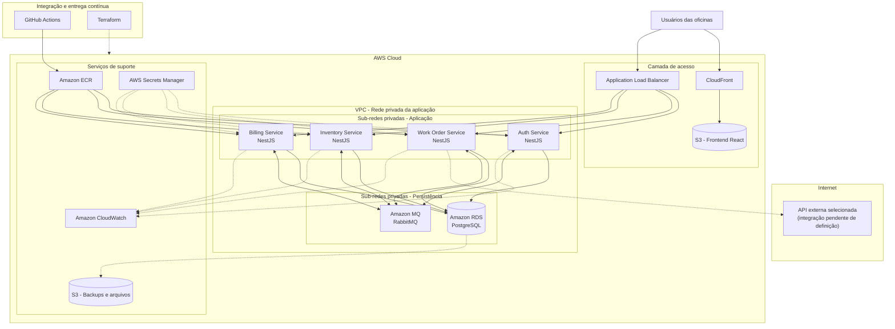

# Desenho de Arquitetura em Nuvem — OficinaPro

> **Documento histórico — não usar na entrega.** Esta versão (revisada em 16/11/2026) segue o modelo com controle de estoque, reserva de peças e Inventory Service. O grupo retirou o estoque do escopo em 13/11/2026 e, em 22/11/2026, adotou o MVP com os serviços `identity`, `customers` e `workorders`. A versão vigente está em [`entrega/Projetos/OficinaPro/`](../../entrega/Projetos/OficinaPro/README.md) (Documento 05). Mantido como registro do levantamento.

**Projeto:** OficinaPro  
**Grupo:** GarageOps  
**Provedor de Nuvem:** Amazon Web Services (AWS)  
**Data:** 16/11/2026  
**Versão:** 1.0  
**Status:** Proposta arquitetural para validação do grupo e do professor.

---

## 1. Objetivo

Este documento apresenta o desenho da arquitetura de infraestrutura em nuvem proposta para o OficinaPro, uma plataforma SaaS (Software as a Service) destinada à gestão operacional de pequenas e médias oficinas mecânicas.

A arquitetura descreve os serviços de nuvem, os recursos computacionais, a organização da rede, a persistência de dados, a comunicação entre microsserviços, os mecanismos de segurança, a observabilidade e a automação da infraestrutura por meio de Terraform.

A infraestrutura deverá atender aos seguintes objetivos:

- Disponibilizar a aplicação pela internet de maneira segura.
- Permitir a execução independente dos microsserviços.
- Garantir o isolamento dos dados entre diferentes oficinas.
- Manter a responsabilidade dos dados separada por microsserviço.
- Permitir monitoramento, identificação e análise de falhas.
- Automatizar a criação e a atualização dos recursos de infraestrutura.
- Possibilitar a recuperação dos dados em caso de falhas.
- Controlar os custos de execução e evitar recursos desnecessários.
- Permitir a evolução da plataforma conforme o crescimento da utilização.

A AWS foi definida como provedora de nuvem da arquitetura proposta. Docker será utilizado para empacotamento dos serviços e Terraform para declaração e provisionamento da infraestrutura.

**Importante:** este documento descreve a arquitetura planejada. A existência, configuração e disponibilidade dos recursos na AWS dependerão da implementação e da validação prática da infraestrutura.

## 2. Visão Geral da Arquitetura

A arquitetura será organizada em camadas:

1. **Acesso e distribuição:** disponibilização do frontend e recebimento das requisições externas.
2. **Aplicação:** execução dos quatro microsserviços em contêineres.
3. **Persistência:** armazenamento dos dados em bancos PostgreSQL separados por responsabilidade.
4. **Mensageria:** comunicação assíncrona entre os microsserviços por RabbitMQ.
5. **Segurança e configuração:** gerenciamento de credenciais, permissões e configurações.
6. **Observabilidade:** centralização de logs, coleta de métricas e acompanhamento da disponibilidade.
7. **Automação:** provisionamento e atualização da infraestrutura por Terraform e GitHub Actions.

### 2.1 Diagrama da arquitetura proposta



**Observações sobre o diagrama:**

- O frontend será disponibilizado por S3 e CloudFront.
- O ALB será o ponto de entrada das APIs dos microsserviços.
- Os quatro serviços serão executados em contêineres independentes no ECS Fargate.
- O RDS poderá conter bancos lógicos separados para cada microsserviço, mantendo a propriedade individual dos dados.
- O RabbitMQ será utilizado para troca de eventos e comunicação assíncrona.
- A integração com API externa permanece pendente de seleção e formalização.
- O diagrama representa uma proposta lógica, não uma comprovação de recursos já implantados.

### 2.2 Fluxo geral de comunicação

1. O usuário acessa a interface do OficinaPro pelo navegador.
2. O CloudFront distribui os arquivos estáticos hospedados no S3.
3. As requisições da interface às APIs são encaminhadas pelo ALB.
4. O ALB direciona cada requisição ao microsserviço responsável.
5. O microsserviço valida a autenticação, as permissões e o contexto da oficina.
6. O serviço consulta ou modifica exclusivamente os dados sob sua responsabilidade.
7. Quando necessário, publica ou consome eventos por meio do RabbitMQ.
8. Os serviços registram informações operacionais nos mecanismos de observabilidade.

## 3. Inventário de Recursos Cloud

### 3.1 Computação

A aplicação será organizada em quatro microsserviços, executados de maneira independente por meio do Amazon ECS com AWS Fargate.

| Recurso | Serviço AWS | Configuração proposta | Finalidade |
|---|---|---|---|
| Auth Service | ECS Fargate | Contêiner independente | Autenticação, usuários, vínculos com oficinas e permissões. |
| Work Order Service | ECS Fargate | Contêiner independente | Clientes, veículos, ordens de serviço e diagnósticos. |
| Inventory Service | ECS Fargate | Contêiner independente | Cadastro de peças, controle de estoque, reservas e movimentações. |
| Billing Service | ECS Fargate | Contêiner independente | Orçamentos, itens de orçamento e pagamentos. |
| Imagens Docker | Amazon ECR | Repositórios para os serviços | Armazenamento e versionamento das imagens dos microsserviços. |

Cada serviço deverá possuir:

- Imagem Docker própria.
- Definição de execução independente.
- Variáveis de ambiente e configurações próprias.
- Permissões específicas para acessar os recursos necessários.
- Health checks para verificação de disponibilidade.
- Logs e métricas para acompanhamento operacional.

A quantidade de CPU e memória de cada serviço deverá ser definida após testes e avaliação da demanda do MVP, evitando dimensionamento arbitrário.

O ECS Fargate foi escolhido como proposta inicial por permitir executar contêineres sem administrar diretamente servidores. O Amazon EKS não será adotado como padrão no MVP, pois adicionaria complexidade operacional sem necessidade identificada até o momento.

### 3.2 Banco de Dados e Cache

O PostgreSQL será utilizado como tecnologia de persistência.

A arquitetura seguirá o padrão Database-per-Service, no qual cada microsserviço é responsável pelo próprio banco de dados.

| Recurso | Serviço AWS | Configuração proposta | Finalidade |
|---|---|---|---|
| Auth Service | Amazon RDS for PostgreSQL | Banco `auth_db` | Persistência de usuários, perfis e vínculos com oficinas. |
| Work Order Service | Amazon RDS for PostgreSQL | Banco `work_order_db` | Persistência de clientes, veículos, ordens de serviço e diagnósticos. |
| Inventory Service | Amazon RDS for PostgreSQL | Banco `inventory_db` | Persistência de peças, saldos, reservas e movimentações. |
| Billing Service | Amazon RDS for PostgreSQL | Banco `billing_db` | Persistência de orçamentos, itens e pagamentos. |
| Cache | Não previsto no MVP | Avaliação futura | Cache de consultas ou sessões, caso exista necessidade comprovada. |

Para reduzir custos e complexidade no MVP, será avaliada a utilização de uma única instância Amazon RDS for PostgreSQL contendo bancos separados, credenciais específicas e permissões independentes para cada microsserviço.

Essa alternativa mantém a separação lógica das responsabilidades, mas não equivale a isolamento físico entre instâncias.

Cada microsserviço deverá:

- Acessar exclusivamente seu próprio banco.
- Utilizar credenciais específicas.
- Controlar suas próprias migrações.
- Não consultar diretamente tabelas pertencentes a outro microsserviço.
- Trocar informações por APIs ou eventos.
- Manter as restrições de integridade dentro do próprio banco.

A separação física dos bancos em instâncias independentes poderá ser considerada futuramente, conforme as necessidades de escalabilidade, disponibilidade e isolamento.

**Cache:** não será introduzido Redis ou outro mecanismo de cache no MVP sem uma necessidade funcional ou de desempenho identificada.

### 3.3 Rede

A infraestrutura utilizará uma VPC (Virtual Private Cloud), permitindo controlar a comunicação entre os componentes e restringir o acesso aos recursos internos.

| Recurso | Configuração proposta | Finalidade |
|---|---|---|
| VPC | Faixa CIDR inicial sugerida `10.0.0.0/16` | Isolamento lógico da rede. |
| Sub-redes públicas | Distribuídas entre zonas de disponibilidade, conforme ambiente | Hospedagem dos componentes que necessitam de entrada pública. |
| Sub-redes privadas de aplicação | Distribuídas entre zonas de disponibilidade | Execução dos contêineres dos microsserviços. |
| Sub-redes privadas de dados | Distribuídas entre zonas de disponibilidade | Persistência e mensageria. |
| Security Groups | Regras específicas por componente | Controle de tráfego entre os recursos. |
| Application Load Balancer | Entrada HTTPS das APIs | Distribuição das requisições externas. |
| Internet Gateway | Associado à VPC | Comunicação de recursos públicos com a internet. |
| NAT Gateway | Uso condicionado à necessidade e ao orçamento | Acesso de saída à internet por recursos privados, quando necessário. |

Os bancos de dados e o broker RabbitMQ não deverão receber conexões públicas diretamente.

### 3.4 Mensageria e Eventos

| Recurso | Serviço AWS | Finalidade |
|---|---|---|
| Broker de mensagens | Amazon MQ com RabbitMQ | Comunicação assíncrona entre os microsserviços. |
| Filas e exchanges | RabbitMQ | Distribuição de eventos aos serviços interessados. |
| Dead Letter Queue (DLQ) | RabbitMQ | Isolamento de mensagens que não puderam ser processadas. |

A escolha do RabbitMQ mantém a arquitetura de mensageria já definida nos documentos do projeto.

O Amazon SQS não será utilizado como substituto do RabbitMQ nesta proposta, pois os serviços deverão seguir o mecanismo de mensageria definido para o OficinaPro.

### 3.5 Armazenamento

| Recurso | Serviço AWS | Finalidade |
|---|---|---|
| Frontend | Amazon S3 | Hospedagem dos arquivos estáticos da interface. |
| Distribuição do frontend | Amazon CloudFront | Distribuição de conteúdo e acesso HTTPS. |
| Imagens de contêineres | Amazon ECR | Armazenamento das imagens Docker. |
| Backups e arquivos | Amazon S3 | Armazenamento de arquivos e cópias de segurança, conforme necessidade. |
| Estado do Terraform | Amazon S3 | Armazenamento remoto e versionado do estado da infraestrutura. |

Os buckets deverão possuir políticas de acesso restritas, criptografia e identificação de finalidade.

O bucket do frontend não deverá armazenar informações sensíveis ou dados internos dos microsserviços.

### 3.6 Monitoramento e Observabilidade

| Recurso | Tecnologia | Finalidade |
|---|---|---|
| Logs | Amazon CloudWatch | Centralização e consulta de logs operacionais. |
| Métricas | Prometheus | Coleta de métricas da aplicação e dos serviços. |
| Dashboards | Grafana | Visualização de métricas e acompanhamento operacional. |
| Alertas | CloudWatch e/ou Grafana | Identificação de falhas e condições operacionais relevantes. |

A configuração deverá permitir acompanhar:

- Disponibilidade dos microsserviços.
- Uso de CPU e memória dos contêineres.
- Tempo de resposta das APIs.
- Quantidade de requisições e erros.
- Estado das conexões com os bancos de dados.
- Quantidade de mensagens pendentes no RabbitMQ.
- Falhas de publicação e consumo de eventos.
- Saúde dos serviços e disponibilidade da infraestrutura.

Prometheus e Grafana deverão ser implantados de maneira compatível com o orçamento e com os requisitos acadêmicos do projeto. A forma de hospedagem dessas ferramentas ainda deverá ser definida.

### 3.7 CI/CD e Registry

| Recurso | Serviço | Finalidade |
|---|---|---|
| Pipeline | GitHub Actions | Build, testes, validações e implantação automatizada. |
| Container Registry | Amazon ECR | Armazenamento das imagens Docker. |
| Infraestrutura como Código | Terraform | Provisionamento e atualização dos recursos AWS. |
| Autenticação do pipeline | OIDC com IAM | Acesso temporário e controlado do GitHub Actions à AWS. |

O pipeline deverá separar as etapas de validação da aplicação e de alteração da infraestrutura.

## 4. Estratégia de Rede e Segurança

### 4.1 Diagrama de Rede

A organização lógica inicial da rede é apresentada abaixo:

```text
VPC: 10.0.0.0/16
│
├── Sub-redes públicas
│   ├── Public Subnet A - AZ-a
│   │   └── Application Load Balancer
│   │
│   └── Public Subnet B - AZ-b
│       └── Application Load Balancer
│
├── Sub-redes privadas de aplicação
│   ├── Private App Subnet A - AZ-a
│   │   ├── Auth Service
│   │   ├── Work Order Service
│   │   ├── Inventory Service
│   │   └── Billing Service
│   │
│   └── Private App Subnet B - AZ-b
│       └── Execução distribuída dos contêineres,
│           conforme necessidade de disponibilidade
│
└── Sub-redes privadas de dados
    ├── Private Data Subnet A - AZ-a
    │   ├── Amazon RDS PostgreSQL
    │   └── Amazon MQ
    │
    └── Private Data Subnet B - AZ-b
        └── Recursos de disponibilidade e recuperação,
            conforme configuração dos serviços gerenciados
```

A distribuição exata dos recursos, faixas CIDR e zonas de disponibilidade deverá ser definida na implementação Terraform.

A utilização de múltiplas zonas de disponibilidade será considerada especialmente para o ambiente de produção, respeitando o orçamento disponível.

### 4.2 Security Groups

Os Security Groups deverão limitar a comunicação entre os componentes, seguindo o princípio do menor privilégio.

| Nome lógico | Porta(s) | Origem autorizada | Destino | Finalidade |
|---|---|---|---|---|
| `sg-alb` | 443 | Internet | ALB | Recebimento de requisições HTTPS. |
| `sg-app` | Portas definidas para as APIs | Security Group do ALB e serviços autorizados | Contêineres | Comunicação com os microsserviços. |
| `sg-db` | 5432 | Security Groups dos serviços autorizados | RDS PostgreSQL | Acesso aos bancos de dados. |
| `sg-mq` | Portas configuradas para RabbitMQ | Security Groups dos microsserviços | Amazon MQ | Publicação e consumo de eventos. |
| `sg-monitoring` | Portas específicas | Origem administrativa restrita | Prometheus/Grafana | Acesso às ferramentas de monitoramento. |

As portas efetivamente utilizadas deverão ser confirmadas durante a implementação, de acordo com as configurações dos serviços.

Não deverá existir regra de acesso público irrestrito aos bancos de dados, ao RabbitMQ ou às ferramentas administrativas.

### 4.3 Proteção de Comunicação

A arquitetura deverá considerar:

- HTTPS para comunicação externa.
- Certificados digitais adequados para os domínios utilizados.
- Comunicação privada entre os recursos internos.
- Criptografia dos dados armazenados, conforme os recursos AWS utilizados.
- Restrição de acesso aos bancos e ao broker.
- Controle de permissões por usuário e serviço.
- Proteção dos logs contra exposição de informações sensíveis.

### 4.4 Isolamento Multi-tenant

Como o OficinaPro será uma plataforma SaaS, diferentes oficinas utilizarão a mesma aplicação.

O isolamento dos dados será realizado por meio do identificador `tenant_id`, seguindo as regras estabelecidas nos documentos de requisitos e no MER.

A infraestrutura deverá apoiar esse isolamento por meio de:

- Comunicação autenticada entre os serviços.
- Credenciais específicas para cada microsserviço.
- Restrição de acesso aos bancos de dados.
- Proteção das credenciais e configurações.
- Registro do contexto da oficina nos eventos.
- Monitoramento das operações e dos acessos relevantes.

O backend deverá obter e validar o `tenant_id` a partir do contexto autenticado. O identificador enviado pelo frontend não poderá ser considerado suficiente para autorizar acesso aos dados de uma oficina.

O isolamento lógico por `tenant_id` deverá ser aplicado em todas as consultas, alterações, eventos e relatórios que envolvam dados de uma oficina.

### 4.5 Gerenciamento de Credenciais

O AWS Secrets Manager será a opção proposta para armazenar credenciais de bancos de dados, tokens e outras informações sensíveis.

As aplicações deverão receber os segredos por mecanismos seguros durante a execução.

Não deverão ser armazenados no GitHub:

- Senhas de bancos de dados.
- Chaves privadas.
- Tokens de autenticação.
- Credenciais permanentes da AWS.
- Arquivos de configuração contendo informações sensíveis.

O acesso aos segredos deverá ser limitado às funções IAM dos serviços que realmente necessitem deles.

### 4.6 Permissões e Identidade

O gerenciamento de permissões da infraestrutura deverá utilizar IAM.

Cada componente deverá possuir somente as permissões necessárias para executar suas atividades.

Para o ECS Fargate, deverão ser configuradas as permissões adequadas às funções de execução das tarefas e às aplicações.

O GitHub Actions deverá utilizar OIDC (OpenID Connect) para autenticação na AWS, evitando o armazenamento de chaves permanentes de acesso no repositório.

A relação de confiança deverá ser restrita ao repositório, à branch ou ao ambiente autorizado para executar as operações.

### 4.7 Proteção de Dados e LGPD

A arquitetura deverá considerar os princípios de proteção de dados aplicáveis ao sistema:

- Restrição de acesso a dados pessoais.
- Controle de permissões por perfil.
- Proteção das credenciais.
- Criptografia de dados armazenados e transmitidos.
- Registro de operações relevantes.
- Evitar exposição de dados pessoais em logs.
- Preservação do histórico operacional necessário.
- Aplicação de políticas de retenção e descarte adequadas.

As medidas deverão ser implementadas em conjunto com os requisitos de segurança e privacidade definidos no documento de requisitos.

## 5. Infraestrutura como Código (Terraform)

O Terraform será utilizado para declarar e provisionar os recursos da AWS.

A infraestrutura deverá ser organizada em módulos reutilizáveis, permitindo separar responsabilidades e facilitar a manutenção.

### 5.1 Recursos Gerenciados pelo Terraform

A estrutura de IaC deverá contemplar, conforme a necessidade de cada ambiente:

1. VPC, sub-redes, tabelas de rotas e Internet Gateway.
2. Security Groups e regras de comunicação.
3. Application Load Balancer.
4. Cluster ECS e serviços dos microsserviços.
5. Definições de execução e permissões dos contêineres.
6. Repositórios Amazon ECR.
7. Instância Amazon RDS e recursos relacionados.
8. Broker Amazon MQ.
9. Buckets S3 e distribuição CloudFront.
10. Segredos e permissões de acesso.
11. Recursos de monitoramento e logs.
12. Políticas de backup e configurações de segurança.

A criação dos recursos deverá respeitar a separação dos ambientes e as dependências entre os componentes.

### 5.2 Estrutura dos Módulos

Uma estrutura inicial sugerida é:

```text
infra/
├── bootstrap/
│   └── main.tf
│
├── modules/
│   ├── networking/
│   ├── ecs/
│   ├── database/
│   ├── messaging/
│   ├── storage/
│   ├── security/
│   └── monitoring/
│
└── environments/
    ├── dev/
    │   ├── main.tf
    │   ├── variables.tf
    │   └── backend.hcl
    │
    ├── staging/
    │   ├── main.tf
    │   ├── variables.tf
    │   └── backend.hcl
    │
    └── prod/
        ├── main.tf
        ├── variables.tf
        └── backend.hcl
```

Essa estrutura é uma proposta inicial e poderá ser ajustada conforme a organização efetivamente adotada pelo grupo.

### 5.3 State Management

O estado do Terraform deverá ser armazenado remotamente em um bucket S3 dedicado.

| Item | Configuração proposta |
|---|---|
| Backend | Amazon S3 |
| State File | Arquivos separados por ambiente |
| Versionamento | Habilitado no bucket |
| Criptografia | Habilitada |
| Bloqueio | Mecanismo nativo `use_lockfile` do backend S3 |
| Acesso | Restrito às identidades autorizadas |
| Bootstrap | Criação prévia do bucket e de suas configurações |

O bucket utilizado pelo backend deverá ser criado previamente, por uma etapa de bootstrap independente da configuração que utiliza esse mesmo backend.

A separação dos estados deverá impedir que alterações em um ambiente afetem diretamente os demais.

### 5.4 Exemplo de Configuração do Backend

Exemplo ilustrativo para o ambiente de desenvolvimento:

```hcl
terraform {
  required_version = ">= 1.10.0"

  required_providers {
    aws = {
      source  = "hashicorp/aws"
      version = "~> 6.0"
    }
  }

  backend "s3" {}
}

provider "aws" {
  region = "us-east-1"

  default_tags {
    tags = {
      Project     = "OficinaPro"
      ManagedBy   = "Terraform"
      Team        = "GarageOps"
      Environment = "dev"
    }
  }
}
```

Arquivo `backend.hcl`:

```hcl
bucket       = "oficinapro-terraform-state-garageops"
key          = "infra/dev/terraform.tfstate"
region       = "us-east-1"
encrypt      = true
use_lockfile = true
```

Inicialização:

```powershell
terraform init -backend-config=backend.hcl
```

**Observações:**

- O nome do bucket é ilustrativo e deverá ser substituído pelo nome efetivamente criado na AWS.
- A região `us-east-1` é uma referência inicial, sujeita à confirmação da configuração do grupo.
- O exemplo utiliza Terraform 1.10 ou superior devido ao mecanismo de bloqueio nativo do S3.
- O arquivo de estado poderá conter informações sensíveis e deverá ser protegido contra acesso não autorizado.
- A criação do bucket e suas configurações de segurança deverá ocorrer antes da inicialização do backend remoto.
- O exemplo não representa uma infraestrutura já provisionada.

## 6. Estimativa de Custos

A infraestrutura deverá ser dimensionada considerando o volume inicial de utilização do MVP e a possibilidade de crescimento futuro.

A estimativa deverá considerar custos de computação, armazenamento, banco de dados, mensageria, rede, transferência de dados e monitoramento.

| Recurso | Serviço AWS | Estimativa mensal |
|---|---|---|
| Computação | ECS Fargate | A calcular |
| Banco de dados | Amazon RDS PostgreSQL | A calcular |
| Mensageria | Amazon MQ RabbitMQ | A calcular |
| Distribuição | CloudFront | A calcular |
| Armazenamento | S3 e ECR | A calcular |
| Rede | ALB, NAT Gateway e transferência de dados | A calcular |
| Monitoramento | CloudWatch, Prometheus e Grafana | A calcular |
| **Total estimado** | | **Pendente de dimensionamento** |

A estimativa não será preenchida com valores fictícios. Os custos deverão ser calculados utilizando a configuração real planejada para cada serviço.

A consulta poderá ser realizada pelo [AWS Pricing Calculator](https://calculator.aws/).

### 6.1 Estratégia de Controle de Custos

Recomenda-se:

- Utilizar recursos dimensionados para a demanda inicial.
- Avaliar os custos de ECS Fargate, RDS, Amazon MQ e NAT Gateway antes do provisionamento.
- Evitar manter ambientes de desenvolvimento e homologação ativos sem necessidade.
- Configurar alertas de orçamento na AWS.
- Aplicar tags de identificação dos recursos.
- Acompanhar os custos por ambiente e serviço.
- Revisar periodicamente os recursos provisionados.
- Planejar a remoção de recursos temporários, preservando os dados necessários.
- Avaliar a necessidade de alta disponibilidade de acordo com o ambiente e o orçamento.

Serviços gerenciados reduzem a carga de administração, mas não são necessariamente a alternativa mais barata. A escolha final deverá equilibrar confiabilidade, complexidade operacional e orçamento disponível.

## 7. Histórico de Revisões

| Versão | Data | Autor | Descrição da Alteração |
|---|---|---|---|
| 1.0 | 16/11/2026 | Grupo GarageOps | Consolidação da arquitetura AWS, dos quatro microsserviços do MVP, da persistência Database-per-Service, da mensageria RabbitMQ, da segurança e da estratégia de IaC. |

---

## Aprovação

**Aprovado pelo grupo:**

___________________________________________________

**Data:** ___/___/_____

**Aprovado pelo professor orientador:**

___________________________________________________

**Data:** ___/___/_____

---

**Observação final:** a arquitetura apresentada representa o planejamento técnico do OficinaPro. A implantação dos recursos, os testes de funcionamento, a validação dos custos e a comprovação dos mecanismos de segurança deverão ser registrados conforme forem efetivamente realizados.
