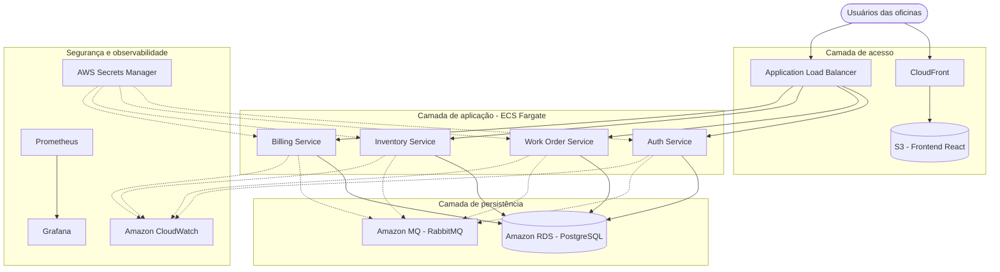

# Arquitetura de Nuvem e Infraestrutura como Código (IaC) — OficinaPro

> **Documento de trabalho — Grupo GarageOps**
>
> Este documento apresenta a arquitetura de infraestrutura em nuvem proposta para o OficinaPro, considerando sua utilização como uma plataforma SaaS (Software as a Service) para múltiplas oficinas mecânicas.
>
> A proposta descreve os serviços de nuvem, a organização dos ambientes, a hospedagem dos microsserviços, a segurança, a observabilidade e a automação da infraestrutura por meio do Terraform.
>
> As decisões técnicas aqui apresentadas deverão ser validadas pelo grupo e pelo professor antes da implementação definitiva.

---

## 1. Objetivo e Visão Geral da Arquitetura

O OficinaPro será desenvolvido como uma aplicação SaaS, permitindo que diferentes oficinas utilizem a mesma plataforma, mantendo seus dados e operações isolados.

A infraestrutura deverá atender aos seguintes objetivos:

- Disponibilizar a aplicação pela internet de maneira segura.
- Permitir a execução independente dos microsserviços.
- Garantir o isolamento dos dados entre diferentes oficinas.
- Facilitar a manutenção e a evolução da aplicação.
- Permitir o monitoramento dos serviços e a identificação de falhas.
- Automatizar a criação e a atualização dos recursos de infraestrutura.
- Controlar os custos e evitar recursos desnecessários.
- Permitir a recuperação dos dados em caso de falhas.

A arquitetura proposta utiliza a AWS como provedora de nuvem, Docker para empacotamento dos serviços e Terraform para provisionamento da infraestrutura.

### 1.1 Arquitetura lógica proposta

A infraestrutura será organizada nas seguintes camadas:

1. **Acesso e distribuição:** disponibilização do frontend e recebimento das requisições externas.
2. **Aplicação:** execução dos quatro microsserviços em contêineres.
3. **Persistência:** armazenamento dos dados em bancos PostgreSQL separados por responsabilidade.
4. **Mensageria:** comunicação assíncrona entre os microsserviços.
5. **Segurança e configuração:** gerenciamento de credenciais, permissões e configurações.
6. **Observabilidade:** monitoramento de métricas, logs e disponibilidade.
7. **Automação:** provisionamento e atualização da infraestrutura por Terraform e GitHub Actions.

### 1.2 Diagrama da infraestrutura proposta



**Observação:** o diagrama representa a organização lógica dos componentes. O compartilhamento de uma instância RDS não significa compartilhamento das responsabilidades dos bancos: cada microsserviço deverá acessar exclusivamente seu próprio banco de dados.

---

## 2. Pilha Tecnológica de Nuvem e DevOps

A tabela apresenta a arquitetura-base recomendada para o projeto.

| Camada / Recurso | Tecnologia proposta | Finalidade |
|---|---|---|
| Provedor de nuvem | AWS | Hospedagem da aplicação e dos recursos de infraestrutura. |
| Infraestrutura como Código | Terraform | Provisionamento e gerenciamento declarativo dos recursos. |
| Estado remoto | AWS S3 | Armazenamento centralizado e versionado do estado Terraform. |
| Bloqueio do estado | S3 Lockfile | Evitar alterações simultâneas no mesmo estado Terraform. |
| Frontend | React + S3 + CloudFront | Hospedagem e distribuição da interface da aplicação. |
| Contêineres | Docker | Empacotamento dos microsserviços. |
| Execução dos contêineres | AWS ECS com Fargate | Execução e gerenciamento dos microsserviços sem administrar servidores. |
| Entrada das APIs | Application Load Balancer (ALB) | Distribuição de requisições para os microsserviços. |
| Registro de imagens | Amazon ECR | Armazenamento das imagens Docker. |
| Banco de dados | PostgreSQL no Amazon RDS | Persistência dos dados dos microsserviços. |
| Mensageria | RabbitMQ no Amazon MQ | Comunicação assíncrona entre os microsserviços. |
| Armazenamento de arquivos | AWS S3 | Armazenamento de documentos e arquivos da aplicação. |
| Gerenciamento de segredos | AWS Secrets Manager | Armazenamento protegido de credenciais e informações sensíveis. |
| CI/CD | GitHub Actions | Automação de testes, validações e implantação. |
| Logs | Amazon CloudWatch | Centralização e consulta de logs operacionais. |
| Métricas | Prometheus | Coleta de métricas da aplicação e dos serviços. |
| Dashboards | Grafana | Visualização de métricas e acompanhamento da infraestrutura. |

**Diretriz arquitetural:** o ECS com Fargate será a opção inicial de execução dos contêineres. O EKS não será adotado como padrão, pois introduziria a complexidade de Kubernetes sem uma necessidade identificada no MVP.

A utilização de serviços gerenciados reduz a necessidade de administrar diretamente servidores, bancos de dados e componentes de infraestrutura, mas deverá ser acompanhada de uma avaliação de custos.

---

## 3. Organização da Infraestrutura de Rede

A infraestrutura deverá utilizar uma VPC (Virtual Private Cloud), permitindo controlar a comunicação entre os componentes e restringir o acesso aos recursos internos.

### 3.1 Organização das sub-redes

A proposta considera a seguinte separação:

| Camada | Localização | Recursos |
|---|---|---|
| Acesso público | Sub-redes públicas | Application Load Balancer e componentes que precisem de acesso público. |
| Aplicação | Sub-redes privadas | Contêineres dos microsserviços executados no ECS Fargate. |
| Persistência | Sub-redes privadas de banco de dados | Instância RDS e recursos de persistência. |
| Mensageria | Sub-redes privadas | Broker RabbitMQ do Amazon MQ. |

Os bancos de dados e o broker de mensageria não deverão receber conexões públicas diretamente.

### 3.2 Controle de tráfego

Os Security Groups deverão limitar a comunicação entre os componentes.

Exemplos:

- O ALB poderá receber tráfego HTTPS externo.
- Os microsserviços receberão requisições somente dos componentes autorizados.
- O PostgreSQL aceitará conexões somente dos microsserviços autorizados.
- O RabbitMQ aceitará conexões somente dos serviços que precisem publicar ou consumir eventos.
- O acesso administrativo deverá ser restrito e autenticado.

### 3.3 Disponibilidade e custos de rede

A infraestrutura de produção deverá considerar a distribuição dos recursos entre zonas de disponibilidade, quando compatível com os serviços escolhidos.

O NAT Gateway poderá ser utilizado quando os recursos em sub-redes privadas precisarem acessar a internet. Entretanto, como possui custo próprio, sua necessidade deverá ser avaliada antes do provisionamento.

Para o MVP, a configuração de rede deverá buscar equilíbrio entre segurança, disponibilidade e custo.

---

## 4. Hospedagem da Aplicação

### 4.1 Frontend — React

O frontend será desenvolvido utilizando React e poderá ser hospedado em um bucket AWS S3 configurado para armazenamento de conteúdo estático.

O CloudFront será utilizado como camada de distribuição de conteúdo, permitindo disponibilizar a interface aos usuários.

A configuração deverá considerar:

- Distribuição HTTPS.
- Restrição de acesso direto ao bucket.
- Atualização dos arquivos publicados.
- Configuração das rotas da aplicação frontend.
- Separação dos arquivos de cada ambiente.

O bucket do frontend não deverá armazenar informações sensíveis ou dados internos dos microsserviços.

### 4.2 Microsserviços — ECS Fargate

A aplicação será organizada em quatro microsserviços, conforme a arquitetura definida no DFD:

| Microsserviço | Responsabilidade |
|---|---|
| **Auth Service** | Autenticação, usuários, vínculos com oficinas e permissões. |
| **Work Order Service** | Clientes, veículos, ordens de serviço e diagnósticos. |
| **Inventory Service** | Cadastro de peças, controle de estoque e movimentações. |
| **Billing Service** | Orçamentos, itens de orçamento e pagamentos. |

Cada microsserviço deverá possuir:

- Sua própria imagem Docker.
- Uma definição de execução independente.
- Configurações e variáveis de ambiente próprias.
- Permissões específicas para acessar seus recursos.
- Health checks para verificar sua disponibilidade.
- Logs e métricas para acompanhamento operacional.

O ECS Fargate será responsável pela execução dos contêineres, sem exigir que o grupo administre diretamente as máquinas virtuais utilizadas pela plataforma.

### 4.3 Entrada das APIs — Application Load Balancer

O Application Load Balancer será utilizado como ponto de entrada das APIs.

Ele deverá encaminhar as requisições para os serviços correspondentes, conforme regras de roteamento definidas pelo grupo.

A comunicação deverá utilizar HTTPS e certificados digitais adequados.

Para o MVP, não será necessário introduzir um API Gateway adicional se o ALB atender aos requisitos de roteamento, distribuição e exposição dos serviços.

Caso sejam identificadas necessidades futuras de gerenciamento avançado de APIs, autenticação centralizada, limitação de requisições ou políticas específicas, essa decisão poderá ser reavaliada.

### 4.4 Registro das Imagens — Amazon ECR

O Amazon Elastic Container Registry (ECR) será utilizado para armazenar as imagens Docker dos microsserviços.

O processo previsto será:

1. O GitHub Actions executa os testes e validações.
2. Após a aprovação das verificações, as imagens Docker são construídas.
3. As imagens são identificadas por tags, preferencialmente associadas ao commit correspondente.
4. As imagens são publicadas no ECR.
5. O ECS utiliza a nova versão da imagem durante a implantação.

As imagens deverão possuir identificação de versão para facilitar a rastreabilidade e a reversão de implantações.

---

## 5. Banco de Dados e Isolamento SaaS

### 5.1 PostgreSQL e Database-per-Service

O PostgreSQL será utilizado como tecnologia de banco de dados.

A arquitetura seguirá o padrão Database-per-Service, no qual cada microsserviço é responsável pelos próprios dados.

A organização lógica proposta é:

| Microsserviço | Banco de dados |
|---|---|
| Auth Service | `auth_db` |
| Work Order Service | `work_order_db` |
| Inventory Service | `inventory_db` |
| Billing Service | `billing_db` |

Para reduzir custos e complexidade no MVP, recomenda-se avaliar uma única instância Amazon RDS for PostgreSQL contendo bancos separados, credenciais específicas e permissões independentes para cada microsserviço.

Essa organização mantém a separação lógica sem exigir quatro instâncias físicas independentes.

Cada serviço deverá:

- Acessar somente seu próprio banco.
- Possuir credenciais específicas.
- Controlar suas próprias migrações.
- Não consultar diretamente as tabelas dos demais serviços.
- Trocar informações por APIs ou eventos.

A separação física em instâncias independentes poderá ser considerada futuramente, conforme a necessidade de escalabilidade, disponibilidade ou isolamento.

### 5.2 Isolamento entre Oficinas (Multi-tenancy)

Como o OficinaPro será um SaaS, diferentes oficinas utilizarão a mesma plataforma.

A proposta inicial é utilizar um modelo multi-tenant com separação lógica dos dados por meio do identificador `tenant_id`.

As tabelas que armazenarem dados pertencentes a uma oficina deverão possuir esse identificador.

O isolamento deverá ser garantido pelas seguintes regras:

- O `tenant_id` deverá ser obtido de um contexto autenticado e validado pelo backend.
- O sistema não deverá confiar exclusivamente no identificador enviado pelo frontend.
- Todas as consultas e alterações deverão respeitar o contexto da oficina.
- As operações deverão validar o vínculo do usuário com a oficina.
- As restrições de unicidade deverão considerar o contexto da oficina quando a regra permitir registros iguais em oficinas diferentes.
- Os eventos publicados no RabbitMQ deverão transportar o identificador da oficina.
- Os consumidores deverão validar o contexto da oficina antes de processar os eventos.

O uso de Row-Level Security (RLS) no PostgreSQL poderá ser avaliado como camada adicional de proteção. Entretanto, deverá ser implementado com cuidado para garantir que o contexto da oficina seja definido corretamente em cada transação e conexão utilizada pela aplicação.

**Regra fundamental:** uma oficina nunca poderá consultar, modificar ou excluir dados pertencentes a outra oficina.

### 5.3 Backups e Recuperação

O banco de dados deverá possuir uma estratégia de backup e recuperação compatível com a importância das informações armazenadas.

A configuração deverá considerar:

- Backups automatizados.
- Criptografia dos backups.
- Política de retenção.
- Recuperação para um ponto no tempo, quando disponível no serviço contratado.
- Testes periódicos de restauração.
- Restrição de acesso aos backups.

O objetivo é permitir a recuperação dos dados em caso de falhas operacionais ou incidentes.

---

## 6. Mensageria Assíncrona

O RabbitMQ será utilizado para a comunicação assíncrona entre os microsserviços.

A proposta é utilizar o Amazon MQ com RabbitMQ para reduzir a necessidade de administrar diretamente o broker em produção.

Os principais eventos previstos no DFD são:

| Evento | Publicador | Consumidor |
|---|---|---|
| `RESERVA_SOLICITADA` | Billing Service | Inventory Service |
| `RESERVA_CONFIRMADA` | Inventory Service | Billing Service |
| `RESERVA_RECUSADA` | Inventory Service | Billing Service |
| `ORCAMENTO_APROVADO` | Billing Service | Work Order Service |

### 6.1 Requisitos de Confiabilidade

A comunicação deverá considerar:

- Persistência de mensagens e filas, conforme a configuração adotada.
- Confirmação de recebimento e processamento das mensagens.
- Identificadores únicos para rastreabilidade.
- Consumidores idempotentes.
- Estratégia de retentativa para falhas temporárias.
- Dead Letter Queue (DLQ) para mensagens que não puderem ser processadas após as tentativas definidas.
- Monitoramento de filas, mensagens pendentes e falhas.

O padrão Transactional Outbox deverá ser aplicado nos serviços que precisarem persistir uma alteração no banco de dados e publicar um evento relacionado a essa alteração.

O Inventory Service deverá utilizá-lo para publicar os resultados das reservas. O Billing Service deverá aplicar o mesmo princípio ao registrar a aprovação definitiva do orçamento e publicar o evento correspondente.

A implementação deverá respeitar as regras de consistência e idempotência descritas no DFD.

---

## 7. Segurança e Gerenciamento de Segredos

A segurança deverá ser considerada em todas as camadas da infraestrutura.

### 7.1 Gerenciamento de Credenciais

O AWS Secrets Manager será a opção proposta para armazenar credenciais de bancos de dados, tokens e outras informações sensíveis.

As aplicações deverão receber os segredos por mecanismos seguros durante a execução.

Não deverão ser armazenados no GitHub:

- Senhas de bancos de dados.
- Chaves privadas.
- Tokens de autenticação.
- Credenciais permanentes da AWS.
- Arquivos de configuração contendo informações sensíveis.

### 7.2 Permissões e Identidade

O gerenciamento de permissões deverá utilizar IAM e mecanismos de identidade próprios dos serviços da AWS.

Cada componente deverá possuir somente as permissões necessárias para executar suas atividades.

Para o ECS Fargate, deverão ser configuradas as permissões adequadas às funções de execução das tarefas e às aplicações.

### 7.3 Autenticação do GitHub Actions na AWS

O GitHub Actions deverá utilizar OIDC (OpenID Connect) para autenticação na AWS, evitando a necessidade de armazenar chaves permanentes de acesso no repositório.

A relação de confiança deverá ser restrita ao repositório, à branch ou ao ambiente autorizado para executar as operações.

As permissões utilizadas nos pipelines deverão ser limitadas às ações necessárias.

### 7.4 Proteção dos Dados

A infraestrutura deverá considerar:

- HTTPS para comunicação externa.
- Criptografia dos dados armazenados, conforme os recursos utilizados.
- Restrição de acesso aos bancos de dados e ao broker.
- Proteção dos logs contra exposição de informações sensíveis.
- Controle de permissões por usuário e serviço.
- Auditoria das operações relevantes.
- Medidas compatíveis com os requisitos da LGPD.

---

## 8. Infraestrutura como Código — Terraform

O Terraform será utilizado para declarar e provisionar os recursos da AWS.

A infraestrutura deverá ser organizada em módulos ou componentes reutilizáveis, evitando a concentração de toda a configuração em um único arquivo.

### 8.1 Recursos Gerenciados pelo Terraform

A estrutura de IaC deverá contemplar, conforme a necessidade do ambiente:

1. VPC, sub-redes, tabelas de rotas e Internet Gateway.
2. Security Groups e regras de comunicação.
3. Application Load Balancer.
4. Cluster ECS e serviços dos microsserviços.
5. Definições de execução e permissões dos contêineres.
6. Repositórios Amazon ECR.
7. Instância Amazon RDS e recursos relacionados.
8. Broker Amazon MQ.
9. Buckets S3 e distribuição CloudFront.
10. Segredos e permissões de acesso.
11. Recursos de monitoramento e logs.
12. Políticas de backup e configurações de segurança.

A divisão dos recursos deverá respeitar a separação dos ambientes e facilitar a manutenção da infraestrutura.

### 8.2 Organização dos Arquivos

Uma estrutura inicial sugerida é:

```text
infra/
├── bootstrap/
│   └── main.tf
├── modules/
│   ├── networking/
│   ├── ecs/
│   ├── database/
│   ├── messaging/
│   ├── storage/
│   └── monitoring/
└── environments/
    ├── dev/
    │   ├── main.tf
    │   ├── variables.tf
    │   └── backend.hcl
    ├── staging/
    │   ├── main.tf
    │   ├── variables.tf
    │   └── backend.hcl
    └── prod/
        ├── main.tf
        ├── variables.tf
        └── backend.hcl
```

Essa estrutura é uma sugestão inicial e poderá ser ajustada conforme a organização efetivamente adotada pelo grupo.

### 8.3 Backend Remoto do Terraform

O estado do Terraform deverá ser armazenado em um bucket S3 dedicado.

A configuração deverá contemplar:

- Versionamento do bucket.
- Criptografia dos objetos.
- Bloqueio nativo do estado por meio de `use_lockfile = true`.
- Controle de acesso restrito.
- Separação dos arquivos de estado por ambiente.

O bucket utilizado pelo backend deverá ser criado previamente, por uma etapa de bootstrap independente da configuração que utiliza esse mesmo backend.

### 8.4 Exemplo de Configuração do Backend

Exemplo ilustrativo para o ambiente de desenvolvimento:

```hcl
terraform {
  required_version = ">= 1.10.0"

  required_providers {
    aws = {
      source  = "hashicorp/aws"
      version = "~> 6.0"
    }
  }

  backend "s3" {}
}

provider "aws" {
  region = "us-east-1"

  default_tags {
    tags = {
      Project     = "OficinaPro"
      ManagedBy   = "Terraform"
      Team        = "GarageOps"
      Environment = "dev"
    }
  }
}
```

Arquivo `backend.hcl`:

```hcl
bucket       = "oficinapro-terraform-state-garageops"
key          = "infra/dev/terraform.tfstate"
region       = "us-east-1"
encrypt      = true
use_lockfile = true
```

Inicialização do backend:

```powershell
terraform init -backend-config=backend.hcl
```

**Observações:**

- O nome do bucket é ilustrativo e deverá ser substituído pelo nome efetivamente criado na AWS.
- A região `us-east-1` é uma referência inicial, sujeita à confirmação do grupo.
- O exemplo utiliza Terraform 1.10 ou superior devido ao bloqueio nativo do S3.
- O provider AWS deverá ser testado com os recursos declarados e sua versão deverá ser mantida de maneira controlada.
- O arquivo de estado poderá conter dados sensíveis. Portanto, deverá ser protegido contra acesso não autorizado.
- A criação do bucket e suas configurações de segurança deverá ocorrer antes da inicialização do backend remoto.

---

## 9. Integração e Entrega Contínua — CI/CD

O GitHub Actions será utilizado para automatizar as verificações de qualidade e o processo de implantação.

O pipeline deverá separar a validação da aplicação da validação e implantação da infraestrutura.

### 9.1 Pipeline de Integração Contínua (CI)

O fluxo de CI poderá contemplar:

1. Verificação de formatação do código.
2. Execução de linters e análises estáticas.
3. Execução dos testes automatizados dos microsserviços.
4. Verificação da cobertura de testes exigida pelo projeto.
5. Verificação da formatação Terraform com `terraform fmt`.
6. Validação das configurações Terraform com `terraform validate`.
7. Construção das imagens Docker.
8. Verificação dos artefatos gerados.

As verificações deverão ocorrer antes da integração das alterações na branch principal.

### 9.2 Pipeline de Infraestrutura

O pipeline de infraestrutura deverá executar:

1. Inicialização do Terraform.
2. Validação da configuração.
3. Geração do plano de execução (`terraform plan`).
4. Análise das alterações propostas.
5. Aprovação das operações que alterem a infraestrutura.
6. Aplicação das alterações autorizadas (`terraform apply`).

Alterações destrutivas ou que possam gerar custos adicionais deverão receber atenção especial e aprovação antes da execução.

### 9.3 Pipeline de Implantação da Aplicação

O processo de implantação dos microsserviços deverá contemplar:

1. Construção das imagens Docker.
2. Identificação das versões das imagens.
3. Publicação das imagens no Amazon ECR.
4. Atualização das definições de execução no ECS.
5. Implantação dos novos contêineres.
6. Verificação da saúde dos serviços após a implantação.
7. Possibilidade de reversão para uma versão anterior em caso de falha.

As alterações de infraestrutura não deverão ser executadas automaticamente a cada alteração de código da aplicação. Cada fluxo deverá ser acionado conforme a natureza da mudança.

---

## 10. Ambientes de Execução

A infraestrutura deverá ser organizada em três ambientes:

| Ambiente | Finalidade |
|---|---|
| **Desenvolvimento (dev)** | Desenvolvimento individual, testes iniciais e integração dos microsserviços. |
| **Homologação (staging)** | Validação integrada das funcionalidades e testes antes da publicação. |
| **Produção (prod)** | Execução da plataforma disponibilizada às oficinas. |

### 10.1 Isolamento dos Ambientes

Cada ambiente deverá possuir configurações próprias, incluindo:

- Arquivos de estado Terraform independentes.
- Configurações e variáveis específicas.
- Segredos e credenciais próprios.
- Recursos identificados pelo ambiente correspondente.
- Políticas de acesso adequadas à finalidade.

A separação por contas AWS distintas é recomendável para ambientes de produção e não produção quando a estrutura e o orçamento permitirem.

Caso o projeto utilize uma única conta AWS, deverá haver isolamento por recursos, permissões, configurações e estados separados, sem compartilhamento indevido de dados.

---

## 11. Monitoramento e Observabilidade

O OficinaPro deverá possuir mecanismos para acompanhar o funcionamento da aplicação e identificar problemas operacionais.

A proposta contempla:

| Tecnologia | Responsabilidade |
|---|---|
| **Prometheus** | Coleta e armazenamento de métricas. |
| **Grafana** | Visualização de métricas por meio de dashboards. |
| **CloudWatch** | Centralização de logs e acompanhamento dos recursos AWS. |

O monitoramento deverá contemplar:

- Disponibilidade dos microsserviços.
- Uso de CPU e memória dos contêineres.
- Tempo de resposta das APIs.
- Quantidade de requisições e erros.
- Estado das conexões com os bancos de dados.
- Quantidade de mensagens pendentes no RabbitMQ.
- Falhas de publicação e consumo de eventos.
- Saúde dos serviços e disponibilidade da infraestrutura.

Os dashboards deverão permitir acompanhar os principais indicadores do sistema e apoiar a identificação de falhas.

A configuração de Prometheus e Grafana deverá atender ao critério acadêmico de disponibilização funcional e acessível dessas ferramentas.

---

## 12. Controle de Custos e Dimensionamento

A infraestrutura deverá ser dimensionada considerando o volume inicial de utilização do MVP e a possibilidade de crescimento futuro.

A escolha dos serviços gerenciados deverá considerar o custo de execução, armazenamento, transferência de dados e manutenção.

Recomenda-se:

- Utilizar recursos dimensionados para a demanda inicial.
- Avaliar os custos do ECS Fargate, RDS, Amazon MQ e NAT Gateway antes do provisionamento.
- Evitar manter ambientes de desenvolvimento e homologação ativos sem necessidade.
- Configurar alertas de orçamento na AWS.
- Aplicar tags de identificação dos recursos.
- Acompanhar os custos por ambiente e serviço.
- Revisar periodicamente os recursos provisionados.
- Planejar a remoção de recursos temporários, preservando os dados necessários.

**Importante:** serviços gerenciados reduzem a carga de administração, mas não são necessariamente a alternativa mais barata. A escolha final deverá equilibrar confiabilidade, complexidade e orçamento disponível.

---

## 13. Pontos Pendentes de Validação

Embora a arquitetura-base esteja definida como proposta neste documento, os seguintes pontos ainda deverão ser confirmados pelo grupo:

1. Confirmação da AWS como provedora de nuvem.
2. Confirmação do ECS Fargate como ambiente de execução dos microsserviços.
3. Confirmação do Application Load Balancer como ponto de entrada das APIs.
4. Confirmação da hospedagem do frontend em S3 com distribuição pelo CloudFront.
5. Confirmação da utilização do Amazon RDS for PostgreSQL, com bancos separados por microsserviço.
6. Confirmação da utilização do Amazon MQ com RabbitMQ.
7. Definição da região AWS e das zonas de disponibilidade.
8. Definição da quantidade de ambientes que serão efetivamente provisionados para o MVP.
9. Definição da estratégia de isolamento dos ambientes por contas AWS ou por recursos dentro de uma única conta.
10. Definição da política de backups, retenção e recuperação dos bancos de dados.
11. Definição dos limites de custos e do dimensionamento inicial dos recursos.
12. Definição da configuração de Prometheus, Grafana e CloudWatch.
13. Confirmação da estrutura de módulos Terraform e do processo de bootstrap do backend remoto.
14. Definição dos fluxos de CI/CD e das aprovações necessárias para implantação.
15. Validação da estratégia de isolamento multi-tenant e das permissões de acesso aos dados.

---

**Última atualização:** 15/11/2026

**Responsável:** Product Owner — Grupo GarageOps

**Status:** Documento de trabalho sujeito à validação do grupo e do professor.