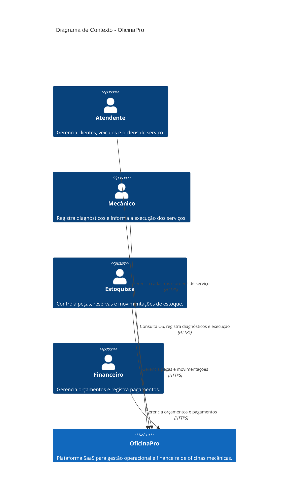
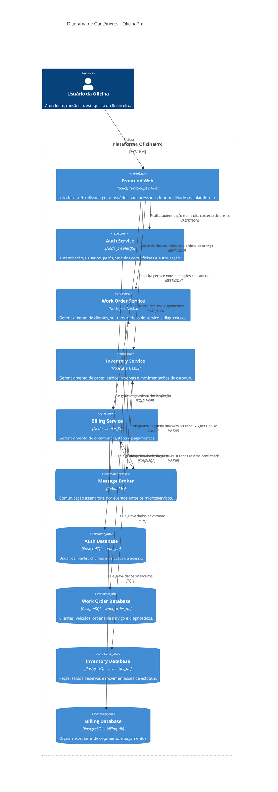
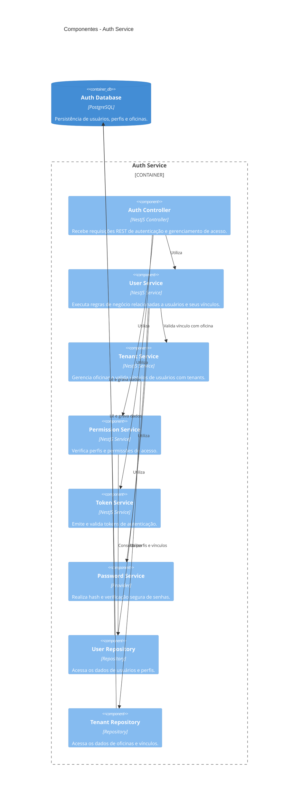
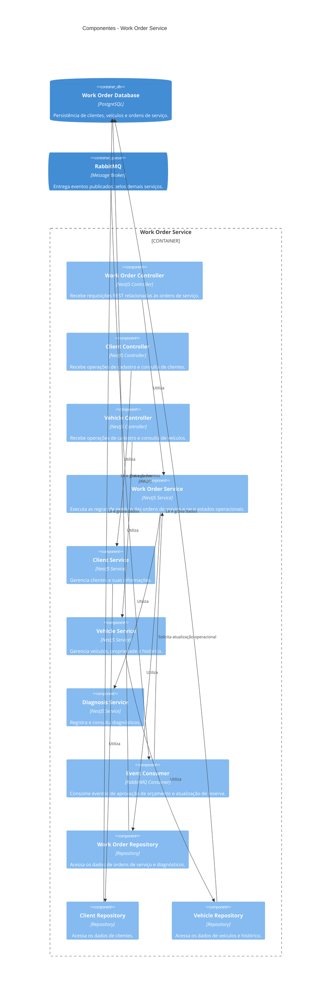
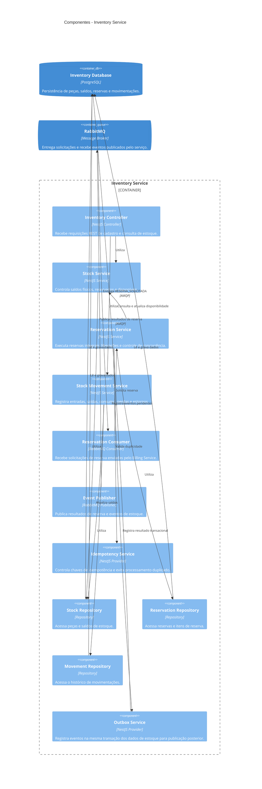
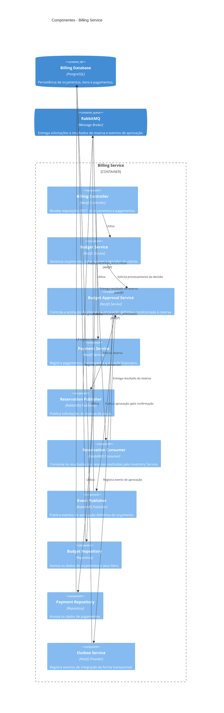

# C4 Model — OficinaPro

**Projeto:** OficinaPro  
**Grupo:** GarageOps  
**Data:** 16/11/2026  
**Versão:** 1.0  
**Status:** Proposta arquitetural para validação do grupo e do professor.

---

## 1. Objetivo

Este documento apresenta a arquitetura de software do OficinaPro utilizando o **C4 Model**, contemplando os três níveis exigidos:

1. **Contexto:** apresenta o sistema, seus usuários e suas interações externas.
2. **Contêineres:** apresenta as aplicações, os microsserviços, os bancos de dados e a mensageria.
3. **Componentes:** detalha a organização interna dos quatro microsserviços previstos para o MVP.

O objetivo é facilitar a compreensão da estrutura da solução, das responsabilidades de cada parte e das relações entre os componentes.

Os diagramas representam a arquitetura planejada para o MVP. Os componentes internos descritos são uma proposta de organização lógica e deverão ser ajustados conforme a implementação efetiva.

## 2. Nível 1 — Diagrama de Contexto

O Diagrama de Contexto apresenta o OficinaPro como um sistema SaaS de gestão operacional para pequenas e médias oficinas mecânicas.

A plataforma será utilizada por diferentes perfis profissionais vinculados a uma oficina. Cada usuário terá acesso às funcionalidades permitidas por suas responsabilidades e permissões.

### 2.1. Diagrama de Contexto do Sistema

### 2.2. Descrição dos Elementos

| Elemento | Tipo | Descrição |
|---|---|---|
| Atendente | Pessoa | Responsável pelo cadastro e gerenciamento de clientes, veículos e ordens de serviço. |
| Mecânico | Pessoa | Responsável por consultar ordens de serviço, registrar diagnósticos e informar a execução dos serviços. |
| Estoquista | Pessoa | Responsável pelo cadastro de peças, consulta de disponibilidade, reservas e movimentações de estoque. |
| Financeiro | Pessoa | Responsável pelo gerenciamento de orçamentos e pelo registro e acompanhamento de pagamentos. |
| OficinaPro | Sistema | Plataforma SaaS que integra os processos operacionais e financeiros de oficinas mecânicas. |

**Observações:**

- Os perfis apresentados são os previstos para o MVP.
- Não foi criado um perfil genérico de administrador da oficina, pois as responsabilidades estão distribuídas entre os perfis definidos.
- As permissões específicas de cada perfil deverão seguir os requisitos funcionais e as regras de negócio.
- A integração externa para consulta de dados ainda depende de seleção e formalização. Por isso, não foi representada como uma dependência já definida do sistema.

---

## 3. Nível 2 — Diagrama de Contêineres

O Diagrama de Contêineres apresenta os principais elementos executáveis e armazenamentos de dados que compõem o OficinaPro.

A arquitetura proposta utiliza quatro microsserviços independentes, desenvolvidos com Node.js, TypeScript e NestJS:

- **Auth Service:** autenticação, usuários, perfis e vínculos com oficinas.
- **Work Order Service:** clientes, veículos, ordens de serviço e diagnósticos.
- **Inventory Service:** peças, disponibilidade, reservas e movimentações de estoque.
- **Billing Service:** orçamentos, itens de orçamento e pagamentos.

O frontend será desenvolvido com React, TypeScript e Vite. A comunicação síncrona será realizada por APIs REST, enquanto a comunicação assíncrona entre os serviços utilizará RabbitMQ.

Cada microsserviço será responsável pelos próprios dados, seguindo o padrão Database-per-Service.

### 3.1. Diagrama de Contêineres

### 3.2. Descrição dos Contêineres

| Contêiner | Tecnologia | Responsabilidade |
|---|---|---|
| Frontend Web | React, TypeScript e Vite | Interface para os usuários, comunicação com as APIs e apresentação das funcionalidades conforme as permissões. |
| Auth Service | Node.js, TypeScript e NestJS | Autenticação, gerenciamento de usuários, perfis, vínculos com oficinas e autorização. |
| Work Order Service | Node.js, TypeScript e NestJS | Gerenciamento de clientes, veículos, ordens de serviço, diagnósticos e execução operacional. |
| Inventory Service | Node.js, TypeScript e NestJS | Cadastro de peças, controle de disponibilidade, reservas, utilização e movimentações de estoque. |
| Billing Service | Node.js, TypeScript e NestJS | Gerenciamento de orçamentos, itens, valores e pagamentos. |
| Message Broker | RabbitMQ | Publicação e consumo de eventos entre os microsserviços. |
| Auth Database | PostgreSQL | Persistência dos dados de autenticação e acesso. |
| Work Order Database | PostgreSQL | Persistência dos dados de clientes, veículos e ordens de serviço. |
| Inventory Database | PostgreSQL | Persistência dos dados de peças, reservas e movimentações. |
| Billing Database | PostgreSQL | Persistência dos dados de orçamentos e pagamentos. |

### 3.3. Comunicação entre os Contêineres

**Comunicação síncrona — REST**

O frontend realizará requisições aos microsserviços por meio de APIs REST.

As operações deverão utilizar HTTPS na comunicação externa e validar a autenticação, as permissões e o contexto da oficina antes de acessar os dados.

A proposta atual não define um API Gateway de aplicação independente. A decisão entre encaminhamento direto às APIs e a adoção de uma camada adicional de gateway permanece sujeita à validação do grupo.

O Application Load Balancer previsto no desenho de nuvem é um componente de infraestrutura para distribuição de tráfego. Sua utilização não significa, por si só, a adoção de um API Gateway com funcionalidades próprias de gerenciamento de APIs.

**Comunicação assíncrona — RabbitMQ**

O RabbitMQ será utilizado para comunicação entre os microsserviços quando uma operação depender do processamento de outro serviço.

O principal fluxo assíncrono do MVP será a reserva de peças condicionada à aceitação do orçamento pelo cliente.

1. O cliente aceita o orçamento.
2. Billing registra a decisão do cliente e solicita a reserva das peças.
3. Billing publica o evento `RESERVA_SOLICITADA`.
4. Inventory recebe a solicitação e verifica a disponibilidade das peças.
5. Inventory realiza a reserva integral ou registra a recusa.
6. Inventory publica `RESERVA_CONFIRMADA` ou `RESERVA_RECUSADA`.
7. Billing consome o resultado.
8. Caso a reserva seja confirmada, Billing efetiva a aprovação do orçamento e publica `ORCAMENTO_APROVADO`.
9. Work Order consome o evento e atualiza a situação operacional da ordem de serviço, permitindo o início da execução.

A reserva não representa a baixa definitiva do estoque. A baixa deverá ocorrer quando a peça for efetivamente utilizada.

### 3.4. Organização dos Bancos de Dados

O OficinaPro seguirá o padrão Database-per-Service.

Cada microsserviço será responsável exclusivamente pelos dados sob seu domínio.

| Banco | Responsável | Principais dados |
|---|---|---|
| `auth_db` | Auth Service | Oficinas, usuários, perfis e vínculos entre usuários e oficinas. |
| `work_order_db` | Work Order Service | Clientes, veículos, histórico de veículos, ordens de serviço e diagnósticos. |
| `inventory_db` | Inventory Service | Peças, saldos de estoque, reservas, itens de reserva e movimentações. |
| `billing_db` | Billing Service | Orçamentos, itens de serviços, itens de peças e pagamentos. |

Para o MVP, os bancos poderão ser implementados como bancos logicamente separados em uma mesma instância PostgreSQL, desde que sejam mantidas credenciais e permissões próprias para cada serviço.

Essa configuração não representa isolamento físico entre instâncias, mas preserva a responsabilidade individual de cada microsserviço sobre seus dados.

Não serão utilizadas chaves estrangeiras entre bancos de microsserviços diferentes. As referências externas serão verificadas por APIs ou eventos.

---

## 4. Nível 3 — Diagrama de Componentes

O Diagrama de Componentes apresenta a organização interna de cada microsserviço, identificando os principais módulos responsáveis por receber requisições, executar regras de negócio, acessar dados e trocar eventos.

Os componentes apresentados são uma proposta de organização lógica baseada nas responsabilidades dos serviços. Seus nomes e divisões internas poderão ser ajustados durante a implementação.

### 4.1. Componentes do Auth Service

**Responsabilidade:** autenticação, gerenciamento de usuários, perfis, vínculos com oficinas e autorização de acesso.

**Descrição dos componentes:**

| Componente | Responsabilidade |
|---|---|
| Auth Controller | Receber requisições de login, autenticação e gerenciamento de acesso. |
| User Service | Executar as regras de criação, atualização e consulta de usuários. |
| Tenant Service | Gerenciar oficinas e validar os vínculos dos usuários com os tenants. |
| Permission Service | Verificar se o usuário possui autorização para realizar determinada operação. |
| Token Service | Emitir e validar tokens utilizados na autenticação. |
| Password Service | Realizar hash e verificação de senhas. |
| User Repository | Acessar os dados de usuários e perfis no banco. |
| Tenant Repository | Acessar os dados de oficinas e vínculos no banco. |

### 4.2. Componentes do Work Order Service

**Responsabilidade:** gerenciamento de clientes, veículos, ordens de serviço, diagnósticos e acompanhamento da execução.

**Descrição dos componentes:**

| Componente | Responsabilidade |
|---|---|
| Work Order Controller | Receber operações relacionadas às ordens de serviço. |
| Client Controller | Receber operações relacionadas aos clientes. |
| Vehicle Controller | Receber operações relacionadas aos veículos. |
| Work Order Service | Aplicar as regras de criação, atualização, cancelamento e transição de estados das ordens de serviço. |
| Client Service | Gerenciar os dados cadastrais dos clientes. |
| Vehicle Service | Gerenciar os veículos e o histórico de propriedade e manutenção. |
| Diagnosis Service | Registrar e consultar diagnósticos associados às ordens de serviço. |
| Event Consumer | Consumir eventos relacionados à aprovação dos orçamentos e atualizar a situação operacional das ordens. |
| Work Order Repository | Persistir ordens de serviço e diagnósticos. |
| Client Repository | Persistir os dados dos clientes. |
| Vehicle Repository | Persistir os dados dos veículos e seus históricos. |

O Work Order Service não deverá alterar diretamente os dados de estoque ou de pagamento. Essas operações pertencem aos microsserviços Inventory e Billing.

### 4.3. Componentes do Inventory Service

**Responsabilidade:** cadastro de peças, controle de disponibilidade, reservas e movimentações de estoque.

**Descrição dos componentes:**

| Componente | Responsabilidade |
|---|---|
| Inventory Controller | Receber requisições de cadastro e consulta de estoque. |
| Stock Service | Controlar quantidade física, quantidade reservada e disponibilidade. |
| Reservation Service | Executar reservas integrais, controlar concorrência e liberar reservas. |
| Stock Movement Service | Registrar entradas, consumo definitivo, perdas e estornos. |
| Reservation Consumer | Consumir solicitações de reserva publicadas pelo Billing Service. |
| Event Publisher | Publicar os resultados das operações de estoque. |
| Idempotency Service | Evitar processamento duplicado de solicitações. |
| Stock Repository | Acessar peças e saldos de estoque. |
| Reservation Repository | Acessar reservas e seus itens. |
| Movement Repository | Persistir as movimentações de estoque. |
| Outbox Service | Registrar eventos de forma transacional para posterior publicação. |

**Regras importantes para este serviço:**

- A reserva deverá ser integral: todas as peças solicitadas serão reservadas ou nenhuma será.
- O controle de concorrência deverá impedir reservas simultâneas acima da quantidade disponível.
- A quantidade disponível será calculada a partir do estoque físico menos o estoque reservado.
- A reserva não representa consumo definitivo.
- A baixa definitiva ocorrerá quando a peça for efetivamente utilizada.
- Peças não utilizadas poderão ter sua reserva liberada.
- Peças perdidas ou inutilizadas deverão ser registradas como movimentações específicas.
- As operações deverão possuir mecanismos de idempotência.
- A publicação de eventos deverá utilizar o padrão Transactional Outbox.

### 4.4. Componentes do Billing Service

**Responsabilidade:** gerenciamento de orçamentos, itens, valores e pagamentos.

**Descrição dos componentes:**

| Componente | Responsabilidade |
|---|---|
| Billing Controller | Receber requisições relacionadas a orçamentos e pagamentos. |
| Budget Service | Gerenciar orçamentos, itens e valores. |
| Budget Approval Service | Controlar a decisão do cliente e a aprovação definitiva após confirmação da reserva. |
| Payment Service | Registrar pagamentos e atualizar a situação financeira. |
| Reservation Publisher | Publicar solicitações de reserva de peças no RabbitMQ. |
| Reservation Consumer | Receber o resultado da reserva e encaminhar o processamento. |
| Event Publisher | Publicar o evento de aprovação definitiva do orçamento. |
| Budget Repository | Persistir orçamentos e seus itens. |
| Payment Repository | Persistir pagamentos. |
| Outbox Service | Registrar eventos de integração de forma transacional. |

**Regras importantes para este serviço:**

- A aceitação do orçamento pelo cliente não equivale à aprovação operacional definitiva.
- A aprovação definitiva dependerá da confirmação integral da reserva de estoque.
- Caso a reserva seja recusada, o orçamento não deverá ser considerado aprovado.
- A situação financeira deverá ser controlada independentemente da situação operacional da ordem de serviço.
- A aprovação e os eventos relacionados deverão ser registrados de maneira confiável.
- O processamento de eventos deverá ser idempotente.

---

## 5. Decisões Arquiteturais Resumidas

A tabela apresenta as principais decisões representadas nos diagramas. O detalhamento formal das decisões, suas alternativas e consequências será desenvolvido no documento de ADR.

| Nº | Decisão | Motivação | Alternativas consideradas |
|---|---|---|---|
| 1 | Arquitetura baseada em quatro microsserviços no MVP | Separar responsabilidades e permitir evolução independente dos domínios. | Monólito modular e maior quantidade de microsserviços. |
| 2 | Frontend React com TypeScript e Vite | Construção de interface web com tipagem estática e organização modular. | Vue, Angular e outras soluções frontend. |
| 3 | Backend Node.js com NestJS | Padronização da estrutura dos serviços e organização por módulos. | Java com Spring Boot, Python com FastAPI e outras tecnologias. |
| 4 | PostgreSQL com Database-per-Service | Persistência relacional e propriedade dos dados por serviço. | Banco compartilhado e outras tecnologias de persistência. |
| 5 | RabbitMQ para mensageria | Comunicação assíncrona e desacoplamento entre serviços. | SQS, Redis Streams e comunicação exclusivamente síncrona. |
| 6 | Reserva de estoque antes da aprovação definitiva | Evitar liberar a execução de serviços sem disponibilidade integral das peças. | Aprovação sem reserva prévia. |
| 7 | Transactional Outbox e idempotência | Reduzir falhas de publicação e processamento duplicado de eventos. | Publicação direta sem mecanismo de confiabilidade. |
| 8 | Multi-tenancy com isolamento por `tenant_id` | Permitir que diferentes oficinas utilizem a mesma plataforma sem acesso cruzado aos dados. | Instância ou banco físico independente por oficina. |

A utilização de API Gateway independente, a definição da API externa e a separação física dos bancos permanecem sujeitas à validação do grupo.

---

## 6. Tecnologias Utilizadas

| Camada | Tecnologia | Versão | Justificativa |
|---|---|---|---|
| Frontend | React | A definir | Construção da interface web. |
| Linguagem frontend | TypeScript | A definir | Tipagem estática e manutenção do código. |
| Build frontend | Vite | A definir | Desenvolvimento e geração dos arquivos da aplicação. |
| Backend | Node.js e NestJS | A definir | Desenvolvimento dos quatro microsserviços. |
| Linguagem backend | TypeScript | A definir | Padronização da linguagem entre frontend e backend. |
| Banco relacional | PostgreSQL | A definir | Persistência relacional dos dados. |
| Mensageria | RabbitMQ | A definir | Comunicação assíncrona entre microsserviços. |
| Containerização | Docker | A definir | Empacotamento e padronização da execução dos serviços. |
| Nuvem | AWS | Conforme configuração do ambiente | Hospedagem e gerenciamento da infraestrutura. |
| Infraestrutura como Código | Terraform | A definir | Provisionamento automatizado da infraestrutura. |
| CI/CD | GitHub Actions | — | Automação de validações, testes e implantação. |
| Monitoramento | Prometheus e Grafana | A definir | Coleta e visualização de métricas. |
| Logs | Amazon CloudWatch | Conforme serviço AWS | Centralização e consulta de logs da infraestrutura e aplicação. |

Não está prevista a utilização de banco NoSQL ou cache dedicado no escopo inicial do MVP, pois não existe necessidade funcional definida que justifique sua inclusão.

---

## 7. Pontos Pendentes de Validação

Os seguintes pontos deverão ser confirmados pelo grupo e, quando necessário, pelo professor:

1. Confirmação da organização definitiva dos quatro microsserviços.
2. Definição sobre a utilização de um API Gateway de aplicação ou encaminhamento direto às APIs.
3. Confirmação da organização dos bancos PostgreSQL e do nível de isolamento no ambiente do MVP.
4. Formalização dos contratos de eventos e das filas do RabbitMQ.
5. Definição dos mecanismos de autenticação e propagação do contexto de autorização entre os serviços.
6. Confirmação da estrutura de usuários, oficinas e perfis de acesso.
7. Seleção e formalização da API externa exigida pelo projeto.
8. Detalhamento das classes, módulos e interfaces durante a implementação.
9. Validação dos mecanismos de Outbox, Inbox, idempotência e recuperação de mensagens.

---

## 8. Histórico de Revisões

| Versão | Data | Autor | Descrição da Alteração |
|---|---|---|---|
| 1.0 | 16/11/2026 | Grupo GarageOps | Consolidação dos três níveis do C4 Model: Contexto, Contêineres e Componentes. Organização dos quatro microsserviços, seus bancos de dados e a comunicação assíncrona. |

---

## Aprovação

**Aprovado pelo grupo:**

___________________________________________________

**Data:** ___/___/_____

**Aprovado pelo professor orientador:**

___________________________________________________

**Data:** ___/___/_____

---

**Observação final:** os diagramas representam a arquitetura proposta para o OficinaPro. A implementação dos componentes, das integrações e dos mecanismos de comunicação deverá ser comprovada durante o desenvolvimento do MVP.
