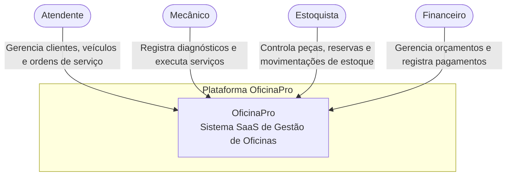
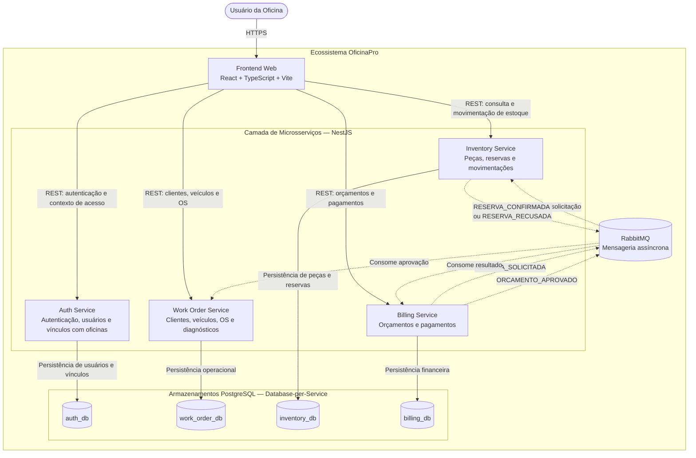

# C4 Model e Visão de Containers — OficinaPro

> **Documento histórico — não usar na entrega.** Este arquivo foi escrito para o modelo anterior do OficinaPro, com controle de estoque, reserva de peças e perfil de estoque, retirados do escopo pelo grupo em 13/11/2026. Ele não reflete os serviços, papéis e fluxos atuais. A versão vigente está em [`entrega/Projetos/OficinaPro/`](../../entrega/Projetos/OficinaPro/README.md) (Documento 06). Mantido apenas como registro do levantamento.

> **Documento oficial de trabalho — Grupo GarageOps**
>
> Este documento apresenta a arquitetura de software do OficinaPro utilizando o **C4 Model**, detalhando o contexto do sistema e a visão de containers, incluindo frontend, microsserviços, bancos de dados e mensageria.
>
> A arquitetura apresentada representa a proposta técnica para o MVP e permanece sujeita à validação do grupo e do professor, especialmente nos pontos relacionados à infraestrutura e à organização dos bancos de dados.

---

## 1. Nível 1: Diagrama de Contexto do Sistema (System Context)

O Diagrama de Contexto apresenta o OficinaPro em seu ambiente de utilização, identificando os atores humanos que interagem diretamente com a plataforma e suas principais responsabilidades.

O sistema será utilizado por diferentes perfis de acesso vinculados a uma oficina. Cada usuário deverá acessar somente as funcionalidades e informações permitidas pelas suas respectivas permissões.

### 1.1. Atores do sistema

| Ator | Responsabilidades principais |
|---|---|
| **Atendente** | Cadastro e gerenciamento de clientes, veículos e ordens de serviço. |
| **Mecânico** | Consulta ordens de serviço, registra diagnósticos e informa a execução dos serviços. |
| **Estoquista** | Gerenciamento de peças, consulta de disponibilidade e registro de movimentações de estoque. |
| **Financeiro** | Elaboração e gerenciamento de orçamentos, além do registro e acompanhamento de pagamentos. |

**Observação:** os perfis apresentados representam a proposta de organização das permissões do MVP. As permissões específicas de cada função deverão ser detalhadas e validadas pelo grupo.

---

## 2. Nível 2: Diagrama de Containers (Container Diagram)

O Diagrama de Containers apresenta os principais componentes executáveis e armazenamentos de dados que compõem o OficinaPro, bem como suas responsabilidades e formas de comunicação.

A proposta arquitetural utiliza uma abordagem baseada em **microsserviços**, com quatro serviços independentes desenvolvidos em NestJS:

- **Auth Service:** autenticação, usuários e vínculos com oficinas.
- **Work Order Service:** clientes, veículos, ordens de serviço e diagnósticos.
- **Inventory Service:** cadastro de peças, disponibilidade, reservas e movimentações de estoque.
- **Billing Service:** orçamentos, itens de orçamento e pagamentos.

O frontend será desenvolvido em React, utilizando APIs REST para comunicação com os serviços. A comunicação assíncrona entre os microsserviços será realizada por meio do RabbitMQ.

O modelo proposto é o **Database-per-Service**, no qual cada microsserviço possui responsabilidade exclusiva sobre seus próprios dados. Para o MVP, os bancos poderão ser implementados como bancos ou estruturas logicamente separados dentro de uma mesma instância PostgreSQL, sem exigir servidores físicos independentes.

### 2.1. Considerações sobre a comunicação

A comunicação entre os componentes será organizada da seguinte maneira:

**Comunicação síncrona — REST**

O frontend realizará requisições HTTP para os microsserviços, utilizando HTTPS na comunicação com a plataforma.

Cada serviço deverá validar a autenticação, as permissões e o contexto da oficina antes de executar operações sobre os dados.

A utilização de um API Gateway ou de comunicação direta do frontend com os microsserviços permanece como decisão técnica a ser validada pelo grupo.

**Comunicação assíncrona — RabbitMQ**

O RabbitMQ será utilizado para transmitir eventos entre os microsserviços, reduzindo o acoplamento entre suas operações.

O fluxo de aprovação de orçamento dependerá da confirmação da reserva de estoque:

1. Billing registra a aceitação do orçamento pelo cliente e solicita a reserva das peças.
2. Billing publica o evento `RESERVA_SOLICITADA`.
3. Inventory recebe a solicitação e verifica a disponibilidade das peças.
4. Inventory realiza a reserva integral ou registra a recusa, caso não exista quantidade suficiente.
5. Inventory publica `RESERVA_CONFIRMADA` ou `RESERVA_RECUSADA`.
6. Billing consome o resultado. Em caso de confirmação, efetiva a aprovação do orçamento e publica `ORCAMENTO_APROVADO`.
7. Work Order consome o evento e atualiza a situação da ordem de serviço, permitindo o início da execução conforme as regras de negócio.

**Importante:** a reserva não representa a baixa definitiva da peça. A baixa deverá ocorrer quando a peça for efetivamente utilizada, conforme as regras de movimentação do estoque.

---

## 3. Detalhamento Tecnológico dos Containers

| Container | Stack tecnológica | Responsabilidade principal |
|---|---|---|
| **Frontend** | React, TypeScript e Vite | Interface web responsiva para os usuários da oficina, permitindo acesso às funcionalidades conforme suas permissões. |
| **Auth Service** | Node.js, NestJS e PostgreSQL | Autenticação de usuários, emissão e validação de tokens JWT, gerenciamento de usuários, vínculos com oficinas e permissões de acesso. |
| **Work Order Service** | Node.js, NestJS e PostgreSQL | Gerenciamento de clientes, veículos, ordens de serviço, diagnósticos e acompanhamento da execução dos serviços. |
| **Inventory Service** | Node.js, NestJS e PostgreSQL | Gerenciamento de peças, controle de disponibilidade, reservas, movimentações de estoque, utilização, devoluções e estornos. |
| **Billing Service** | Node.js, NestJS e PostgreSQL | Gerenciamento de orçamentos, itens de orçamento, cálculo de valores e registro e acompanhamento de pagamentos. |
| **RabbitMQ** | RabbitMQ Broker | Comunicação assíncrona entre microsserviços por meio da publicação e do consumo de eventos. |

---

## 4. Diretrizes Arquiteturais Complementares

### 4.1. Multi-tenancy e isolamento de dados

O OficinaPro está sendo projetado como uma plataforma SaaS multi-tenant, na qual cada oficina representa um tenant independente.

Como proposta inicial, os registros pertencentes a uma oficina deverão possuir um identificador `tenant_id`, permitindo associar os dados ao respectivo ambiente de utilização.

O isolamento deverá ser garantido no backend, considerando:

- Validação do vínculo entre usuário e oficina.
- Verificação das permissões do usuário em cada operação.
- Restrição de consultas e alterações ao tenant autorizado.
- Inclusão do contexto do tenant nos eventos que envolvam dados de uma oficina.
- Impedimento de acesso cruzado entre oficinas.

A implementação definitiva do modelo de isolamento e a associação entre usuários, oficinas e perfis permanecem sujeitas à validação do grupo.

### 4.2. Independência dos bancos de dados

Cada microsserviço será responsável pela persistência e integridade de seus próprios dados.

A comunicação entre serviços deverá ocorrer por APIs REST ou eventos RabbitMQ, sem acesso direto às tabelas pertencentes a outro microsserviço.

Os relacionamentos entre entidades de serviços diferentes deverão utilizar identificadores de referência, como UUIDs, sem estabelecer chaves estrangeiras entre bancos independentes.

A utilização de uma mesma instância PostgreSQL para o MVP não elimina a separação lógica e a responsabilidade individual de cada serviço sobre seus dados.

### 4.3. Consistência e confiabilidade das operações

As operações que envolvem mais de um microsserviço deverão considerar possíveis falhas de comunicação e processamento.

Como propostas técnicas para garantir a confiabilidade, serão avaliados:

- Transações atômicas no Inventory Service para reservas integrais.
- Controle de concorrência para impedir reservas acima da quantidade disponível.
- Idempotência para impedir processamento duplicado.
- Transactional Outbox para publicação confiável de eventos.
- Inbox ou mecanismo equivalente para controle de mensagens processadas.
- Retentativas e Dead Letter Queue (DLQ) para tratamento de falhas.

Esses mecanismos deverão ser detalhados no DFD e na documentação técnica de comunicação entre os serviços.

---

## 5. Pontos Pendentes de Validação

Os seguintes pontos precisam ser discutidos pelo grupo antes de serem considerados decisões definitivas:

1. Confirmação da arquitetura com os quatro microsserviços.
2. Definição da comunicação entre frontend e backend: acesso direto às APIs ou utilização de API Gateway.
3. Definição da implementação do Database-per-Service: bancos separados ou estruturas logicamente isoladas em uma mesma instância PostgreSQL.
4. Confirmação do RabbitMQ como solução de mensageria.
5. Definição do modelo multi-tenant e das regras de isolamento por `tenant_id`.
6. Definição dos vínculos entre usuários, oficinas e perfis de acesso.
7. Validação do fluxo de reserva de estoque condicionado à aprovação definitiva do orçamento.
8. Definição dos eventos e contratos de comunicação entre os microsserviços.
9. Validação dos mecanismos de consistência, idempotência e recuperação de falhas.

---

**Última atualização:** 15/11/2026

**Responsável:** Product Owner — Grupo GarageOps

**Status:** Documento de trabalho sujeito à validação do grupo e do professor.