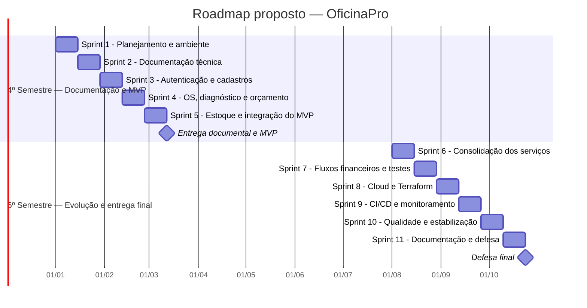

# Planejamento de Sprints e Tarefas

> **Documento histórico — não usar na entrega.** Esta versão (revisada em 16/11/2026) segue o modelo com controle de estoque, reserva de peças e Inventory Service. O grupo retirou o estoque do escopo em 13/11/2026 e, em 22/11/2026, adotou o MVP com os serviços `identity`, `customers` e `workorders`. A versão vigente está em [`entrega/Projetos/OficinaPro/`](../../entrega/Projetos/OficinaPro/README.md) (Documento 08). Mantido como registro do levantamento.

---

**Projeto:** OficinaPro  
**Grupo:** GarageOps  
**Curso:** Análise e Desenvolvimento de Sistemas — UniFAAT  
**Metodologia:** Scrum, com adaptações conforme a rotina e a capacidade do grupo  
**Duração sugerida da Sprint:** 2 semanas  
**Data de Início:** A definir conforme calendário acadêmico  
**Data de Término Prevista:** A definir conforme calendário acadêmico  
**Versão:** 1.0  
**Status:** Planejamento proposto, sujeito à validação do grupo e do professor orientador.

---

## 1. Objetivo

Este documento apresenta o planejamento de desenvolvimento do OficinaPro, organizado em sprints, com tarefas, prioridades, estimativas e critérios de conclusão.

O planejamento contempla as duas etapas acadêmicas do Projeto Experimental:

- **4º semestre:** elaboração e revisão dos oito documentos técnicos obrigatórios e desenvolvimento de um MVP funcional que demonstre o fluxo operacional principal do OficinaPro.
- **5º semestre:** evolução do sistema, implementação das funcionalidades previstas, implantação em nuvem, infraestrutura como código, testes automatizados, monitoramento e preparação para a defesa.

O planejamento é uma referência inicial. A quantidade de tarefas por sprint, as estimativas e os responsáveis deverão ser revisados pelo grupo conforme a disponibilidade dos integrantes, os resultados obtidos e as orientações do professor.

O objetivo não é apenas concluir tarefas isoladas, mas entregar incrementos funcionais e integrados do sistema.

---

## 2. Membros da Equipe e Papéis

Os integrantes abaixo foram identificados no README da pasta oficial do projeto. A distribuição de papéis técnicos ainda deverá ser confirmada pelo grupo.

| # | Nome | RA | Papel Principal | Papéis Secundários |
|---|---|---|---|---|
| 1 | Gabriel Carneiro da Silva | 6325300 | A definir pelo grupo | A definir |
| 2 | Thiago Marques Bueno | 6325304 | A definir pelo grupo | A definir |
| 3 | Matheus Gabriel Correa Braga Viana | 6325053 | A definir pelo grupo | A definir |
| 4 | Eloisa do Santos Brandão | 2325096 | A definir pelo grupo | A definir |

### 2.1 Papéis sugeridos para organização do trabalho

A equipe poderá distribuir as responsabilidades considerando as seguintes frentes:

| Frente | Responsabilidades |
|---|---|
| Gestão do produto e requisitos | Organização do backlog, priorização, critérios de aceite e alinhamento com o escopo. |
| Arquitetura e backend | Organização dos serviços, regras de negócio, APIs, banco de dados e integrações. |
| Frontend e experiência do usuário | Telas, navegação, formulários e integração com o backend. |
| DevOps e infraestrutura | Docker, CI/CD, Terraform, ambiente de nuvem e monitoramento. |
| Qualidade e testes | Planejamento de testes, validação dos fluxos, cobertura e revisão de código. |

Os papéis não representam cargos exclusivos. Um integrante poderá atuar em mais de uma frente, e as responsabilidades poderão ser compartilhadas.

**Status da distribuição:** pendente de confirmação pelo grupo.

---

## 3. Visão Geral do Cronograma

### 3.1 Roadmap por semestre

O roadmap abaixo organiza as entregas por etapas e sprints relativas. Não representa um calendário acadêmico com datas já confirmadas.

> **Observação:** as datas exibidas no diagrama são apenas referências técnicas para a visualização do encadeamento. Devem ser substituídas pelas datas reais do calendário acadêmico antes da aprovação do cronograma. A quantidade e a duração das sprints também poderão ser alteradas.

### 3.2 Entregas acadêmicas

| Etapa | Entrega esperada |
|---|---|
| 4º semestre | Oito documentos técnicos completos, revisados e organizados na pasta oficial do grupo. |
| 4º semestre | MVP funcional demonstrando o fluxo operacional principal do OficinaPro. |
| 5º semestre | Evolução das funcionalidades e integração dos microsserviços. |
| 5º semestre | Infraestrutura em nuvem provisionada por Terraform, conforme viabilidade e aprovação. |
| 5º semestre | Testes automatizados com cobertura mínima global de 60%. |
| 5º semestre | Monitoramento, documentação técnica e preparação para a defesa. |

---

## 4. Product Backlog Priorizado

### 4.1 Legenda de prioridade

- **P0 — Crítica:** tarefa bloqueadora ou indispensável para o funcionamento do fluxo principal.
- **P1 — Alta:** necessária para a entrega do MVP ou para atender requisito acadêmico.
- **P2 — Média:** necessária para a evolução e entrega final do projeto.
- **P3 — Baixa:** melhoria desejável ou funcionalidade que poderá ser postergada.

### 4.2 Legenda de estimativa

| Story Points | Referência |
|---|---|
| 1 | Trivial |
| 2 | Pequena |
| 3 | Média |
| 5 | Grande |
| 8 | Muito grande; avaliar divisão |
| 13 | Épico; deve ser decomposto |

As estimativas são iniciais e não representam horas exatas de trabalho. Devem ser revisadas pelo grupo após as primeiras sprints.

### 4.3 Backlog completo

| ID | Épico | Tarefa | Prioridade | SP | Responsável | Sprint | Status |
|---|---|---|---|---:|---|---|---|
| T-001 | Planejamento | Revisar escopo, requisitos e prioridades do MVP | P0 | 3 | A definir | S1 | Planejada |
| T-002 | Planejamento | Definir papéis, disponibilidade e capacidade da equipe | P1 | 2 | A definir | S1 | Planejada |
| T-003 | Setup | Organizar repositório, branches e estrutura de desenvolvimento | P0 | 3 | A definir | S1 | Planejada |
| T-004 | Setup | Preparar ambiente local com Docker Compose | P0 | 3 | A definir | S1 | Planejada |
| T-005 | Setup | Definir padrão de commits, PRs e revisão de código | P1 | 2 | A definir | S1 | Planejada |
| T-006 | Documentação | Revisar Documento de Solicitação do Sistema | P1 | 2 | A definir | S2 | Planejada |
| T-007 | Documentação | Revisar requisitos funcionais e não funcionais | P1 | 3 | A definir | S2 | Planejada |
| T-008 | Documentação | Revisar DFD e dicionário de dados | P1 | 3 | A definir | S2 | Planejada |
| T-009 | Documentação | Revisar Modelo Entidade-Relacionamento | P1 | 3 | A definir | S2 | Planejada |
| T-010 | Documentação | Revisar arquitetura em nuvem | P1 | 3 | A definir | S2 | Planejada |
| T-011 | Documentação | Revisar C4 Model | P1 | 3 | A definir | S2 | Planejada |
| T-012 | Documentação | Revisar Registro de Decisões Arquitetônicas | P1 | 3 | A definir | S2 | Planejada |
| T-013 | Documentação | Finalizar planejamento de sprints e tarefas | P1 | 2 | A definir | S2 | Planejada |
| T-014 | Autenticação | Implementar cadastro e autenticação de usuários | P0 | 8 | A definir | S3 | Planejada |
| T-015 | Autenticação | Implementar perfis e permissões de acesso | P0 | 5 | A definir | S3 | Planejada |
| T-016 | Multi-tenancy | Implementar isolamento dos dados por oficina | P0 | 8 | A definir | S3 | Planejada |
| T-017 | Clientes | Implementar cadastro e consulta de clientes | P0 | 5 | A definir | S3 | Planejada |
| T-018 | Veículos | Implementar cadastro e consulta de veículos | P0 | 5 | A definir | S3 | Planejada |
| T-019 | Frontend | Desenvolver telas de login e cadastros iniciais | P1 | 5 | A definir | S3 | Planejada |
| T-020 | Ordem de Serviço | Implementar abertura e consulta de OS | P0 | 5 | A definir | S4 | Planejada |
| T-021 | Diagnóstico | Implementar registro de diagnóstico técnico | P0 | 3 | A definir | S4 | Planejada |
| T-022 | Orçamento | Implementar composição e cálculo de orçamento | P0 | 8 | A definir | S4 | Planejada |
| T-023 | Orçamento | Registrar decisão do cliente e histórico de versões | P0 | 5 | A definir | S4 | Planejada |
| T-024 | Frontend | Desenvolver telas de OS, diagnóstico e orçamento | P1 | 8 | A definir | S4 | Planejada |
| T-025 | Inventory | Implementar cadastro de peças e entradas de estoque | P0 | 5 | A definir | S5 | Planejada |
| T-026 | Inventory | Implementar consulta de estoque físico, reservado e disponível | P0 | 5 | A definir | S5 | Planejada |
| T-027 | Inventory | Implementar reserva integral com controle de concorrência | P0 | 8 | A definir | S5 | Planejada |
| T-028 | Integração | Implementar comunicação entre serviços e processamento idempotente | P0 | 8 | A definir | S5 | Planejada |
| T-029 | Integração externa | Selecionar e implementar API externa relevante | P1 | 5 | A definir | S5 | Planejada |
| T-030 | MVP | Integrar o fluxo principal de ponta a ponta | P0 | 8 | A definir | S5 | Planejada |
| T-031 | Billing | Implementar cálculo financeiro e registro de pagamentos | P1 | 8 | A definir | S6 | Planejada |
| T-032 | Histórico | Implementar histórico de manutenção do veículo | P1 | 5 | A definir | S6 | Planejada |
| T-033 | Inventory | Implementar consumo, liberação e registro de perdas | P0 | 8 | A definir | S6 | Planejada |
| T-034 | Arquitetura | Consolidar limites e integração dos quatro serviços do MVP | P1 | 5 | A definir | S6 | Planejada |
| T-035 | Qualidade | Implementar testes unitários e de integração | P1 | 8 | A definir | S7 | Planejada |
| T-036 | Qualidade | Validar regras de negócio e critérios de aceite | P0 | 5 | A definir | S7 | Planejada |
| T-037 | Segurança | Revisar autenticação, autorização e isolamento por tenant | P0 | 5 | A definir | S7 | Planejada |
| T-038 | Qualidade | Atingir cobertura mínima global de 60% | P1 | 8 | A definir | S7 | Planejada |
| T-039 | DevOps | Preparar infraestrutura como código com Terraform | P1 | 8 | A definir | S8 | Planejada |
| T-040 | Cloud | Preparar recursos de nuvem AWS conforme arquitetura aprovada | P1 | 8 | A definir | S8 | Planejada |
| T-041 | Cloud | Configurar implantação dos serviços e banco de dados | P1 | 8 | A definir | S8 | Planejada |
| T-042 | CI/CD | Configurar pipeline de build, testes e validações | P1 | 5 | A definir | S9 | Planejada |
| T-043 | CI/CD | Automatizar processo de implantação após aprovação | P2 | 5 | A definir | S9 | Planejada |
| T-044 | Monitoramento | Configurar coleta de métricas e logs | P1 | 5 | A definir | S9 | Planejada |
| T-045 | Monitoramento | Criar dashboards e alertas operacionais | P2 | 5 | A definir | S9 | Planejada |
| T-046 | Qualidade | Executar testes de desempenho e estabilidade | P2 | 5 | A definir | S10 | Planejada |
| T-047 | Qualidade | Corrigir falhas e inconsistências identificadas | P1 | 8 | A definir | S10 | Planejada |
| T-048 | Documentação | Atualizar documentação técnica e instruções de execução | P1 | 3 | A definir | S10 | Planejada |
| T-049 | Entrega | Preparar demonstração integrada do sistema | P1 | 5 | A definir | S11 | Planejada |
| T-050 | Entrega | Revisar evidências, documentação e requisitos acadêmicos | P1 | 5 | A definir | S11 | Planejada |
| T-051 | Entrega | Preparar apresentação e defesa do projeto | P1 | 5 | A definir | S11 | Planejada |

**Observações sobre o backlog:**

1. Os responsáveis permanecem como “A definir” até a distribuição ser acordada pelos integrantes.
2. As tarefas são propostas de planejamento, não comprovação de execução.
3. A integração externa é obrigatória no contexto acadêmico, mas a escolha entre as alternativas disponíveis ainda precisa ser formalizada pelo grupo.
4. A implantação em nuvem depende da validação da arquitetura, da disponibilidade do ambiente acadêmico e da análise de custos.
5. Funcionalidades pós-MVP, como notificações avançadas, relatórios gerenciais e gestão de assinaturas SaaS, não foram incluídas como entregas obrigatórias deste planejamento inicial.

---

## 5. Detalhamento por Sprint

As sprints abaixo representam uma divisão inicial do trabalho. O grupo deverá selecionar as tarefas efetivamente executáveis em cada Sprint Planning, considerando dependências e capacidade.

### Sprint 1 — Planejamento e ambiente de desenvolvimento

| Informação | Detalhe |
|---|---|
| **Período** | A definir |
| **Duração sugerida** | 2 semanas |
| **Objetivo** | Organizar o trabalho, validar o escopo do MVP e preparar o ambiente de desenvolvimento. |
| **Capacidade** | A definir após avaliação da equipe. |

| ID | Tarefa | Responsável | SP | Critério de conclusão |
|---|---|---|---:|---|
| T-001 | Revisar escopo e prioridades | A definir | 3 | Backlog revisado e prioridades confirmadas. |
| T-002 | Definir papéis e disponibilidade | A definir | 2 | Divisão de responsabilidades acordada. |
| T-003 | Organizar repositório e branches | A definir | 3 | Estrutura e fluxo de contribuição documentados. |
| T-004 | Preparar Docker Compose | A definir | 3 | Ambiente local sobe e serviços essenciais são acessíveis. |
| T-005 | Definir padrões de contribuição | A definir | 2 | Padrões de commit, PR e revisão registrados. |

**Resultado esperado:** equipe alinhada, backlog organizado e ambiente local preparado.

### Sprint 2 — Documentação técnica

| Informação | Detalhe |
|---|---|
| **Período** | A definir |
| **Duração sugerida** | 2 semanas |
| **Objetivo** | Revisar e consolidar os oito documentos técnicos obrigatórios. |
| **Capacidade** | A definir após avaliação da equipe. |

| ID | Tarefa | Responsável | SP | Critério de conclusão |
|---|---|---|---:|---|
| T-006 | Solicitação do Sistema | A definir | 2 | Documento revisado conforme modelo oficial. |
| T-007 | Requisitos RF/RNF | A definir | 3 | Requisitos identificados, consistentes e rastreáveis. |
| T-008 | DFD | A definir | 3 | Diagramas e dicionário de dados revisados. |
| T-009 | MER | A definir | 3 | Entidades, atributos e relacionamentos documentados. |
| T-010 | Arquitetura em nuvem | A definir | 3 | Componentes e fluxos arquiteturais representados. |
| T-011 | C4 Model | A definir | 3 | Diagramas de contexto, contêineres e componentes revisados. |
| T-012 | ADR | A definir | 3 | Decisões e alternativas documentadas. |
| T-013 | Planejamento de sprints | A definir | 2 | Backlog e roadmap inicial consolidados. |

**Resultado esperado:** conjunto de oito documentos organizado, revisado e pronto para validação acadêmica.

### Sprint 3 — Autenticação, isolamento e cadastros

| Informação | Detalhe |
|---|---|
| **Período** | A definir |
| **Duração sugerida** | 2 semanas |
| **Objetivo** | Implementar a base de acesso e os cadastros fundamentais do OficinaPro. |
| **Capacidade** | A definir após avaliação da equipe. |

| ID | Tarefa | Responsável | SP | Critério de conclusão |
|---|---|---|---:|---|
| T-014 | Autenticação | A definir | 8 | Usuários conseguem autenticar com credenciais válidas. |
| T-015 | Perfis e permissões | A definir | 5 | Acesso controlado conforme perfil. |
| T-016 | Isolamento por tenant | A definir | 8 | Dados de oficinas distintas não são compartilhados indevidamente. |
| T-017 | Cadastro de clientes | A definir | 5 | Cadastro, consulta e validações funcionando. |
| T-018 | Cadastro de veículos | A definir | 5 | Veículos vinculados a clientes e oficinas corretas. |
| T-019 | Telas iniciais | A definir | 5 | Login e cadastros integrados ao backend. |

**Resultado esperado:** usuários autenticados conseguem acessar o sistema e realizar os cadastros iniciais com isolamento por oficina.

### Sprint 4 — Ordem de serviço, diagnóstico e orçamento

| Informação | Detalhe |
|---|---|
| **Período** | A definir |
| **Duração sugerida** | 2 semanas |
| **Objetivo** | Implementar o núcleo operacional do atendimento. |
| **Capacidade** | A definir após avaliação da equipe. |

| ID | Tarefa | Responsável | SP | Critério de conclusão |
|---|---|---|---:|---|
| T-020 | Abertura de OS | A definir | 5 | OS vinculada ao cliente e veículo corretos. |
| T-021 | Diagnóstico | A definir | 3 | Diagnóstico registrado e associado à OS. |
| T-022 | Orçamento | A definir | 8 | Serviços, peças e total calculados corretamente. |
| T-023 | Decisão do cliente | A definir | 5 | Aceitação ou recusa registrada com responsável e data. |
| T-024 | Telas operacionais | A definir | 8 | Telas de OS, diagnóstico e orçamento integradas. |

**Resultado esperado:** fluxo de atendimento consegue avançar de cadastro até a elaboração e decisão do orçamento.

### Sprint 5 — Estoque e integração do MVP

| Informação | Detalhe |
|---|---|
| **Período** | A definir |
| **Duração sugerida** | 2 semanas |
| **Objetivo** | Implementar o controle de estoque e integrar o fluxo principal do MVP. |
| **Capacidade** | A definir após avaliação da equipe. |

| ID | Tarefa | Responsável | SP | Critério de conclusão |
|---|---|---|---:|---|
| T-025 | Cadastro e entrada de peças | A definir | 5 | Peças e entradas registradas corretamente. |
| T-026 | Saldos de estoque | A definir | 5 | Estoque físico, reservado e disponível consultáveis. |
| T-027 | Reserva integral | A definir | 8 | Reserva total ou recusa integral, com concorrência controlada. |
| T-028 | Comunicação entre serviços | A definir | 8 | Eventos processados com idempotência e rastreabilidade. |
| T-029 | API externa | A definir | 5 | Integração escolhida documentada e validada. |
| T-030 | Integração do MVP | A definir | 8 | Fluxo principal executado de ponta a ponta. |

**Resultado esperado:** MVP funcional demonstrando o fluxo de atendimento, orçamento, aceitação, reserva integral e bloqueio da execução quando a reserva não for confirmada.

### Sprint 6 — Financeiro, histórico e consolidação dos serviços

| Informação | Detalhe |
|---|---|
| **Período** | A definir |
| **Duração sugerida** | 2 semanas |
| **Objetivo** | Completar os fluxos financeiros e de estoque, consolidando a separação de responsabilidades dos serviços. |
| **Capacidade** | A definir após avaliação da equipe. |

| ID | Tarefa | Responsável | SP | Critério de conclusão |
|---|---|---|---:|---|
| T-031 | Pagamentos e situação financeira | A definir | 8 | Pagamentos registrados e estados financeiros atualizados. |
| T-032 | Histórico de manutenção | A definir | 5 | Histórico consultável por veículo. |
| T-033 | Consumo e liberação de estoque | A definir | 8 | Reservas convertidas, liberadas ou registradas como perda corretamente. |
| T-034 | Consolidação dos serviços | A definir | 5 | Responsabilidades e integrações coerentes com a arquitetura. |

**Resultado esperado:** fluxo operacional e financeiro completo, sem confundir conclusão da OS com quitação financeira.

### Sprint 7 — Testes e segurança

| Informação | Detalhe |
|---|---|
| **Período** | A definir |
| **Duração sugerida** | 2 semanas |
| **Objetivo** | Validar o comportamento do sistema e reforçar a segurança. |
| **Capacidade** | A definir após avaliação da equipe. |

| ID | Tarefa | Responsável | SP | Critério de conclusão |
|---|---|---|---:|---|
| T-035 | Testes unitários e de integração | A definir | 8 | Testes automatizados executados com sucesso. |
| T-036 | Validação de regras de negócio | A definir | 5 | Critérios de aceite cobertos por testes ou evidências. |
| T-037 | Revisão de segurança | A definir | 5 | Autorização, autenticação e isolamento revisados. |
| T-038 | Cobertura global mínima | A definir | 8 | Relatório demonstra cobertura igual ou superior a 60%. |

**Resultado esperado:** sistema validado por testes, com segurança revisada e cobertura mínima exigida pelo projeto.

### Sprint 8 — Infraestrutura em nuvem e Terraform

| Informação | Detalhe |
|---|---|
| **Período** | A definir |
| **Duração sugerida** | 2 semanas |
| **Objetivo** | Preparar a infraestrutura em nuvem de acordo com a arquitetura aprovada. |
| **Capacidade** | A definir após avaliação da equipe. |

| ID | Tarefa | Responsável | SP | Critério de conclusão |
|---|---|---|---:|---|
| T-039 | Estrutura Terraform | A definir | 8 | Código de infraestrutura organizado e validado. |
| T-040 | Recursos AWS | A definir | 8 | Recursos necessários definidos e revisados quanto a custos. |
| T-041 | Implantação dos serviços | A definir | 8 | Aplicação e banco disponíveis no ambiente aprovado. |

**Resultado esperado:** infraestrutura documentada e preparada para implantação controlada, respeitando limites de custo e disponibilidade do ambiente acadêmico.

### Sprint 9 — CI/CD e monitoramento

| Informação | Detalhe |
|---|---|
| **Período** | A definir |
| **Duração sugerida** | 2 semanas |
| **Objetivo** | Automatizar validações e melhorar a observabilidade da aplicação. |
| **Capacidade** | A definir após avaliação da equipe. |

| ID | Tarefa | Responsável | SP | Critério de conclusão |
|---|---|---|---:|---|
| T-042 | Pipeline de CI | A definir | 5 | Build, testes e validações executados automaticamente. |
| T-043 | Processo de CD | A definir | 5 | Implantação automatizada com controles de aprovação. |
| T-044 | Métricas e logs | A definir | 5 | Métricas e logs relevantes disponíveis. |
| T-045 | Dashboards e alertas | A definir | 5 | Indicadores essenciais visualizados e alertas configurados. |

**Resultado esperado:** pipeline automatizado e monitoramento básico dos serviços e componentes críticos.

### Sprint 10 — Estabilização e documentação

| Informação | Detalhe |
|---|---|
| **Período** | A definir |
| **Duração sugerida** | 2 semanas |
| **Objetivo** | Corrigir problemas, validar o sistema integrado e atualizar a documentação. |
| **Capacidade** | A definir após avaliação da equipe. |

| ID | Tarefa | Responsável | SP | Critério de conclusão |
|---|---|---|---:|---|
| T-046 | Testes de desempenho | A definir | 5 | Resultados dos testes documentados. |
| T-047 | Correção de falhas | A definir | 8 | Falhas críticas identificadas corrigidas ou justificadas. |
| T-048 | Atualização documental | A definir | 3 | Documentação corresponde à implementação entregue. |

**Resultado esperado:** versão estável, documentação atualizada e principais riscos técnicos tratados.

### Sprint 11 — Preparação para entrega e defesa

| Informação | Detalhe |
|---|---|
| **Período** | A definir |
| **Duração sugerida** | 2 semanas |
| **Objetivo** | Consolidar evidências, demonstração e apresentação final. |
| **Capacidade** | A definir após avaliação da equipe. |

| ID | Tarefa | Responsável | SP | Critério de conclusão |
|---|---|---|---:|---|
| T-049 | Demonstração integrada | A definir | 5 | Demonstração reproduzível do fluxo principal. |
| T-050 | Revisão de evidências | A definir | 5 | Requisitos acadêmicos acompanhados de evidências. |
| T-051 | Preparação da defesa | A definir | 5 | Apresentação revisada e integrantes preparados. |

**Resultado esperado:** projeto organizado para avaliação, com demonstração funcional, documentação e evidências técnicas.

---

## 6. Cerimônias Ágeis

O grupo poderá utilizar cerimônias do Scrum adaptadas à disponibilidade dos integrantes.

| Cerimônia | Frequência | Duração sugerida | Registro |
|---|---|---|---|
| Sprint Planning | Início de cada sprint | 30 a 60 minutos | Ata com objetivo e tarefas selecionadas. |
| Daily ou alinhamento | 2 a 3 vezes por semana | 10 a 15 minutos | Atualização breve das atividades e impedimentos. |
| Sprint Review | Final de cada sprint | 30 a 60 minutos | Demonstração do incremento e feedback. |
| Sprint Retrospective | Final de cada sprint | 30 minutos | Pontos positivos, dificuldades e ações de melhoria. |

### 6.1 Informações mínimas a registrar

Em cada sprint, recomenda-se registrar:

- objetivo da sprint;
- tarefas selecionadas;
- responsáveis acordados;
- estimativas;
- tarefas concluídas;
- tarefas não concluídas e justificativas;
- impedimentos identificados;
- resultados demonstráveis;
- melhorias definidas para a próxima sprint.

---

## 7. Definition of Done (DoD) Global

Uma tarefa somente será considerada concluída quando atender aos critérios aplicáveis abaixo:

- [ ] A implementação atende ao objetivo e aos critérios de aceite.
- [ ] O código foi implementado e validado localmente.
- [ ] Os testes aplicáveis foram escritos e executados com sucesso.
- [ ] As regras de negócio relacionadas foram respeitadas.
- [ ] O isolamento por tenant foi preservado nas operações aplicáveis.
- [ ] Não existem credenciais ou segredos expostos no código ou nos logs.
- [ ] A revisão de código foi realizada por pelo menos outro integrante, quando aplicável.
- [ ] O pipeline de CI foi executado com sucesso, quando configurado.
- [ ] A documentação foi atualizada quando houve alteração de comportamento ou arquitetura.
- [ ] A alteração foi integrada à branch definida pelo grupo por meio do fluxo de revisão acordado.
- [ ] A entrega possui evidência verificável, como teste, demonstração, registro ou documentação.

### 7.1 Critérios específicos para funcionalidades de estoque

Além do DoD global, alterações relacionadas ao Inventory Service deverão respeitar:

- [ ] Reserva integral: todas as peças são reservadas ou nenhuma é reservada.
- [ ] Controle de concorrência para evitar reserva acima do saldo disponível.
- [ ] Idempotência para impedir processamento duplicado.
- [ ] Separação entre estoque físico, reservado e disponível.
- [ ] Consumo definitivo somente quando a peça for efetivamente utilizada.
- [ ] Liberação de reservas sem aumento indevido do estoque físico.
- [ ] Registro rastreável de consumo, liberação, perda e descarte.

---

## 8. Métricas de Acompanhamento

| Métrica | Como medir | Meta ou critério |
|---|---|---|
| Velocity | Story points concluídos por sprint | Observar a capacidade real após as primeiras sprints. |
| Burndown | Tarefas ou pontos restantes ao longo da sprint | Acompanhar a evolução e identificar atrasos. |
| Cobertura de testes | Relatório automatizado de cobertura | Mínimo de 60% global, conforme requisito do projeto. |
| Lead Time | Tempo entre início e conclusão de uma tarefa | Acompanhar tendência e identificar gargalos. |
| Taxa de conclusão | Tarefas concluídas em relação às selecionadas | Analisar ao final de cada sprint. |
| Falhas de integração | Erros identificados em APIs, eventos e consumidores | Registrar, corrigir e acompanhar recorrências. |
| Falhas de processamento | Mensagens com erro, retentativas e mensagens em DLQ | Monitorar os fluxos assíncronos relevantes. |

As metas de produtividade deverão ser definidas a partir de dados reais do grupo. Não será estabelecida uma velocidade artificial antes da obtenção de histórico de execução.

---

## 9. Ferramentas de Gestão

| Finalidade | Ferramenta prevista |
|---|---|
| Repositório | GitHub |
| Controle de versão | Git |
| Board de tarefas | GitHub Projects ou ferramenta acordada pelo grupo |
| Comunicação | Canal definido pelo grupo |
| Documentação | Markdown nos repositórios do projeto |
| Ambiente local | Docker e Docker Compose |
| Backend | Node.js, TypeScript e NestJS |
| Frontend | React, TypeScript e Vite |
| Banco de dados | PostgreSQL |
| Mensageria | RabbitMQ |
| Testes backend | Jest e Supertest |
| Testes frontend | React Testing Library |
| CI/CD | GitHub Actions |
| Infraestrutura como código | Terraform |
| Cloud | AWS |
| Monitoramento | Prometheus e Grafana, conforme arquitetura aprovada |

A escolha definitiva da ferramenta de gestão e comunicação deverá ser confirmada pelo grupo.

---

## 10. Riscos e Mitigações

| Risco | Probabilidade | Impacto | Mitigação |
|---|---|---|---|
| Indisponibilidade de integrantes | Média | Alto | Compartilhar conhecimento, documentar atividades e evitar dependência de uma única pessoa. |
| Atraso nas sprints | Média | Alto | Repriorizar backlog, dividir tarefas grandes e revisar capacidade da equipe. |
| Divergência entre documentação e implementação | Média | Alto | Atualizar documentos após decisões arquiteturais e alterações relevantes. |
| Falha de integração entre microsserviços | Média | Alto | Testes de contrato e integração, rastreabilidade e tratamento de falhas. |
| Reserva duplicada ou concorrente de estoque | Média | Alto | Transações, controle de concorrência, idempotência e testes específicos. |
| Indisponibilidade de API externa | Média | Médio | Tratamento de timeout e erro, validação de respostas e possibilidade de operação manual quando aplicável. |
| Custos de nuvem acima do previsto | Média | Alto | Revisar recursos e custos antes de provisionar, utilizar alertas e dimensionamento compatível com o projeto. |
| Limitações do ambiente acadêmico AWS | Média | Alto | Verificar permissões e serviços disponíveis antes de definir a implantação final. |
| Cobertura de testes abaixo do mínimo | Média | Alto | Desenvolver testes durante a implementação, evitando concentrar toda a atividade no final. |
| Perda ou inconsistência de dados | Baixa | Alto | Backups, migrations revisadas, validações e testes de recuperação. |
| Falha na entrega da documentação | Média | Alto | Manter checklist dos oito documentos e revisar os modelos oficiais antes da submissão. |

### 10.1 Dependências críticas

As seguintes dependências deverão ser acompanhadas durante o desenvolvimento:

1. O fluxo de orçamento depende da existência de clientes, veículos e ordens de serviço.
2. A aprovação operacional depende da confirmação da reserva integral pelo Inventory Service.
3. A execução depende da aprovação operacional do orçamento.
4. A conclusão da OS depende do registro adequado da execução e da utilização ou liberação das peças.
5. O histórico depende da preservação dos registros dos atendimentos.
6. O fechamento financeiro depende dos valores e pagamentos associados à OS.
7. A implantação em nuvem depende da validação da arquitetura, permissões e custos.

---

## 11. Histórico de Revisões

| Versão | Data | Autor | Descrição da alteração |
|---|---|---|---|
| 1.0 | 16/11/2026 | Grupo GarageOps — organização documental | Elaboração da proposta inicial de planejamento de sprints, backlog e critérios de acompanhamento. |

---

## 12. Aprovação

**Responsáveis pela validação:** Grupo GarageOps.

**Status:** Aguardando validação do grupo e do professor orientador.

**Distribuição dos papéis:** pendente de definição pelos integrantes.

**Calendário definitivo:** pendente de confirmação conforme calendário acadêmico.

**Aprovado por:**

___________________________________________________

Professor(a) Orientador(a)

**Data:** ____/____/________

---

**Observação final:** este documento representa um planejamento inicial. O status das tarefas deverá ser atualizado somente após a execução e validação das respectivas entregas. A existência de uma tarefa no backlog não significa que ela já foi iniciada ou concluída.
