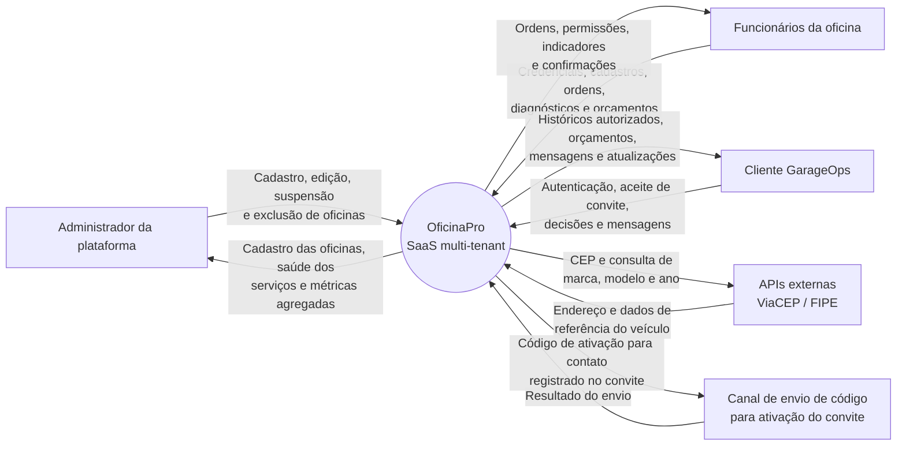
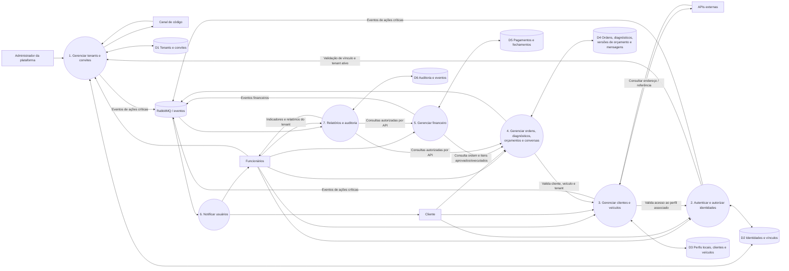
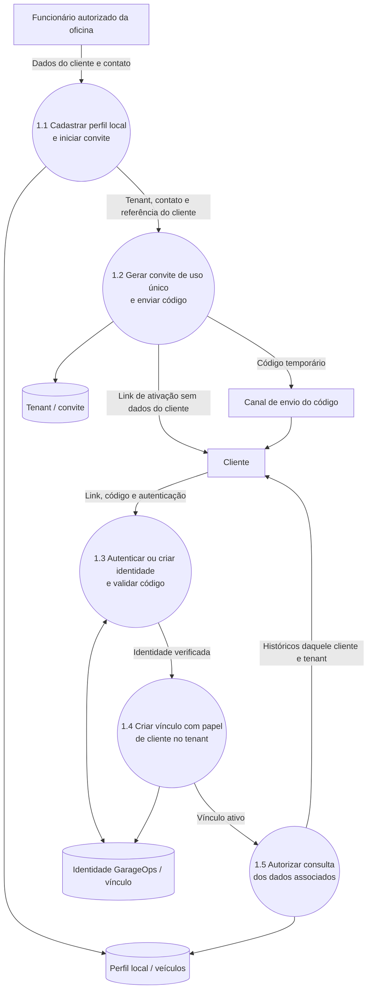
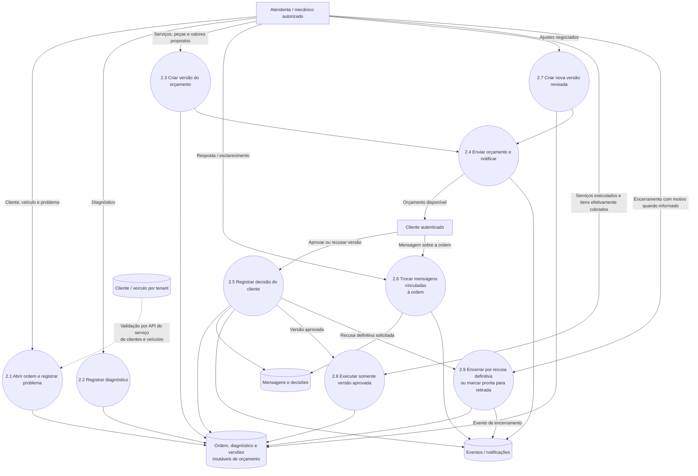

# Diagrama de Fluxo de Dados (DFD)

---

**Projeto:** OficinaPro — Plataforma SaaS Multi-Tenant para Gestão de Oficinas Mecânicas
**Grupo:** GarageOps
**Data:** 25/11/2026
**Versão:** 1.5 — atualizada conforme decisões do grupo

---

## 1. Objetivo e escopo

Este documento descreve a entrada, o processamento, o armazenamento e a saída dos dados do OficinaPro. O DFD parte dos requisitos do Documento 02 e detalha identidade global, vínculos por oficina, convite do cliente, histórico autorizado, ordem de serviço, versões de orçamento, conversa entre cliente e oficina, financeiro e notificações. O sistema não controla estoque; peças são itens informados manualmente no orçamento.

A identidade global GarageOps com vínculos independentes por oficina faz parte do escopo definido. A pessoa pode usar uma conta para acessar suas oficinas autorizadas; cada oficina mantém seus próprios dados operacionais. Um vínculo do cliente com uma oficina não dá à oficina acesso aos dados de outra.

Os processos são domínios funcionais. O DFD não afirma que cada processo já é um microsserviço separado; a divisão de serviços, interfaces e propriedade de dados será detalhada nos documentos de arquitetura e ADR.

## 2. Notação

| Símbolo | Significado |
|---|---|
| Retângulo | Entidade externa que troca dados com o sistema |
| Círculo | Processo que valida, transforma ou encaminha dados |
| Cilindro | Armazenamento de dados conceitual |
| Fila | Canal de eventos assíncronos |
| Seta | Fluxo identificado e descrito nos dicionários |

## 3. DFD nível 0 — contexto

O canal de envio de código está representado de forma genérica. O provedor, o custo e o mecanismo de envio precisam ser decididos antes da implementação; o código recebido não substitui a autenticação da conta.

O administrador da plataforma cadastra, edita, suspende e exclui oficinas e, por isso, conhece o cadastro delas (nome, identificador, identidade visual (cor) e situação (ativa ou suspensa)). Fora isso, o fluxo de administração limita-se à saúde global e a métricas agregadas; clientes, veículos, diagnósticos, ordens, orçamentos, valores, mensagens e pagamentos não são acessíveis por sua interface ou API. Na exclusão de uma oficina, cada serviço apaga os próprios dados sem devolvê-los ao console.

## 4. DFD nível 1 — processos e armazenamentos

O contexto do tenant é validado no servidor. O diagrama não representa acesso direto de um processo ao banco de outro microsserviço; consultas entre domínios ocorrem por interfaces (API) ou eventos. Relatórios e auditoria (processo 7) mantêm armazenamento próprio, alimentado por eventos, e consultam os demais domínios somente por API.

**Situação no MVP:** os processos 1 e 2 estão implementados no serviço `identity`; o processo 3, no serviço `customers`; os processos 4 e 5 (registro de pagamentos e saldo), no serviço `workorders`. A comunicação entre eles é síncrona por API interna. Os processos 6 e 7 e o uso de RabbitMQ estão planejados para o 5º semestre (Documento 07, ADR-003).

## 5. DFD nível 2 — convite e identidade global

Possuir o link não autentica a pessoa nem exibe dados. O convite precisa ser limitado no tempo, de uso único, revogável e associado ao contato registrado. A conta autenticada recebe somente um vínculo autorizado; não recebe acesso geral a todos os tenants.

## 6. DFD nível 2 — ordem, recusa, conversa e revisão de orçamento

Regras do fluxo: recusar uma versão não apaga a ordem nem autoriza execução. Uma revisão gera nova versão e preserva a anterior. O cliente precisa aprovar a versão vigente. Itens de peça no orçamento são informados manualmente e não geram controle de saldo ou movimentação de estoque. Se desistir definitivamente, a oficina encerra a ordem como recusada; essa ação é auditada e não pode gerar execução ou cobrança de serviço não autorizado.

## 7. Dicionário resumido de fluxos

| ID | Fluxo | Origem → destino | Conteúdo e regra principal |
|---|---|---|---|
| F-001 | Cadastro de tenant | Plataforma / representante → Tenant Service | Dados da oficina e identificação do tenant |
| F-002 | Credenciais | Usuário → Auth Service | Credenciais; nunca incluir senha em logs |
| F-003 | Identidade e tenant ativo | Auth Service → serviços | Identidade, vínculo, papel e tenant validado no servidor |
| F-004 | Convite | Oficina → cliente | Link de ativação sem acesso direto a dados |
| F-005 | Código de ativação | Canal de envio → cliente | Código temporário enviado ao contato registrado |
| F-006 | Aceite do convite | Cliente → Auth/Tenant Services | Autenticação, código validado e aceite explícito do vínculo |
| F-007 | Perfil e veículos | Oficina/cliente → Customer Vehicle Service | Dados limitados ao tenant e aos perfis autorizados |
| F-008 | Ordem e diagnóstico | Funcionário → Work Order Service | Problema relatado, veículo, diagnóstico e responsável |
| F-009 | Versão de orçamento | Oficina → Work Order Service → cliente | Itens, quantidades, valores, versão e estado de aprovação |
| F-010 | Decisão de orçamento | Cliente → Work Order Service | Aprovação/recusa, identidade, data/hora, versão e motivo quando informado |
| F-011 | Mensagem da ordem | Cliente / funcionário → Work Order Service | Texto, autor, data/hora e identificador da ordem |
| F-012 | Revisão de orçamento | Funcionário → Work Order Service → cliente | Nova versão; versões anteriores preservadas |
| F-013 | Item de peça no orçamento | Funcionário → Work Order Service | Descrição, quantidade e valores informados manualmente; sem consulta ou movimentação de estoque |
| F-014 | Encerramento por recusa | Funcionário autorizado → Work Order Service | Responsável, data/hora, motivo opcional; sem execução ou cobrança de serviço não autorizado |
| F-015 | Notificação | Notification Service → usuário | Aviso de orçamento, nova mensagem e mudança relevante |
| F-016 | Integração externa | Serviços de domínio ↔ API externa | Consulta de endereço pelo CEP (ViaCEP) ou de marca, modelo e ano do veículo (FIPE) |

## 8. Armazenamentos conceituais e responsáveis

| ID | Conteúdo conceitual | Responsabilidade prevista |
|---|---|---|
| D-001 | Tenants, convites e configuração da oficina | Tenant Service |
| D-002 | Identidades, credenciais e vínculos por tenant | Auth Service |
| D-003 | Perfis locais de cliente, veículos e histórico associado | Customer Vehicle Service |
| D-004 | Ordens, diagnósticos, versões de orçamento, decisões e mensagens | Work Order Service |
| D-005 | Fechamentos e pagamentos | Billing Service |
| D-006 | Auditoria e eventos operacionais | Audit Service |
| MQ-001 | Eventos assíncronos | RabbitMQ, conforme decisões de arquitetura |

Os armazenamentos são conceituais. O MER e o documento de arquitetura deverão definir entidades, propriedade e interfaces sem permitir acesso direto ao banco de outro serviço.

## 9. Histórico de revisões

| Versão | Data | Autor | Descrição |
|---|---|---|---|
| 1.0 | 24/09/2026 | Gabriel | Versão inicial do DFD SaaS multi-tenant |
| 1.1 | 09/11/2026 | Gabriel | Atualização proposta para identidade global, convites, acesso do cliente, conversa por ordem e revisão de orçamento; pendente validação do grupo |
| 1.2 | 13/11/2026 | Gabriel | Remoção de estoque interno, descrição de peças manuais no orçamento e restrição de acesso do administrador da plataforma ao conteúdo dos tenants |
| 1.3 | 20/11/2026 | Gabriel | Fluxos do administrador da plataforma: gestão do cadastro das oficinas, sem acesso ao conteúdo operacional |
| 1.4 | 21/11/2026 | Gabriel | Integrações externas limitadas a ViaCEP e FIPE; remoção da cobrança de teste do fluxo financeiro |
| 1.5 | 25/11/2026 | Eloisa (revisão) e Gabriel (validação) | Revisão de consistência: relatórios e auditoria sem leitura direta de armazenamentos de outros serviços; validação de cliente e veículo por API no nível 2; correspondência com os serviços do MVP |

---

**Aprovado por:**

___________________________________________________  
Professor(a) Orientador(a)

Data: ___/___/2026
