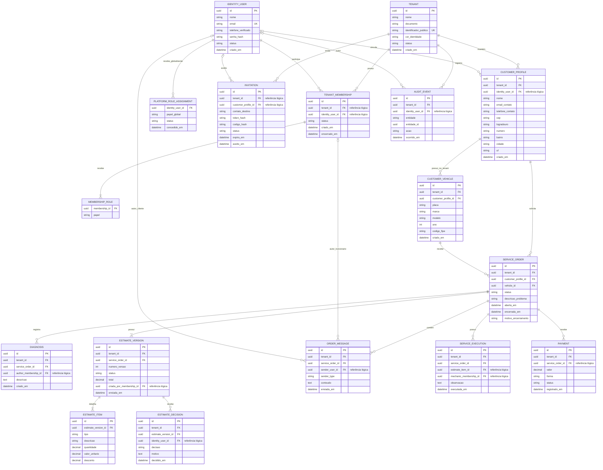

# Modelo Entidade-Relacionamento (MER)

---

**Projeto:** OficinaPro — Plataforma SaaS Multi-Tenant para Gestão de Oficinas
**Grupo:** GarageOps
**Data:** 26/11/2026
**Versão:** 1.6 — atualizada conforme decisões do grupo

---

## 1. Objetivo e limites do modelo

Este documento apresenta o modelo lógico dos principais dados necessários ao fluxo do OficinaPro: identidade GarageOps, vínculos com oficinas, convite de clientes, perfis locais, veículos, ordens, diagnósticos, versões de orçamento, decisões, conversa e financeiro. O MVP não mantém catálogo nem saldo de peças; linhas de peças são informadas manualmente em cada orçamento.

A identidade global GarageOps com vínculos independentes a várias oficinas faz parte do escopo definido. Os detalhes físicos do modelo ainda são uma proposta para revisão técnica. Os registros operacionais pertencem ao tenant que os criou; a identidade global não transforma dados de diferentes oficinas em um cadastro compartilhado.

O diagrama é lógico, não um esquema físico final. Os limites de microsserviço e a propriedade dos bancos são representados por domínio. O papel de administrador da plataforma é global e separado dos papéis de vínculo com uma oficina; ele permite manter o cadastro do TENANT, mas não concede leitura de dados operacionais dos tenants. Referências entre domínios indicam identificadores trocados por API/evento; não autorizam consultas diretas ao banco de outro serviço nem implicam chave estrangeira entre bancos independentes.

## 2. Justificativa do banco de dados

| Critério | Análise proposta |
|---|---|
| Tipo | Relacional (SQL) |
| Tecnologia prevista | PostgreSQL, conforme RNF-009 do Documento 02 |
| Dados | Estruturados e relacionais: tenant, identidade, papéis, clientes, veículos, ordens, versões de orçamento, itens, mensagens e pagamentos |
| Consistência | Restrições e transações são importantes para aprovações, versões e pagamentos; integrações entre microsserviços exigirão consistência por eventos/processos, não uma transação única entre bancos |
| Isolamento | `tenant_id` nos dados de negócio; vínculos e autorização validados pelo servidor; identificadores compostos podem reforçar a integridade dentro do tenant |
| Escalabilidade | Começar com PostgreSQL e índices alinhados às consultas por tenant; escala e particionamento só devem ser definidos com evidência de carga |

**Justificativa:**

O núcleo operacional do OficinaPro possui relações claras e regras que precisam ser preservadas: uma ordem pertence a uma oficina, usa um veículo cadastrado naquela oficina, referencia versões de orçamento, registra decisões do cliente e pode gerar pagamentos. Itens de peças são dados do orçamento, sem saldo ou movimentação de estoque. O PostgreSQL é adequado a esse perfil por oferecer transações, integridade referencial, índices e consultas relacionais.

A conta GarageOps é global, enquanto o perfil de cliente e os dados dos veículos/atendimentos são locais a cada tenant. Essa separação permite que uma pessoa entre uma vez e tenha vínculos autorizados com várias oficinas, sem compartilhar automaticamente os registros operacionais entre elas. Dados de um serviço não devem ser consultados diretamente pelo banco de outro serviço; a integração entre domínios deve ocorrer pelas interfaces documentadas.

## 3. Diagrama conceitual

As relações entre serviços são referências lógicas. A implantação pode usar bancos separados por serviço, conforme a arquitetura definida no Documento 07; por isso, nem toda referência abaixo será uma chave estrangeira física.

## 4. Dicionário de dados

### 4.1 Tenant e identidade — Tenant/Auth Services

| Entidade | Atributo | Tipo lógico | Regra / significado |
|---|---|---|---|
| TENANT | id | UUID | PK interna da oficina |
| TENANT | identificador_publico | VARCHAR | Único; usado para endereçamento amigável, não substitui autorização |
| TENANT | cor_identidade | VARCHAR(7) | Cor hexadecimal que diferencia a oficina na interface; definida pelo administrador da plataforma |
| TENANT | status | ENUM/VARCHAR | `active` ou `suspended`; oficina suspensa não aparece para seleção e não aceita novas sessões de trabalho |
| TENANT | documento, contato, endereço | VARCHAR | Mantidos pelo administrador da oficina; não são exibidos no console da plataforma |
| IDENTITY_USER | id | UUID | PK global da pessoa na plataforma |
| IDENTITY_USER | email | VARCHAR | Único após validação, se escolhido como identificador de login |
| IDENTITY_USER | telefone_verificado | VARCHAR | Contato confirmado; não armazenar códigos em texto puro |
| IDENTITY_USER | senha_hash | VARCHAR | Hash seguro; nunca armazenar senha em texto puro |
| TENANT_MEMBERSHIP | tenant_id, identity_user_id | UUID, UUID | Associação da pessoa à oficina; deve existir no máximo um vínculo ativo para a combinação |
| TENANT_MEMBERSHIP | status | ENUM/VARCHAR | `pending`, `active`, `revoked` ou `inactive`, conforme estados aprovados |
| MEMBERSHIP_ROLE | membership_id, papel | UUID, VARCHAR | Papéis autorizados naquele tenant; não são globais à pessoa |
| PLATFORM_ROLE_ASSIGNMENT | identity_user_id, papel_global | UUID, VARCHAR | Papel administrativo global, separado dos vínculos de oficina; permite manter o cadastro do TENANT, sem acesso ao conteúdo operacional dos tenants |
| INVITATION | token_hash, codigo_hash | VARCHAR | Persistir somente hashes dos segredos de ativação; uso limitado e revogável |

### 4.2 Perfil do cliente e veículos — Customer Vehicle Service

| Entidade | Atributo | Tipo lógico | Regra / significado |
|---|---|---|---|
| CUSTOMER_PROFILE | id | UUID | Perfil operacional do cliente dentro de um tenant |
| CUSTOMER_PROFILE | tenant_id | UUID | Obrigatório; compõe as consultas e restrições de isolamento |
| CUSTOMER_PROFILE | identity_user_id | UUID opcional | Referência lógica à identidade global após aceite do convite |
| CUSTOMER_PROFILE | cep, logradouro, numero, bairro, cidade, uf | VARCHAR | Endereço opcional; logradouro, bairro, cidade e UF podem vir do ViaCEP e sempre podem ser editados manualmente |
| CUSTOMER_VEHICLE | id | UUID | Identificador do veículo neste tenant |
| CUSTOMER_VEHICLE | customer_profile_id | UUID | Cliente proprietário/responsável no cadastro local |
| CUSTOMER_VEHICLE | placa, marca, modelo, ano | VARCHAR/INTEGER | Dados necessários ao atendimento; marca, modelo e ano vêm preferencialmente das listas da FIPE; placa única dentro do tenant (seção 6) |
| CUSTOMER_VEHICLE | codigo_fipe | VARCHAR opcional | Código do modelo na tabela FIPE quando escolhido pelas listas; vazio quando digitado manualmente |

O veículo e seu histórico são registros locais ao tenant. Uma mesma pessoa pode ter vínculos de cliente em oficinas diferentes; cada oficina mantém seu próprio perfil e seus próprios atendimentos.

### 4.3 Ordem, orçamento e conversa — Work Order Service

| Entidade | Atributo | Tipo lógico | Regra / significado |
|---|---|---|---|
| SERVICE_ORDER | id | UUID | Identificador da ordem |
| SERVICE_ORDER | tenant_id | UUID | Tenant proprietário; obrigatório em toda consulta e mutação |
| SERVICE_ORDER | customer_profile_id, vehicle_id | UUID | Referências locais; devem pertencer ao mesmo tenant |
| SERVICE_ORDER | status | VARCHAR/ENUM | `open`, `diagnosis`, `awaiting_approval`, `approved`, `in_progress`, `ready`, `closed` ou `closed_refused`, conforme transições de RF-013; recusa de orçamento não implica encerramento automático e `closed` exige quitação |
| SERVICE_ORDER | motivo_encerramento | TEXT opcional | Justificativa do encerramento definitivo por recusa, quando informada |
| DIAGNOSIS | service_order_id | UUID | Ordem à qual pertence o diagnóstico |
| ESTIMATE_VERSION | numero_versao | INTEGER | Sequencial por ordem; único em conjunto com a ordem |
| ESTIMATE_VERSION | status | VARCHAR/ENUM | `pending` (aguardando decisão), `approved`, `refused` ou `superseded` (substituída por versão mais nova antes da decisão) |
| ESTIMATE_ITEM | tipo | VARCHAR/ENUM | Serviço ou peça proposta |
| ESTIMATE_DECISION | decisao | VARCHAR/ENUM | Aprovação ou recusa de uma versão específica |
| ESTIMATE_DECISION | identity_user_id | UUID | Referência à identidade autenticada que decidiu |
| ORDER_MESSAGE | service_order_id | UUID | Toda mensagem pertence a uma ordem e a um tenant |
| ORDER_MESSAGE | sender_user_id, sender_type | UUID, VARCHAR | Identifica autor cliente ou membro da oficina |
| ORDER_MESSAGE | conteudo, enviada_em | TEXT, TIMESTAMP | Mensagem textual e instante de envio; edição/exclusão não deve apagar evidência da conversa |

Cada revisão é um novo registro de ESTIMATE_VERSION. A decisão aponta para a versão analisada. Assim, a versão recusada e suas mensagens permanecem no histórico, e apenas a versão vigente aprovada pode liberar a execução.

### 4.4 Execução e financeiro — Work Order / Billing Services

| Entidade | Atributo | Tipo lógico | Regra / significado |
|---|---|---|---|
| SERVICE_EXECUTION | estimate_item_id | UUID | Referência lógica ao item aprovado executado |
| PAYMENT | service_order_id | UUID | Referência à ordem do mesmo tenant, validada por interface do serviço responsável |
| AUDIT_EVENT | tenant_id, identity_user_id | UUID | Contexto do tenant e identidade que originou ação crítica |

## 5. Relacionamentos e cardinalidades

| Entidade de origem | Entidade de destino | Cardinalidade | Regra |
|---|---|---|---|
| IDENTITY_USER | TENANT_MEMBERSHIP | 1:N | Uma identidade pode ter vínculo com várias oficinas |
| TENANT | TENANT_MEMBERSHIP | 1:N | Uma oficina possui vários usuários vinculados |
| TENANT_MEMBERSHIP | MEMBERSHIP_ROLE | 1:N | Papéis são atribuídos dentro de um vínculo específico |
| IDENTITY_USER | PLATFORM_ROLE_ASSIGNMENT | 1:N | Papel de plataforma é global; não cria vínculo com oficina nem permissão sobre dados operacionais |
| TENANT | CUSTOMER_PROFILE | 1:N | Cada perfil local pertence a uma oficina |
| IDENTITY_USER | CUSTOMER_PROFILE | 0:N | Uma identidade pode estar associada a perfil de cliente em diferentes tenants |
| CUSTOMER_PROFILE | CUSTOMER_VEHICLE | 1:N | Veículos cadastrados no contexto daquele tenant |
| CUSTOMER_PROFILE / CUSTOMER_VEHICLE | SERVICE_ORDER | 1:N | Cliente e veículo devem pertencer ao tenant da ordem |
| SERVICE_ORDER | ESTIMATE_VERSION | 1:N | Cada revisão gera versão preservada |
| ESTIMATE_VERSION | ESTIMATE_ITEM | 1:N | Cada versão possui serviços e/ou peças propostos |
| ESTIMATE_VERSION | ESTIMATE_DECISION | 1:N | Decisões são vinculadas à versão e auditadas |
| SERVICE_ORDER | ORDER_MESSAGE | 1:N | Conversa preservada por ordem |
| SERVICE_ORDER | PAYMENT | 1:N | Ordem pode receber pagamentos parciais ou múltiplos |

## 6. Restrições e índices propostos

| Tabela/entidade | Restrição ou índice | Justificativa |
|---|---|---|
| TENANT | UNIQUE (`identificador_publico`) | Resolver oficina por identificador amigável |
| IDENTITY_USER | UNIQUE (`email`) após verificação | Evitar identidades duplicadas, se o e-mail for adotado como login |
| TENANT_MEMBERSHIP | UNIQUE parcial (`tenant_id`, `identity_user_id`) para vínculos ativos | Evitar vínculos ativos duplicados e permitir preservar vínculos revogados/inativos |
| PLATFORM_ROLE_ASSIGNMENT | UNIQUE (`identity_user_id`, `papel_global`) para concessões ativas | Evitar atribuição global duplicada e manter o papel separado da administração de oficina |
| CUSTOMER_PROFILE | INDEX (`tenant_id`, `identity_user_id`) | Localizar perfis autorizados da identidade por oficina |
| CUSTOMER_PROFILE | UNIQUE (`tenant_id`, `telefone`) | O telefone, gravado no formato canônico (somente dígitos, com código do país; ADR-014), identifica o cliente para o convite; a unicidade vale dentro da oficina, não entre oficinas, e não depende do formato digitado |
| CUSTOMER_VEHICLE | UNIQUE (`tenant_id`, `placa`) | A mesma placa pode existir em oficinas diferentes, mas não duas vezes na mesma oficina |
| CUSTOMER_VEHICLE | INDEX (`tenant_id`, `customer_profile_id`) | Consultas do cliente e do histórico dentro do tenant |
| SERVICE_ORDER | INDEX (`tenant_id`, `status`, `aberta_em`) | Filas operacionais da oficina |
| ESTIMATE_VERSION | UNIQUE (`service_order_id`, `numero_versao`) | Impedir versões repetidas na mesma ordem |
| ORDER_MESSAGE | INDEX (`tenant_id`, `service_order_id`, `enviada_em`) | Exibir a conversa da ordem em sequência |

Restrições compostas com `tenant_id` devem ser aplicadas onde forem compatíveis com o banco escolhido para garantir que referências operacionais permaneçam no mesmo tenant. Identificadores recebidos de outros serviços devem ser validados por contrato/API; não criar FK entre bancos de microsserviços.

## 7. Propriedade lógica por serviço

| Serviço | Dados sob sua responsabilidade | Integração com outros domínios |
|---|---|---|
| Tenant Service | TENANT, convites e configuração da oficina | Publica tenant e convite; coordena ativação |
| Auth Service | IDENTITY_USER, TENANT_MEMBERSHIP, MEMBERSHIP_ROLE, PLATFORM_ROLE_ASSIGNMENT e autenticação | Emite contexto autenticado; valida vínculo e papel; impede uso do papel global para autorizar dados de tenant |
| Customer Vehicle Service | CUSTOMER_PROFILE e CUSTOMER_VEHICLE | Recebe identidade autenticada e valida escopo do tenant |
| Work Order Service | SERVICE_ORDER, DIAGNOSIS, ESTIMATE_VERSION, ESTIMATE_ITEM, ESTIMATE_DECISION, ORDER_MESSAGE e SERVICE_EXECUTION | Gerencia execução e itens manuais de orçamento; integra com o financeiro por contratos/eventos |
| Billing Service | PAYMENT e fechamento financeiro | Consulta estado da ordem por interface/evento, sem acessar banco de ordens |
| Audit Service | AUDIT_EVENT | Recebe eventos dos serviços e preserva contexto de usuário e tenant |

Esta separação é lógica e deverá ser validada nos documentos de arquitetura e ADR. O DFD/MER não autoriza microsserviços como simples módulos com acesso irrestrito a tabelas compartilhadas.

## 8. Decisões ainda pendentes

1. Se uma pessoa pode acumular papéis internos na mesma oficina e como seleciona o contexto ativo.
2. Provedor e canal para entrega do código de ativação, considerando custo e disponibilidade para o MVP.
3. Identificador de login escolhido e procedimento de recuperação/alteração de telefone.
4. Limites de edição/exclusão de mensagens e política de retenção dos registros.

Resolvidas nesta versão: estados da ordem e das versões de orçamento (seção 4.3, alinhados ao RF-013 do Documento 02) e topologia física dos bancos (um banco lógico por serviço; ver seção 7.1 e Documento 07, ADR-002).

### 7.1 Correspondência com o esquema físico do MVP

No protótipo do MVP, as entidades lógicas estão implementadas em três bancos PostgreSQL, um por serviço (`identitydb`, `customersdb` e `workordersdb`). No ambiente local eles ficam em uma única instância PostgreSQL, com bancos lógicos separados e sem tabelas compartilhadas. Cada serviço cria e atualiza o próprio esquema.

| Entidade lógica | Tabela no MVP | Banco | Diferença em relação ao modelo lógico |
|---|---|---|---|
| TENANT | `tenants` | `identitydb` | Convites ficam em `invitations`, no mesmo banco |
| IDENTITY_USER e PLATFORM_ROLE_ASSIGNMENT | `users` (coluna `platform_role`) | `identitydb` | Papel de plataforma guardado como coluna, não como tabela própria |
| TENANT_MEMBERSHIP e MEMBERSHIP_ROLE | `memberships` (coluna `roles` como lista) | `identitydb` | Papéis do vínculo guardados como lista na própria linha; UNIQUE (`user_id`, `tenant_id`) |
| INVITATION | `invitations` | `identitydb` | Guarda apenas hashes do link e do código, tentativas e expiração |
| CUSTOMER_PROFILE | `customer_profiles` | `customersdb` | Inclui endereço preenchido pelo ViaCEP |
| CUSTOMER_VEHICLE | `vehicles` | `customersdb` | Inclui `fipe_code`; FK composta (`tenant_id`, `customer_id`) garante o mesmo tenant |
| SERVICE_ORDER e DIAGNOSIS | `orders` (coluna `diagnosis`) | `workordersdb` | Diagnóstico guardado na própria ordem |
| ESTIMATE_VERSION, ESTIMATE_ITEM e ESTIMATE_DECISION | `estimates`, `estimate_items`, `decisions` | `workordersdb` | Sem diferença relevante |
| ORDER_MESSAGE | `messages` | `workordersdb` | Sem diferença relevante |
| SERVICE_EXECUTION | `executions` | `workordersdb` | Sem diferença relevante |
| PAYMENT | `payments` | `workordersdb` | Fica no serviço de ordens até a separação do Billing Service (Documento 07, ADR-007) |
| AUDIT_EVENT | — | — | Ainda não implementado; previsto para o 5º semestre |

As diferenças são simplificações do protótipo. A tabela acima deve ser atualizada quando as migrations versionadas (RNF-013) forem criadas.

## 9. Histórico de revisões

| Versão | Data | Autor | Descrição |
|---|---|---|---|
| 1.0 | 09/11/2026 | Gabriel | Primeira proposta de modelo de dados baseada nos documentos 02 e 03; pendente validação do grupo |
| 1.1 | 13/11/2026 | Gabriel | Remoção das entidades de estoque e alinhamento à confidencialidade entre plataforma e dados operacionais dos tenants |
| 1.2 | 13/11/2026 | Gabriel | Separação do papel global de administrador da plataforma dos papéis por oficina, sem autorização para ler dados de negócio dos tenants |
| 1.3 | 20/11/2026 | Gabriel | Papel de plataforma passa a manter o cadastro do TENANT, sem acesso aos dados operacionais; inclusão de cor de identificação e estados `active`/`suspended` do TENANT |
| 1.4 | 21/11/2026 | Gabriel | Endereço do cliente (ViaCEP) e código FIPE do veículo |
| 1.5 | 25/11/2026 | Eloisa (revisão) e Gabriel (validação) | Estados da ordem e das versões de orçamento definidos; unicidade de telefone e placa por tenant; correspondência com o esquema físico do MVP (seção 7.1); pendências resolvidas removidas |
| 1.6 | 26/11/2026 | Eloisa (revisão) e Gabriel (validação) | Telefone gravado e comparado no formato canônico (ADR-014) |

---

**Aprovado por:**

___________________________________________________
Professor(a) Orientador(a)

Data: ___/___/2026
