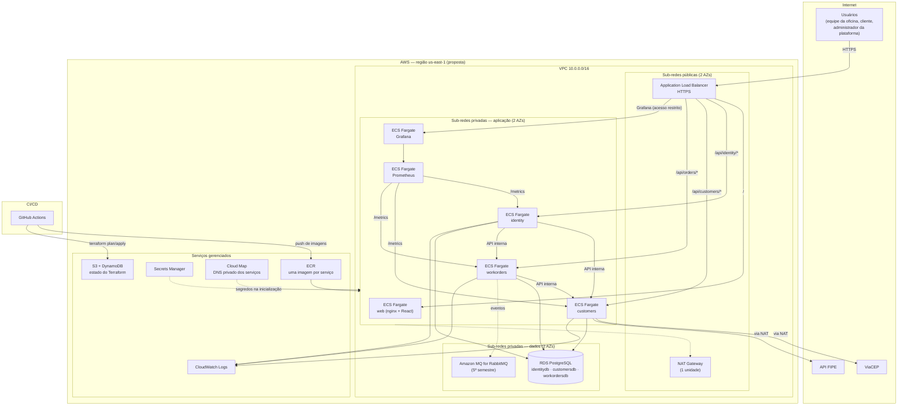

# Desenho de Arquitetura em Nuvem

---

**Projeto:** OficinaPro — Plataforma SaaS Multi-Tenant para Gestão de Oficinas Mecânicas
**Grupo:** GarageOps
**Provedor de Nuvem:** AWS
**Data:** 25/11/2026
**Versão:** 1.0 — proposta para validação do grupo e do orientador

---

## 1. Objetivo

Este documento apresenta o desenho da arquitetura em nuvem do OficinaPro na AWS, com os serviços, redes, recursos e integrações previstos para o ambiente de demonstração. Toda a infraestrutura será provisionada com **Terraform**, conforme RNF-020 e RNF-021 do Documento 02.

**Situação atual:** o deploy em nuvem é entrega do 5º semestre (Documento 01, seção 5.1). No 4º semestre, o MVP roda localmente com Docker Compose: três microsserviços NestJS (`identity`, `customers` e `workorders`), uma instância PostgreSQL com três bancos lógicos e um contêiner `web` (nginx) que serve a interface React e encaminha as rotas `/api/*`. Este documento descreve como essa mesma topologia será levada para a AWS. Nenhum recurso AWS foi criado até esta versão.

Princípios do desenho:

- **Mesmas imagens no local e na nuvem.** A imagem Docker de cada serviço é a mesma usada no Docker Compose, o que mantém a contingência local da banca (RNF-023).
- **Um serviço implantável por domínio**, com banco próprio e sem acesso ao banco de outro serviço (RNF-006).
- **Custo compatível com o projeto acadêmico**: instâncias pequenas, uma única zona para o banco e ambiente ligado apenas nos períodos de uso (seção 6).
- **Isolamento entre oficinas** garantido pela aplicação (tenant obtido do token no servidor) e reforçado por segredos e credenciais separados por serviço.

---

## 2. Visão Geral da Arquitetura



**Leitura do diagrama:**

- O **ALB** é a única entrada pública. Ele reproduz as regras do nginx local: `/api/identity/*`, `/api/customers/*` e `/api/orders/*` vão para o serviço correspondente, e o restante vai para o contêiner `web`. Qualquer caminho `/api/*/internal/*` recebe resposta fixa 404 no ALB, como já ocorre no nginx do MVP.
- As **chamadas internas** entre serviços (por exemplo, `identity` consultando `customers` na ativação de convite) usam o DNS privado do Cloud Map e um segredo de serviço, sem passar pelo ALB.
- O **RDS** fica em sub-rede privada, sem acesso público. Cada serviço acessa somente o próprio banco, com usuário próprio.
- **Amazon MQ** só será criado quando o primeiro fluxo assíncrono for implementado (Documento 07, ADR-003). Até lá, a comunicação é síncrona.
- **Prometheus e Grafana** ficam na rede privada. Somente o Grafana é exposto, por regra do ALB restrita e com autenticação.

---

## 3. Inventário de Recursos Cloud

### 3.1 Computação

| Recurso | Serviço | Configuração | Finalidade |
|---------|---------|--------------|------------|
| identity | ECS Fargate (Linux/x86) | 0,25 vCPU, 0,5 GB, 1 tarefa | Login, emissão de token, oficinas, vínculos, equipe, convites e console da plataforma |
| customers | ECS Fargate (Linux/x86) | 0,25 vCPU, 0,5 GB, 1 tarefa | Clientes, veículos, histórico e integrações ViaCEP e FIPE |
| workorders | ECS Fargate (Linux/x86) | 0,25 vCPU, 0,5 GB, 1 tarefa | Ordens, diagnóstico, orçamentos versionados, decisões, conversa, execução e pagamentos |
| web | ECS Fargate (Linux/x86) | 0,25 vCPU, 0,5 GB, 1 tarefa | nginx servindo a interface React compilada |
| prometheus | ECS Fargate (Linux/x86) | 0,5 vCPU, 1 GB, 1 tarefa | Coleta de métricas dos serviços |
| grafana | ECS Fargate (Linux/x86) | 0,25 vCPU, 0,5 GB, 1 tarefa | Dashboards e alertas |

Os tamanhos são o mínimo do Fargate e devem ser revistos com as métricas da demonstração. Os serviços Billing, Notification, Reporting e Audit, quando separados (Documento 07, ADR-007), seguirão o mesmo padrão: uma imagem, um serviço ECS e um banco lógico próprio.

### 3.2 Banco de Dados e Cache

| Recurso | Serviço | Configuração | Finalidade |
|---------|---------|--------------|------------|
| Banco principal | Amazon RDS for PostgreSQL 16 | db.t4g.micro, Single-AZ, 20 GB gp3, backups automáticos de 7 dias, criptografia em repouso | Três bancos lógicos (`identitydb`, `customersdb`, `workordersdb`), um por serviço, cada um com usuário próprio |
| Cache | Não utilizado | — | O MVP não precisa de cache distribuído. O cache de 24 horas da FIPE fica em memória no serviço `customers`. A necessidade de ElastiCache só será avaliada com evidência de carga |

Uma instância RDS com bancos lógicos separados mantém o padrão *database-per-service* (cada serviço é dono do seu banco e não acessa o de outro) com o custo de uma única instância. Separar em instâncias distintas é uma evolução possível, registrada no ADR-002.

### 3.3 Rede

| Recurso | Configuração | Finalidade |
|---------|--------------|------------|
| VPC | 10.0.0.0/16 | Isolamento de rede do ambiente |
| Subnets Públicas | 2, uma em cada AZ (us-east-1a e us-east-1b) | ALB e NAT Gateway |
| Subnets Privadas — aplicação | 2, uma em cada AZ | Tarefas ECS Fargate |
| Subnets Privadas — dados | 2, uma em cada AZ (exigência do grupo de sub-redes do RDS) | RDS e Amazon MQ |
| Security Groups | Ver seção 4.2 | Liberar somente o tráfego necessário entre camadas |
| Load Balancer | Application Load Balancer com certificado do ACM | Entrada HTTPS única e roteamento por caminho |
| NAT Gateway | 1 unidade, em uma AZ | Saída para ViaCEP, FIPE e serviços AWS a partir das sub-redes privadas |

Usar um único NAT Gateway reduz custo. Se a AZ dele falhar, as tarefas perdem acesso de saída à internet. Esse risco é aceito para o ambiente de demonstração.

### 3.4 Mensageria e Eventos

| Recurso | Serviço | Finalidade |
|---------|---------|------------|
| Broker de mensagens | Amazon MQ for RabbitMQ, mq.t3.micro, instância única (proposta) | Eventos assíncronos entre serviços (RNF-008), como notificações e auditoria. Criado apenas quando o primeiro fluxo assíncrono existir |

No ambiente local, o RabbitMQ será um contêiner no Docker Compose (RNF-016). A escolha entre Amazon MQ e RabbitMQ em contêiner na AWS está pendente (seção 7 e Documento 07, ADR-003).

### 3.5 Armazenamento

| Recurso | Serviço | Finalidade |
|---------|---------|------------|
| Estado do Terraform | S3 (versionado e criptografado) + tabela DynamoDB para lock | Estado remoto compartilhado pela equipe e pelo pipeline |
| Imagens | ECR | Imagens Docker dos serviços |
| Arquivos da interface | Dentro da imagem `web` | A interface compilada é servida pelo nginx; não há upload de arquivos no escopo atual |

### 3.6 Monitoramento e Observabilidade

| Recurso | Serviço | Finalidade |
|---------|---------|------------|
| Métricas | Prometheus (contêiner no ECS Fargate) | Coleta de requisições, erros e latência pelo endpoint `/metrics` de cada serviço (RNF-038) |
| Dashboards | Grafana (contêiner no ECS Fargate) | Visualização e alertas durante a demonstração (RNF-039), sem dados de clientes ou conteúdo das oficinas |
| Logs | CloudWatch Logs, retenção de 7 dias | Logs estruturados dos serviços (RNF-040, RNF-041), sem senhas, tokens ou dados pessoais |
| Saúde | Health check do ALB em cada serviço | Substituir tarefas que não respondem (RNF-037) |

Os endpoints `/metrics` ainda não existem no MVP e precisam ser implementados no 5º semestre (critério C8). O Prometheus encontra as tarefas pelo DNS privado do Cloud Map. Como a tarefa do Prometheus usa armazenamento efêmero, o histórico de métricas é perdido quando ela é reiniciada; isso é aceitável para a demonstração.

### 3.7 CI/CD e Registry

| Recurso | Serviço | Finalidade |
|---------|---------|------------|
| Pipeline | GitHub Actions | Build, lint, testes com cobertura, publicação de imagens, `terraform plan/apply` e atualização dos serviços ECS |
| Container Registry | Amazon ECR | Um repositório por serviço; imagens identificadas pelo hash do commit |
| Autenticação na AWS | OIDC do GitHub com papel IAM de permissão mínima (proposta) | Evitar chaves de acesso permanentes nos segredos do repositório |

---

## 4. Estratégia de Rede e Segurança

### 4.1 Diagrama de Rede

```
VPC: 10.0.0.0/16 (us-east-1)
├── Public Subnet A (10.0.1.0/24) - us-east-1a
│   ├── ALB
│   └── NAT Gateway
├── Public Subnet B (10.0.2.0/24) - us-east-1b
│   └── ALB
├── Private Subnet App A (10.0.10.0/24) - us-east-1a
│   └── Tarefas ECS (web, identity, customers, workorders, prometheus, grafana)
├── Private Subnet App B (10.0.11.0/24) - us-east-1b
│   └── Tarefas ECS (réplicas, quando houver mais de uma)
├── Private Subnet Data A (10.0.20.0/24) - us-east-1a
│   ├── RDS PostgreSQL (Single-AZ)
│   └── Amazon MQ (5º semestre)
└── Private Subnet Data B (10.0.21.0/24) - us-east-1b
    └── Reservada para o grupo de sub-redes do RDS (Multi-AZ futuro)
```

### 4.2 Security Groups

| Nome | Porta(s) | Origem | Destino | Finalidade |
|------|----------|--------|---------|------------|
| sg-alb | 443 (80 redireciona para 443) | 0.0.0.0/0 | ALB | Tráfego público HTTPS |
| sg-web | 80 | sg-alb | Contêiner `web` | Interface |
| sg-services | 3001, 3002, 3003 | sg-alb e sg-services | Contêineres `identity`, `customers` e `workorders` | Chamadas da interface (via ALB) e chamadas internas entre serviços |
| sg-db | 5432 | sg-services | RDS | Acesso ao banco somente pelos serviços |
| sg-mq | 5671 (AMQPS) | sg-services | Amazon MQ | Publicação e consumo de eventos (5º semestre) |
| sg-monitoring | 9090 (Prometheus), 3000 (Grafana) | 9090: somente sg-monitoring; 3000: sg-alb | Prometheus e Grafana | Prometheus sem exposição pública; Grafana somente via ALB, com regra restrita e login |
| sg-scrape | 3001, 3002, 3003 | sg-monitoring | Serviços | Coleta de `/metrics` |

### 4.3 Segredos, identidades e proteção de dados

- **Segredos no Secrets Manager:** `JWT_SECRET` (usado somente pelo `identity` para emitir tokens e pelos demais para verificá-los), `SERVICE_SECRET` (chamadas internas) e uma senha por usuário de banco. As tarefas recebem os segredos na inicialização; nenhum segredo fica no repositório, na imagem ou nas variáveis do Terraform em texto puro.
- **Um usuário de banco por serviço**, com permissão apenas no próprio banco. No ambiente local do MVP os três serviços usam o mesmo usuário (`oficina`); na nuvem isso não se repete.
- **Papéis IAM por tarefa:** cada serviço tem um *task role* com o mínimo necessário (por exemplo, leitura apenas dos próprios segredos).
- **Criptografia:** HTTPS no ALB (certificado do ACM), criptografia em repouso no RDS, no S3 do estado do Terraform e nos logs.
- **Isolamento entre oficinas:** é garantido pela aplicação (tenant obtido do token verificado, nunca do navegador; RNF-003 e RNF-004). A infraestrutura não cria recursos por oficina (RNF-022).
- **Administrador da plataforma:** o acesso operacional à conta AWS (console, RDS) é técnico e não faz parte do produto. As credenciais de infraestrutura devem ficar restritas aos integrantes responsáveis e não podem virar caminho informal de leitura dos dados das oficinas (RNF-049).

---

## 5. Infraestrutura como Código (Terraform)

### 5.1 Estrutura dos Módulos

```
infra/terraform/
├── main.tf
├── variables.tf
├── outputs.tf
├── providers.tf
├── backend.tf
├── modules/
│   ├── networking/      # VPC, sub-redes, rotas, NAT, security groups
│   ├── compute/         # Cluster ECS, task definitions, serviços, Cloud Map, regras do ALB
│   ├── database/        # RDS PostgreSQL, grupo de sub-redes, parâmetros
│   ├── secrets/         # Segredos do Secrets Manager (valores gerados, nunca versionados)
│   ├── monitoring/      # Prometheus, Grafana, grupos de logs do CloudWatch
│   ├── messaging/       # Amazon MQ (habilitado por variável no 5º semestre)
│   └── registry/        # Repositórios ECR
└── environments/
    └── demo/
        └── terraform.tfvars
```

Um único ambiente (`demo`) atende ao escopo acadêmico. Os bancos lógicos e os usuários de cada serviço são criados por script de inicialização versionado, executado pelo pipeline, e não manualmente.

### 5.2 State Management

| Item | Configuração |
|------|--------------|
| Backend | S3 com versionamento e criptografia + tabela DynamoDB para lock |
| State File | `s3://<bucket-do-grupo>/oficinapro/demo/terraform.tfstate` (nome do bucket definido na criação da conta) |
| Lock | Tabela DynamoDB `terraform-locks` |

O bucket e a tabela de lock são os únicos recursos criados antes do restante, por um módulo de *bootstrap* também versionado.

### 5.3 Pipeline de infraestrutura e aplicação

| Gatilho | Workflow | Etapas |
|---|---|---|
| Pull Request | `ci.yml` | Instalação, lint, build, testes unitários e de integração, relatório de cobertura global com limite de 60% (RNF-024, RNF-025, RNF-028) e `terraform fmt/validate/plan` quando houver mudança em `infra/` |
| Merge na branch principal | `deploy.yml` | Build das imagens, push para o ECR com a tag do commit, `terraform apply` aprovado e atualização dos serviços ECS (RNF-026) |

Nenhum workflow existe ainda no repositório do sistema. A criação deles está planejada no Documento 08.

---

## 6. Estimativa de Custos

Estimativa de referência com preços públicos sob demanda da região us-east-1, consultados em 25/11/2026, para o ambiente ligado 24 horas por dia (730 horas por mês). Não inclui impostos, transferência de dados e cobranças por uso variável (LCU do ALB, dados processados pelo NAT, requisições ao CloudWatch). **Deve ser confirmada no [AWS Pricing Calculator](https://calculator.aws/) antes do provisionamento.**

| Recurso | Serviço | Estimativa Mensal (USD) |
|---------|---------|------------------------|
| Computação | ECS Fargate: 5 tarefas de 0,25 vCPU/0,5 GB e 1 de 0,5 vCPU/1 GB (US$ 0,04048 por vCPU-hora e US$ 0,004445 por GB-hora) | ≈ 63,10 |
| Banco de Dados | RDS PostgreSQL db.t4g.micro Single-AZ (≈ US$ 0,016/hora) | ≈ 11,70 + armazenamento e backup |
| Rede | ALB (US$ 0,0225/hora) e NAT Gateway (US$ 0,045/hora), sem uso variável | ≈ 49,30 |
| Rede | Endereços IPv4 públicos (ALB em 2 AZs + NAT; US$ 0,005/hora cada) | ≈ 10,95 |
| Mensageria | Amazon MQ for RabbitMQ mq.t3.micro, instância única (≈ US$ 0,034/hora), somente no 5º semestre | ≈ 24,80 |
| Armazenamento | S3 do estado do Terraform e ECR | Valor baixo; a confirmar no Pricing Calculator |
| Monitoramento | Prometheus e Grafana incluídos em Computação; CloudWatch Logs e Secrets Manager por uso | A confirmar no Pricing Calculator |
| **Total Estimado** | | **≈ 160 por mês, ligado 24 h** |

**Estratégia de controle de custo:**

1. **Ligar o ambiente apenas quando for usado** (testes de integração, encontros com o orientador e banca). O Terraform permite criar e destruir o ambiente de forma reproduzível, e o banco pode ser recriado a partir das migrations e dos dados fictícios. Com cerca de 60 horas por mês, o custo de computação, rede e mensageria cai proporcionalmente.
2. **Alertas de orçamento** do AWS Budgets, criados pelo próprio Terraform.
3. **Verificar créditos acadêmicos ou free tier** disponíveis para a conta usada pelo grupo (pendência da seção 7).

Fontes dos preços: páginas oficiais de preço da AWS para Fargate, Elastic Load Balancing e VPC (NAT Gateway e IPv4 público); preço do db.t4g.micro em us-east-1 conforme comparadores públicos de preço do RDS; preço do mq.t3.micro conforme análise pública de custos do Amazon MQ. Os valores podem mudar e precisam ser conferidos na calculadora oficial.

---

## 7. Pontos pendentes de validação

| Tema | Proposta deste documento | Quem decide |
|---|---|---|
| Conta AWS usada no 5º semestre | Conta do grupo com créditos acadêmicos ou free tier. Se for AWS Academy, conferir se permite OIDC, Amazon MQ e criação de papéis IAM | Grupo, com o orientador |
| Região | us-east-1, por custo e disponibilidade de serviços (o RDS db.t4g.micro custa cerca do dobro em sa-east-1) | Grupo |
| Broker na nuvem | Amazon MQ for RabbitMQ (gerenciado) ou RabbitMQ em contêiner no ECS | Grupo (Documento 07, ADR-003) |
| Domínio e certificado | Domínio próprio com certificado do ACM, ou somente o endereço do ALB na demonstração | Grupo |

---

## 8. Histórico de Revisões

| Versão | Data | Autor | Descrição da Alteração |
|--------|------|-------|------------------------|
| 1.0 | 25/11/2026 | Eloisa (revisão) e Gabriel (validação) | Versão inicial: topologia AWS com ECS Fargate para os três serviços do MVP, RDS PostgreSQL com banco lógico por serviço, rede, segurança, Terraform, CI/CD, monitoramento e estimativa de custos |

---

**Aprovado por:**

___________________________________________________
Professor(a) Orientador(a)

Data: ___/___/2026
