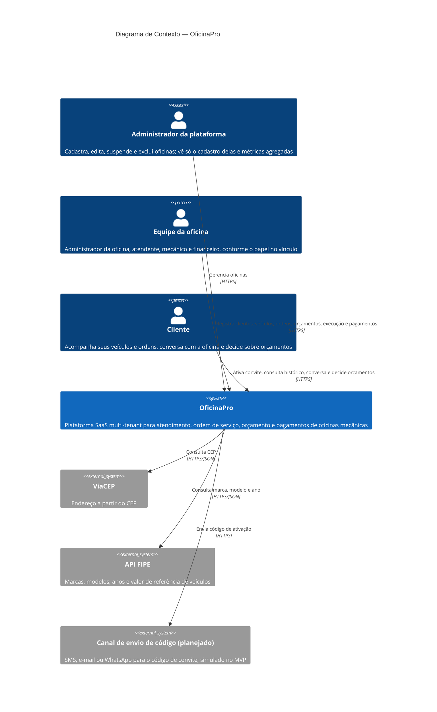
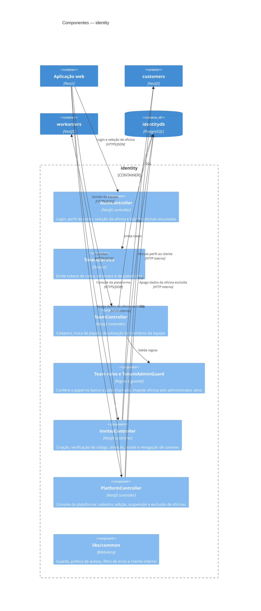
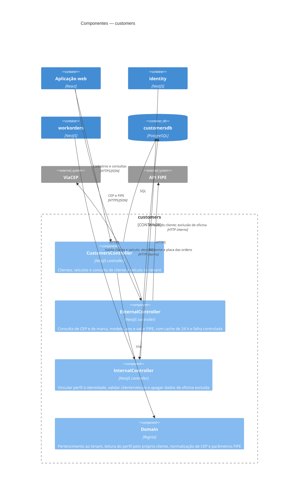
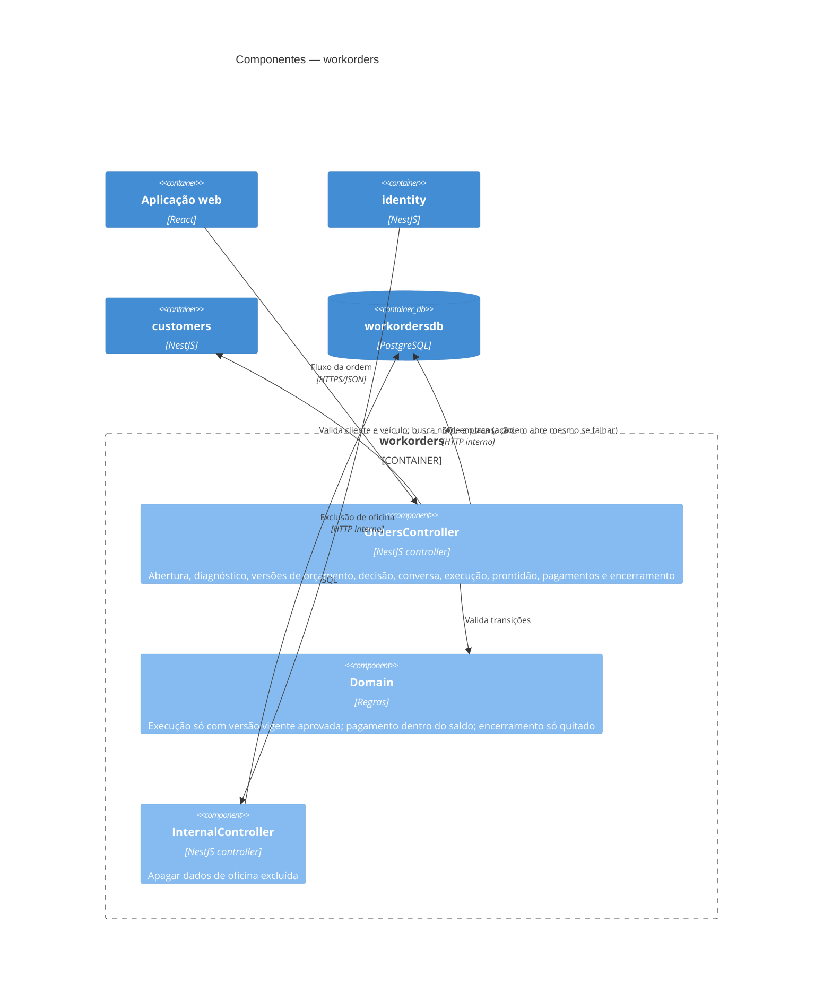

# Diagramas C4 Model

---

**Projeto:** OficinaPro — Plataforma SaaS Multi-Tenant para Gestão de Oficinas Mecânicas
**Grupo:** GarageOps
**Data:** 26/11/2026
**Versão:** 1.2

---

## 1. Objetivo

Este documento apresenta a arquitetura de software do OficinaPro com o **C4 Model**, nos três níveis obrigatórios: Contexto, Contêineres e Componentes. Os nomes de serviços, dados e fluxos são os mesmos dos Documentos 02, 03 e 04.

O documento distingue duas situações:

- **Implementado no MVP:** elementos que existem no protótipo do repositório do sistema (pasta `mvp/`, versão de 22/11/2026), executado com Docker Compose.
- **Planejado:** elementos previstos nos requisitos e no Documento 05, ainda não implementados. Eles aparecem com o rótulo "(planejado)".

---

## 2. Nível 1 — Diagrama de Contexto

### Descrição dos Elementos

| Elemento | Tipo | Descrição |
|----------|------|-----------|
| Equipe da oficina | Pessoa | Usuários com vínculo ativo em uma oficina. O papel do vínculo (`tenant_admin`, `attendant`, `mechanic` ou `finance`) define as áreas e ações disponíveis. O administrador da oficina gerencia a equipe somente no próprio tenant |
| Cliente | Pessoa | Identidade GarageOps com perfil local em uma ou mais oficinas (papel `customer`). Vê apenas os próprios veículos e ordens, identificados pela oficina de origem |
| Administrador da plataforma | Pessoa | Papel global, separado dos vínculos com oficinas. Não acessa clientes, veículos, ordens, orçamentos, valores, mensagens ou pagamentos (RF-039, RNF-049) |
| OficinaPro | Sistema | Plataforma web única para todas as oficinas, com dados isolados por tenant |
| ViaCEP | Sistema Externo | API pública que preenche o endereço do cliente pelo CEP (RF-009). Em caso de falha, o endereço é digitado |
| API FIPE | Sistema Externo | API pública que padroniza marca, modelo e ano do veículo (RF-010). Em caso de falha, os dados são digitados |
| Canal de envio de código | Sistema Externo (planejado) | Entrega do código de ativação do convite. Provedor ainda não definido; no MVP o código é exibido apenas no ambiente local de demonstração |

---

## 3. Nível 2 — Diagrama de Contêineres

```mermaid
C4Container
    title Diagrama de Contêineres — OficinaPro

    Person(staff, "Equipe da oficina")
    Person(customer, "Cliente")
    Person(platformAdmin, "Administrador da plataforma")

    System_Ext(viacep, "ViaCEP")
    System_Ext(fipe, "API FIPE")

    Container_Boundary(oficinapro, "OficinaPro") {
        Container(web, "Aplicação web", "React 18, TypeScript e Vite 6, servida por nginx", "Interface única com navegação conforme o papel ativo")
        Container(gateway, "Entrada HTTP", "nginx no MVP; ALB na AWS (planejado)", "Encaminha /api/identity, /api/customers e /api/orders; bloqueia rotas internas")
        Container(identity, "identity", "Node.js 22, NestJS 10, TypeScript", "Login, token, oficinas, vínculos, equipe, convites e console da plataforma")
        Container(customers, "customers", "Node.js 22, NestJS 10, TypeScript", "Clientes, veículos, histórico, ViaCEP e FIPE")
        Container(workorders, "workorders", "Node.js 22, NestJS 10, TypeScript", "Ordens, diagnóstico, orçamentos, decisões, conversa, execução e pagamentos")
        ContainerDb(identitydb, "identitydb", "PostgreSQL 16", "Oficinas, identidades, vínculos e convites")
        ContainerDb(customersdb, "customersdb", "PostgreSQL 16", "Perfis locais de cliente e veículos")
        ContainerDb(workordersdb, "workordersdb", "PostgreSQL 16", "Ordens, versões de orçamento, decisões, mensagens, execuções e pagamentos")
        ContainerQueue(broker, "RabbitMQ (planejado)", "RabbitMQ", "Eventos assíncronos para notificação e auditoria")
        Container(notification, "Notification Service (planejado)", "NestJS", "Avisos dentro da plataforma")
        Container(prometheus, "Prometheus (planejado)", "Prometheus", "Coleta /metrics de cada serviço")
        Container(grafana, "Grafana (planejado)", "Grafana", "Dashboards e alertas sem dados de clientes")
    }

    Rel(staff, web, "Usa", "HTTPS")
    Rel(customer, web, "Usa", "HTTPS")
    Rel(platformAdmin, web, "Usa", "HTTPS")
    Rel(web, gateway, "Chama a API com token", "HTTPS/JSON")
    Rel(gateway, identity, "/api/identity/*", "HTTP")
    Rel(gateway, customers, "/api/customers/*", "HTTP")
    Rel(gateway, workorders, "/api/orders/*", "HTTP")
    Rel(identity, customers, "Vincula cliente ao convite; apaga dados na exclusão da oficina", "HTTP interno + segredo de serviço")
    Rel(identity, workorders, "Apaga dados na exclusão da oficina", "HTTP interno + segredo de serviço")
    Rel(workorders, customers, "Valida cliente e veículo do tenant; busca nome e placa para exibir a ordem", "HTTP interno + segredo de serviço")
    Rel(identity, identitydb, "Lê e grava", "SQL")
    Rel(customers, customersdb, "Lê e grava", "SQL")
    Rel(workorders, workordersdb, "Lê e grava", "SQL")
    Rel(customers, viacep, "Consulta CEP", "HTTPS")
    Rel(customers, fipe, "Consulta FIPE (cache de 24 h)", "HTTPS")
    Rel(workorders, broker, "Publica eventos (planejado)", "AMQP")
    Rel(broker, notification, "Entrega eventos (planejado)", "AMQP")
    Rel(prometheus, identity, "Coleta métricas (planejado)", "HTTP /metrics")
    Rel(prometheus, customers, "Coleta métricas (planejado)", "HTTP /metrics")
    Rel(prometheus, workorders, "Coleta métricas (planejado)", "HTTP /metrics")
    Rel(grafana, prometheus, "Consulta métricas (planejado)", "PromQL")
```

### Descrição dos Contêineres

| Contêiner | Tecnologia | Responsabilidade | Porta |
|-----------|------------|------------------|-------|
| Aplicação web | React 18, TypeScript 5.6 e Vite 6, servida por nginx 1.27 | Interface única para equipe, cliente e administrador da plataforma | 80 no contêiner; 8080 no host local |
| Entrada HTTP | nginx no MVP; Application Load Balancer na AWS (planejado) | Encaminhamento por caminho e bloqueio de `/api/*/internal/*` | 80/443 |
| identity | Node.js 22, NestJS 10, TypeScript | Domínios Tenant e Auth: login, emissão de token, seleção de oficina, equipe, convites e console da plataforma | 3001 |
| customers | Node.js 22, NestJS 10, TypeScript | Domínio Customer Vehicle: clientes, veículos, histórico e integrações ViaCEP e FIPE | 3002 |
| workorders | Node.js 22, NestJS 10, TypeScript | Domínio Work Order e, provisoriamente, pagamentos e saldo (Billing) | 3003 |
| identitydb, customersdb, workordersdb | PostgreSQL 16 | Um banco lógico por serviço; nenhum serviço acessa o banco de outro | 5432 |
| Message Broker (planejado) | RabbitMQ | Eventos assíncronos (RNF-008) | 5672 local / 5671 AMQPS na AWS |
| Prometheus e Grafana (planejados) | Prometheus, Grafana | Métricas e dashboards (RNF-038, RNF-039) | 9090 / 3000 |
| Billing, Notification, Reporting e Audit (planejados) | NestJS e PostgreSQL | Domínios a separar no 5º semestre (Documento 07, ADR-007) | A definir |

**Contrato de acesso entre contêineres (implementado):** somente o `identity` emite tokens (JWT HS256, validade de 8 horas). O token tem `scope` igual a `account` (conta sem oficina), `tenant` (com `activeTenantId` e papéis do vínculo) ou `platform`. Os demais serviços apenas verificam o token. O tenant ativo vem sempre do token verificado, nunca do corpo, da URL ou de cabeçalho enviado pelo navegador (RNF-003). As rotas `/internal/*` exigem o segredo de serviço e não são acessíveis pelo navegador.

---

## 4. Nível 3 — Diagrama de Componentes

Os três serviços compartilham a biblioteca `libs/common`, que é compilada dentro de cada imagem. Ela não é um serviço e não compartilha banco: cada serviço continua independente na implantação.

| Componente comum (`libs/common`) | Responsabilidade |
|---|---|
| Auth (guards, `access-policy`, decorators) | Toda rota declara quem pode acessá-la (`@TenantEndpoint`, `@AccountEndpoint`, `@PlatformEndpoint`, `@Public`); rota sem declaração é negada |
| Auth context | Verifica o token e monta o principal (usuário, `scope`, tenant ativo e papéis) |
| Api exception filter e `BusinessException` | Erros no formato `{ statusCode, error, message }`; só mensagens de regra de negócio chegam à tela |
| Service client e service secret guard | Chamadas internas autenticadas por segredo de serviço |
| Database module | Conexão PostgreSQL e transações do próprio serviço |

### 4.1 Componentes do serviço identity (Tenant e Auth)

### 4.2 Componentes do serviço customers (Customer Vehicle)

### 4.3 Componentes do serviço workorders (Work Order e pagamentos)

---

## 5. Decisões Arquiteturais (ADRs Resumidos)

Resumo dos ADRs do Documento 07, com os mesmos números e títulos.

| # | Decisão | Motivação | Alternativas Consideradas |
|---|---------|-----------|--------------------------|
| ADR-001 | Linguagem e Framework do Backend: Node.js, TypeScript e NestJS | Contratos tipados, guards e validação; padrão adotado pelo grupo em 22/11/2026 | Express com JavaScript, Java com Spring Boot, Go |
| ADR-002 | Escolha do Banco de Dados: PostgreSQL com banco lógico por serviço | Dados relacionais, transações e restrições por tenant; cada serviço dono dos seus dados | Banco compartilhado, instância por serviço, MongoDB |
| ADR-003 | Comunicação entre Microsserviços: REST síncrono e RabbitMQ para eventos | Resposta imediata onde necessária; desacoplamento de notificação e auditoria | Somente REST, somente mensageria, SQS/SNS |
| ADR-004 | Provedor de Nuvem e Serviços: AWS | Exigência de nuvem de grande porte; Terraform maduro | GCP, Azure |
| ADR-005 | Containerização e Orquestração: ECS Fargate com entrada única pelo ALB | Deploy independente por serviço sem administrar servidores | EKS, EC2 com Docker Compose |
| ADR-006 | Integrações com APIs Externas: ViaCEP e FIPE | Relevantes ao cadastro, públicas e sem custo, com preenchimento manual | Provedor de pagamento, envio de SMS |
| ADR-007 | Decomposição em Microsserviços: três serviços no MVP | Entrega viável com limites claros | Oito serviços desde o início, monólito modular |
| ADR-008 | Isolamento Multi-Tenant por `tenant_id` validado no servidor | Uma aplicação para todas as oficinas, sem vazamento | Esquema ou banco por oficina |
| ADR-009 | Identidade Global, Autenticação e Papéis por Vínculo: JWT emitido pelo identity | Uma conta por pessoa, papéis por oficina, plataforma sem acesso aos dados | Cognito/Keycloak, sessão no servidor |
| ADR-010 | Frontend e Navegação por Papel: React, TypeScript e Vite | Uma aplicação para todos os papéis | Next.js, Angular |
| ADR-011 | Qualidade, Entrega e Observabilidade | Exigências do termo de aceite | CloudWatch sem Prometheus/Grafana |
| ADR-012 | Escopo sem Estoque Interno | Oficinas compram peças de autopeças parceiras; reduz complexidade do MVP | Estoque com reservas e baixa |
| ADR-013 | Orçamento Versionado com Decisão do Cliente | Prova de aprovação e histórico de negociação | Orçamento único editável |
| ADR-014 | Padronização e Comparação de Telefone | Mesma pessoa reconhecida em qualquer formato de número; unicidade por oficina efetiva | Normalizar em cada serviço, não normalizar, normalizar só na comparação |

---

## 6. Tecnologias Utilizadas

| Camada | Tecnologia | Versão | Justificativa |
|--------|------------|--------|---------------|
| Frontend | React com TypeScript e Vite | React 18.3, TypeScript 5.6, Vite 6.0 | SPA leve, uma aplicação para todos os papéis, com tipos dos contratos da API (ADR-010) |
| Backend | Node.js, NestJS e TypeScript | Node.js 22, NestJS 10.4, TypeScript 5.7 | ADR-001 |
| Banco Relacional | PostgreSQL | 16 | ADR-002 |
| Banco NoSQL | Não utilizado | — | O domínio é relacional e transacional |
| Cache | Não utilizado | — | Cache da FIPE em memória no serviço `customers`; cache distribuído não é necessário no MVP |
| Mensageria | RabbitMQ (planejado) | A definir | ADR-003 |
| Monitoramento | Prometheus + Grafana (planejado) | A definir | Requisito obrigatório |
| IaC | Terraform (planejado) | A definir | Requisito obrigatório |
| CI/CD | GitHub Actions (planejado) | - | Requisito obrigatório |
| Containerização | Docker e Docker Compose | Imagens base `node:22-alpine`, `nginx:1.27-alpine` e `postgres:16-alpine` | Padronização de execução e contingência da banca |
| Testes | Jest e Supertest (backend); Vitest e React Testing Library (frontend) | Jest 29, Vitest 2.1, React Testing Library 16 | RNF-028 e RNF-029 |
| Segurança | bcryptjs para hash de senha; JWT HS256 com validade de 8 h | bcryptjs 2.4, @nestjs/jwt 10.2 | RNF-032 e RNF-033 |

---

## 7. Histórico de Revisões

| Versão | Data | Autor | Descrição da Alteração |
|--------|------|-------|------------------------|
| 1.0 | 25/11/2026 | Eloisa (revisão) e Thiago (validação) | Versão inicial com contexto, contêineres e componentes dos três serviços do MVP, distinguindo o que está implementado do que está planejado |
| 1.1 | 26/11/2026 | Eloisa (revisão) e Thiago (validação) | Frontend atualizado para React com TypeScript, após o redesign incorporado ao MVP em 26/11/2026 |
| 1.2 | 26/11/2026 | Eloisa (revisão) e Thiago (validação) | ADR-014 no resumo de ADRs; consulta de nome e placa do serviço de ordens ao de clientes (Pull Request #2); cabeçalho de versão corrigido |

---

**Aprovado por:**

___________________________________________________
Professor(a) Orientador(a)

Data: ___/___/2026
