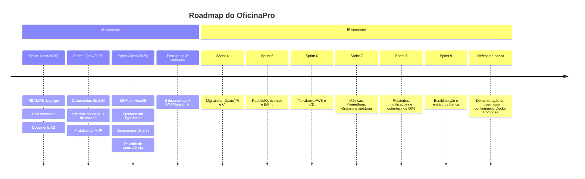
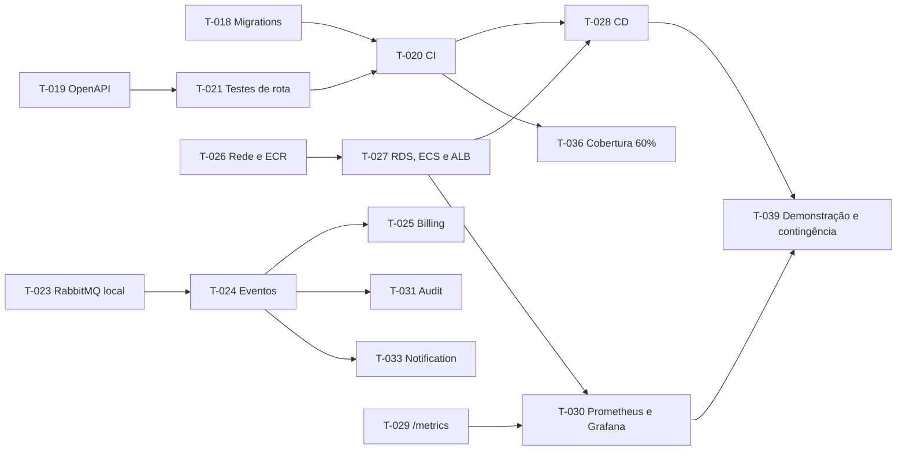

# Planejamento de Sprints e Tarefas

---

**Projeto:** OficinaPro — Plataforma SaaS Multi-Tenant para Gestão de Oficinas Mecânicas
**Grupo:** GarageOps
**Metodologia:** Scrum adaptado, com quadro Kanban para acompanhar as tarefas (proposta)
**Duração da Sprint:** 2 semanas (proposta)
**Data de Início:** 17/09/2026 (primeira versão do Documento 01)
**Data de Término Prevista:** data da banca do 5º semestre, a definir pelo orientador
**Versão:** 1.2

---

## 1. Objetivo

Este documento organiza o desenvolvimento do OficinaPro em sprints, com tarefas, responsáveis, estimativas e critérios de conclusão. O planejamento cobre o 4º semestre (8 documentos e MVP funcional) e o 5º semestre (sistema completo em nuvem e banca), conforme a seção 7 do termo de aceite.

**Sobre as datas:** o calendário acadêmico do 5º semestre não está disponível no repositório oficial. Por isso as sprints futuras são numeradas e ordenadas por dependência, sem datas. As datas das sprints já realizadas vêm do histórico de revisões dos documentos e dos commits. Quando o orientador divulgar o calendário, cada sprint recebe seu período sem mudar o conteúdo.

---

## 2. Membros da Equipe e Papéis

| # | Nome | RA | Papel Principal | Papéis Secundários |
|---|------|-----|-----------------|-------------------|
| 1 | Eloisa do Santos Brandão | 2325096 | Product Owner e Analista de Requisitos | Critérios de aceite, Documento 08, acompanhamento dos critérios C9 e C10 |
| 2 | Thiago Marques Bueno | 6325304 | Desenvolvedor Backend e Integrações | Contratos de API e eventos, Documento 06, métricas nos serviços |
| 3 | Matheus Gabriel Correa Braga Viana | 6325053 | Desenvolvedor Frontend e UX | Consolidação do Documento 07, testes de interface |
| 4 | Gabriel Carneiro da Silva | 6325300 | DevOps, Banco de Dados e Qualidade | Documentos 01 a 05, migrations, CI/CD, Terraform, monitoramento e medição de cobertura |

Os papéis principais e as responsabilidades por documento vêm do README do repositório do sistema. A coluna "Responsável" das tarefas indica quem conduz; revisão por pelo menos um colega é obrigatória (seção 7).

---

## 3. Visão Geral do Cronograma

### 3.1 Roadmap por Semestre

### 3.2 Entregas por semestre

| Semestre | Entrega oficial | Situação em 25/11/2026 |
|---|---|---|
| 4º | 8 documentos técnicos e MVP funcional com integração inicial dos microsserviços | Documentos 01 a 04 entregues ao orientador; 05 a 08 em revisão final; MVP com três serviços funcionando localmente |
| 5º | Sistema completo, deploy na AWS com Terraform, CI/CD, cobertura ≥ 60%, Prometheus e Grafana, mínimo de 4 encontros com o orientador e banca | Não iniciado |

---

## 4. Product Backlog Priorizado

### Legenda de Prioridade
- **P0** — Crítico (bloqueia outras tarefas)
- **P1** — Alta (necessário para o MVP)
- **P2** — Média (necessário para a entrega final)
- **P3** — Baixa (desejável, se houver tempo)

### Legenda de Estimativa (Story Points)
- **1** — Trivial (< 2h)
- **2** — Pequeno (meio dia)
- **3** — Médio (1 dia)
- **5** — Grande (2-3 dias)
- **8** — Muito grande (1 semana, considerar quebrar)
- **13** — Épico (deve ser decomposto)

### Legenda de Status
- **[x]** concluída, com evidência no repositório
- **[~]** em andamento
- **[ ]** não iniciada

### Backlog Completo

| ID | Épico | Tarefa | Prioridade | Story Points | Responsável | Sprint | Status |
|----|-------|--------|------------|--------------|-------------|--------|--------|
| T-001 | Documentação | README do grupo com integrantes, descrição e tecnologias | P0 | 1 | Gabriel | Sprint 1 | [x] |
| T-002 | Documentação | Documento 01 — Solicitação do Sistema | P1 | 3 | Gabriel | Sprint 1 | [x] |
| T-003 | Documentação | Documento 02 — Requisitos Funcionais e Não Funcionais | P1 | 5 | Gabriel | Sprint 1 | [x] |
| T-004 | Documentação | Documento 03 — Diagrama de Fluxo de Dados | P1 | 3 | Gabriel | Sprint 2 | [x] |
| T-005 | Documentação | Documento 04 — Modelo Entidade-Relacionamento | P1 | 3 | Gabriel | Sprint 2 | [x] |
| T-006 | Escopo | Revisar escopo: estoque fora do MVP, papel do administrador da plataforma, APIs externas | P0 | 3 | Gabriel | Sprint 2 | [x] |
| T-007 | MVP | Protótipo do fluxo completo com cinco oficinas fictícias e Docker Compose | P0 | 8 | Gabriel | Sprint 2 | [x] |
| T-008 | Backend | Base NestJS com token por `scope`, política de acesso por rota e erros padronizados | P0 | 8 | Thiago | Sprint 3 | [x] |
| T-009 | Backend | Migrar `identity`, `customers` e `workorders` para NestJS mantendo as rotas | P0 | 8 | Gabriel | Sprint 3 | [x] |
| T-010 | Integração | ViaCEP no cadastro do cliente e FIPE no cadastro do veículo, com fallback manual | P1 | 5 | Gabriel | Sprint 3 | [x] |
| T-011 | Backend | Gestão da equipe pelo administrador da oficina | P1 | 5 | Gabriel | Sprint 3 | [x] |
| T-012 | Documentação | Documento 05 — Arquitetura em Nuvem | P1 | 3 | Gabriel | Sprint 3 | [~] |
| T-013 | Documentação | Documento 06 — C4 Model | P1 | 5 | Thiago | Sprint 3 | [~] |
| T-014 | Documentação | Documento 07 — ADR (cada área escreve os seus; Matheus consolida) | P1 | 3 | Matheus | Sprint 3 | [~] |
| T-015 | Documentação | Documento 08 — Planejamento de Sprints e Tarefas | P1 | 3 | Eloisa | Sprint 3 | [~] |
| T-016 | Documentação | Revisão de consistência entre os 8 documentos e o MVP | P0 | 3 | Eloisa | Sprint 3 | [~] |
| T-017 | Entrega | PR para o orientador somente com a pasta `Projetos/OficinaPro` | P0 | 1 | Eloisa | Sprint 3 | [ ] |
| T-018 | Banco | Migrations versionadas para os três bancos, substituindo a criação de tabelas na inicialização (RNF-013) | P0 | 5 | Gabriel | Sprint 4 | [ ] |
| T-019 | Backend | Contrato OpenAPI das rotas dos três serviços (RNF-030) | P1 | 5 | Thiago | Sprint 4 | [ ] |
| T-020 | DevOps | Workflow de CI: lint, build, testes e cobertura global somada com limite de 60% (RNF-024, RNF-025, RNF-028) | P0 | 5 | Gabriel | Sprint 4 | [ ] |
| T-021 | QA | Testes de rota com Supertest para autorização e isolamento entre tenants no CI (RNF-005, RNF-027) | P0 | 5 | Thiago | Sprint 4 | [ ] |
| T-022 | Frontend | Refazer o frontend em TypeScript, com nova identidade visual e primeiros testes de interface (ADR-010) | P1 | 5 | Matheus | Sprint 3 | [x] |
| T-023 | Infra local | RabbitMQ no Docker Compose com interface de gerenciamento (RNF-016) | P1 | 2 | Gabriel | Sprint 5 | [ ] |
| T-024 | Backend | Publicação de eventos com `event_id`, `tenant_id` e `correlation_id`; consumidor idempotente, retentativa e DLQ (ADR-003) | P1 | 8 | Thiago | Sprint 5 | [ ] |
| T-025 | Backend | Separar Billing Service com banco próprio para pagamentos e fechamento (ADR-007; RF-025 a RF-027) | P2 | 8 | Thiago | Sprint 5 | [ ] |
| T-026 | Infra | Terraform: estado remoto, VPC, sub-redes, security groups e ECR (Documento 05) | P0 | 8 | Gabriel | Sprint 6 | [ ] |
| T-027 | Infra | Terraform: RDS, Secrets Manager, ECS Fargate, Cloud Map e ALB | P0 | 8 | Gabriel | Sprint 6 | [ ] |
| T-028 | DevOps | Workflow de CD: imagens no ECR, `terraform apply` e atualização dos serviços ECS (RNF-026) | P0 | 5 | Gabriel | Sprint 6 | [ ] |
| T-029 | Backend | Endpoint `/metrics` nos serviços, sem dados de clientes (RNF-038) | P1 | 3 | Thiago | Sprint 7 | [ ] |
| T-030 | DevOps | Prometheus e Grafana na AWS e no Docker Compose, dashboards e alertas (RNF-039) | P0 | 5 | Gabriel | Sprint 7 | [ ] |
| T-031 | Backend | Audit Service consumindo eventos de ações críticas (RF-032) | P2 | 5 | Thiago | Sprint 7 | [ ] |
| T-032 | Backend | Revogar acesso quando a oficina for suspensa ou excluída, sem esperar o token vencer (ADR-009) | P1 | 3 | Thiago | Sprint 7 | [ ] |
| T-033 | Backend | Notification Service com avisos dentro da plataforma (RF-029) | P2 | 5 | Thiago | Sprint 8 | [ ] |
| T-034 | Frontend | Dashboard e relatórios do administrador da oficina (RF-030, RF-031) | P2 | 8 | Matheus | Sprint 8 | [ ] |
| T-035 | QA | Ampliar os testes de interface (Vitest e React Testing Library) para estados de carregamento, vazio, erro e acesso negado | P2 | 5 | Matheus | Sprint 8 | [~] |
| T-036 | QA | Atingir e comprovar 60% de cobertura global no relatório do CI | P0 | 8 | Gabriel | Sprint 8 | [ ] |
| T-037 | QA | Teste de latência das APIs principais (P95 até 800 ms, RNF-042) | P3 | 3 | Gabriel | Sprint 9 | [ ] |
| T-038 | Todos | Correções e estabilização | P1 | 8 | Equipe | Sprint 9 | [ ] |
| T-039 | Apresentação | Roteiro da demonstração em nuvem e ensaio da contingência com Docker Compose | P0 | 3 | Eloisa | Sprint 9 | [ ] |
| T-040 | Acompanhamento | Fichas dos encontros com o orientador e quadro de critérios C1 a C10 atualizados | P1 | 2 | Eloisa | Contínuo (5º semestre) | [ ] |
| T-041 | Backend | Padronizar o telefone nos três serviços e corrigir a exibição de cliente e veículo na ordem (ADR-014) | P1 | 3 | Matheus | Sprint 3 | [x] |

As tarefas T-012 a T-015 têm rascunho completo em 25/11/2026 e aguardam a revisão do responsável indicado.

### 4.1 Dependências principais

### 4.2 Rastreabilidade com os critérios da banca

| Critério | Tarefas |
|---|---|
| C1 — Microsserviços | T-009, T-024, T-025, T-031, T-033 |
| C2 — API externa | T-010 |
| C3 — Banco com justificativa | T-005, T-018 |
| C4 — Deploy em nuvem | T-026, T-027, T-028 |
| C5 — Terraform | T-026, T-027 |
| C6 — CI/CD com GitHub Actions | T-020, T-028 |
| C7 — Cobertura ≥ 60% | T-021, T-035, T-036 |
| C8 — Prometheus e Grafana | T-029, T-030 |
| C9 — 8 documentos | T-001 a T-016 |
| C10 — Encontros com evolução | T-040 |

### 4.3 Rastreabilidade com os requisitos funcionais

Cada RF do Documento 02 aponta para a tarefa que o implementa ou implementará. RF já demonstrados no protótipo estão nas tarefas concluídas do 4º semestre; os demais ficam no 5º.

| RF (Documento 02) | Tarefas | Situação |
|---|---|---|
| RF-001 a RF-006, RF-033, RF-039 — tenant, acesso, papéis e console da plataforma | T-007, T-008, T-009, T-011; reforço em T-021 e T-032 | Demonstrados no MVP |
| RF-034 — convite do cliente | T-007, T-009, T-041 | Demonstrado no MVP, com código simulado; envio real depende do provedor (pendente) |
| RF-007, RF-008, RF-011, RF-035 — clientes, veículos e histórico | T-007, T-009, T-041 | Demonstrados no MVP |
| RF-009, RF-010 — ViaCEP e FIPE | T-010 | Demonstrados no MVP |
| RF-012 a RF-019, RF-036 a RF-038 — ordem, diagnóstico, orçamento versionado, decisão, conversa, execução e encerramento | T-007, T-009; testes em T-021 | Demonstrados no MVP |
| RF-025 a RF-027 — fechamento e pagamentos | T-007, T-009; separação em T-025 | Demonstrados no MVP dentro de `workorders` |
| RF-028 — pagamento online | — | Fora do escopo atual |
| RF-029 — notificações | T-024, T-033 | 5º semestre |
| RF-030, RF-031 — dashboard e relatórios | T-034 | 5º semestre |
| RF-032 — auditoria | T-024, T-031 | 5º semestre |

---

## 5. Detalhamento por Sprint

### Sprint 1 — Concepção e Requisitos (4º semestre)

| Informação | Detalhe |
|------------|---------|
| **Período** | 17/09/2026 a 24/09/2026 (registrado no histórico dos Documentos 01 e 02) |
| **Objetivo** | Definir o problema, o escopo SaaS multi-tenant e os requisitos priorizados |
| **Capacidade** | 9 SP |

| ID | Tarefa | Responsável | SP | Critério de Conclusão (DoD) |
|----|--------|-------------|----|-----------------------------|
| T-001 | README do grupo | Gabriel | 1 | Integrantes, RA, descrição e tecnologias preenchidos |
| T-002 | Solicitação do Sistema | Gabriel | 3 | Documento no template, revisado pela PO |
| T-003 | Requisitos RF/RNF | Gabriel | 5 | RF e RNF com critério de aceite, prioridade e rastreabilidade |

**Resultado esperado:** visão do produto e requisitos aprovados pelo grupo. **Alcançado.**

---

### Sprint 2 — Modelagem e Protótipo (4º semestre)

| Informação | Detalhe |
|------------|---------|
| **Período** | 09/11/2026 a 22/11/2026 (registrado no histórico dos Documentos 03 e 04 e nos commits do MVP) |
| **Objetivo** | Modelar fluxos e dados e validar o fluxo principal em um protótipo executável |
| **Capacidade** | 17 SP |

| ID | Tarefa | Responsável | SP | Critério de Conclusão (DoD) |
|----|--------|-------------|----|-----------------------------|
| T-004 | DFD | Gabriel | 3 | Níveis 0, 1 e 2 coerentes com o Documento 02 |
| T-005 | MER | Gabriel | 3 | Entidades, cardinalidades, índices e propriedade por serviço |
| T-006 | Revisão de escopo | Gabriel | 3 | Estoque removido de todos os documentos; regras do administrador da plataforma registradas |
| T-007 | Protótipo do MVP | Gabriel | 8 | `docker compose up` sobe o sistema; teste `smoke` passa com cinco oficinas |

**Resultado esperado:** modelo de dados e protótipo demonstrando o fluxo da ordem com isolamento entre oficinas. **Alcançado.**

---

### Sprint 3 — Arquitetura e Entrega do 4º Semestre

| Informação | Detalhe |
|------------|---------|
| **Período** | 22/11/2026 até a entrega documental do 4º semestre (data definida pelo orientador) |
| **Objetivo** | MVP no padrão NestJS e os 8 documentos completos e consistentes entre si |
| **Capacidade** | 52 SP |

| ID | Tarefa | Responsável | SP | Critério de Conclusão (DoD) |
|----|--------|-------------|----|-----------------------------|
| T-008 | Base NestJS | Thiago | 8 | Build e testes unitários passando |
| T-009 | Migração do MVP | Gabriel | 8 | Testes `smoke` e `platform-check` passando em banco limpo e em banco da versão anterior |
| T-010 | ViaCEP e FIPE | Gabriel | 5 | Consulta pelo serviço `customers`, com fallback manual testado |
| T-011 | Gestão da equipe | Gabriel | 5 | Teste `team-check` passando; administrador limitado ao próprio tenant |
| T-022 | Frontend em TypeScript | Matheus | 5 | Build com tipos e testes de interface passando; incorporado ao MVP em 26/11/2026 |
| T-041 | Telefone padronizado e correções de fluxo | Matheus | 3 | Testes `phone.spec.ts` e `bugfix-check` passando; incorporado ao MVP em 26/11/2026 |
| T-012 a T-015 | Documentos 05 a 08 | Gabriel, Thiago, Matheus e Eloisa | 14 | Documentos no template, revisados pelo responsável |
| T-016 | Revisão de consistência | Eloisa | 3 | Mesmos nomes de serviços, papéis, estados e IDs em todos os documentos |
| T-017 | PR de entrega | Eloisa | 1 | PR com título `[GarageOps] - Entrega N - Descrição`, alterando apenas `Projetos/OficinaPro` |

**Resultado esperado:** entrega completa do 4º semestre (8 documentos + MVP funcional).

---

### Sprint 4 — Fundação de Qualidade (5º semestre)

| Informação | Detalhe |
|------------|---------|
| **Período** | A definir conforme o calendário do 5º semestre |
| **Objetivo** | Banco versionado, contratos publicados e CI bloqueando código quebrado |
| **Capacidade** | 20 SP |

| ID | Tarefa | Responsável | SP | Critério de Conclusão (DoD) |
|----|--------|-------------|----|-----------------------------|
| T-018 | Migrations versionadas | Gabriel | 5 | Os três bancos criados do zero pelas migrations no Docker Compose |
| T-019 | Contrato OpenAPI | Thiago | 5 | Especificação publicada no repositório e usada pelo frontend |
| T-020 | Workflow de CI | Gabriel | 5 | PR executa lint, build, testes e cobertura; falha bloqueia o merge |
| T-021 | Testes de rota e isolamento | Thiago | 5 | Testes de acesso negado entre tenants e para o administrador da plataforma rodando no CI |

**Resultado esperado:** todo PR passa por build e testes automatizados, com relatório de cobertura.

---

### Sprint 5 — Mensageria e Billing (5º semestre)

| Informação | Detalhe |
|------------|---------|
| **Período** | A definir |
| **Objetivo** | Comunicação assíncrona confiável e domínio financeiro em serviço próprio |
| **Capacidade** | 18 SP |

| ID | Tarefa | Responsável | SP | Critério de Conclusão (DoD) |
|----|--------|-------------|----|-----------------------------|
| T-023 | RabbitMQ local | Gabriel | 2 | Contêiner no Docker Compose com interface de gerenciamento |
| T-024 | Eventos | Thiago | 8 | Evento duplicado não é processado duas vezes; mensagem com falha vai para a DLQ (testes automatizados) |
| T-025 | Billing Service | Thiago | 8 | Pagamentos em banco próprio; saldo da ordem consultado por API ou evento; testes de pagamento acima do saldo |

**Resultado esperado:** quatro serviços independentes e eventos funcionando localmente.

---

### Sprint 6 — Infraestrutura na AWS (5º semestre)

| Informação | Detalhe |
|------------|---------|
| **Período** | A definir |
| **Objetivo** | Ambiente de demonstração criado somente por Terraform e deploy automatizado |
| **Capacidade** | 21 SP |

| ID | Tarefa | Responsável | SP | Critério de Conclusão (DoD) |
|----|--------|-------------|----|-----------------------------|
| T-026 | Rede, estado e ECR | Gabriel | 8 | `terraform apply` cria VPC, sub-redes, security groups e repositórios |
| T-027 | RDS, ECS e ALB | Gabriel | 8 | Sistema acessível pelo ALB; nenhum recurso criado manualmente |
| T-028 | Workflow de CD | Gabriel | 5 | Merge na branch principal publica imagens e atualiza os serviços ECS |

**Resultado esperado:** sistema rodando na AWS (critérios C4, C5 e C6).

---

### Sprint 7 — Observabilidade e Segurança (5º semestre)

| Informação | Detalhe |
|------------|---------|
| **Período** | A definir |
| **Objetivo** | Monitoramento funcionando e reforço das regras de acesso |
| **Capacidade** | 16 SP |

| ID | Tarefa | Responsável | SP | Critério de Conclusão (DoD) |
|----|--------|-------------|----|-----------------------------|
| T-029 | `/metrics` | Thiago | 3 | Métricas de requisições, erros e latência coletadas, sem dados de clientes |
| T-030 | Prometheus e Grafana | Gabriel | 5 | Dashboard acessível com saúde e erros dos serviços |
| T-031 | Audit Service | Thiago | 5 | Ações críticas registradas com usuário, tenant e data |
| T-032 | Revogação por suspensão | Thiago | 3 | Teste comprova bloqueio imediato após suspender a oficina |

**Resultado esperado:** critério C8 atendido e lacuna de sessão do ADR-009 corrigida.

---

### Sprint 8 — Funcionalidades Complementares e Cobertura (5º semestre)

| Informação | Detalhe |
|------------|---------|
| **Período** | A definir |
| **Objetivo** | Completar os RF de média prioridade e atingir a cobertura exigida |
| **Capacidade** | 26 SP |

| ID | Tarefa | Responsável | SP | Critério de Conclusão (DoD) |
|----|--------|-------------|----|-----------------------------|
| T-033 | Notification Service | Thiago | 5 | Cliente recebe aviso de orçamento, decisão e nova mensagem |
| T-034 | Dashboard e relatórios | Matheus | 8 | Indicadores só do próprio tenant, carregando em até 3 s (RNF-043) |
| T-035 | Testes de interface | Matheus | 5 | Estados principais das telas cobertos |
| T-036 | Cobertura de 60% | Gabriel | 8 | Relatório do CI com cobertura global ≥ 60% |

**Resultado esperado:** critério C7 comprovado no pipeline.

---

### Sprint 9 — Estabilização e Banca (5º semestre)

| Informação | Detalhe |
|------------|---------|
| **Período** | A definir; termina antes do parecer final (7 dias antes da defesa) |
| **Objetivo** | Sistema estável, demonstração ensaiada e contingência testada |
| **Capacidade** | 14 SP |

| ID | Tarefa | Responsável | SP | Critério de Conclusão (DoD) |
|----|--------|-------------|----|-----------------------------|
| T-037 | Teste de latência | Gabriel | 3 | P95 medido e registrado |
| T-038 | Estabilização | Equipe | 8 | Nenhum defeito crítico aberto |
| T-039 | Demonstração e contingência | Eloisa | 3 | Roteiro executado na AWS e com Docker Compose sem internet |

**Resultado esperado:** projeto pronto para o parecer final e a defesa.

---

## 6. Cerimônias Ágeis

O grupo deve realizar as seguintes cerimônias e registrar evidências:

| Cerimônia | Frequência | Duração | Registro |
|-----------|-----------|---------|----------|
| Sprint Planning | Início de cada sprint | 45 min | Tarefas da sprint no quadro, com responsável e critério de conclusão |
| Daily Standup | 3 vezes por semana (assíncrono) | 15 min | Mensagem curta no canal do grupo: feito, próximo passo, bloqueios |
| Sprint Review | Final de cada sprint | 30 min | Demonstração do incremento; no 5º semestre, junto do encontro com o orientador quando coincidir |
| Sprint Retrospectiva | Final de cada sprint | 30 min | Pontos positivos, negativos e ações de melhoria |

As durações e a frequência são uma proposta para o grupo confirmar. Evidências: o quadro de tarefas (GitHub Projects), os Pull Requests e, no 5º semestre, as fichas oficiais de registro de encontro. No 5º semestre, os encontros com o orientador (mínimo de 4, intervalo máximo de 5 semanas) são registrados na ficha oficial, e cada integrante deve ter pelo menos 1 commit por semana (critério C10).

---

## 7. Definition of Done (DoD) Global

Uma tarefa só é considerada **concluída** quando atende a TODOS os critérios abaixo:

- [ ] Código implementado e funcionando
- [ ] Testes escritos e passando (quando aplicável), incluindo acesso negado entre tenants para rotas novas
- [ ] Code review realizado por pelo menos 1 membro da equipe
- [ ] CI/CD passando (build + testes)
- [ ] Documentação atualizada (se necessário): requisito, critério de aceite, diagrama e ADR afetados
- [ ] Merge na branch principal realizado

---

## 8. Métricas de Acompanhamento

| Métrica | Como Medir | Meta |
|---------|-----------|------|
| Velocity | Story points entregues por sprint | Estabilizar a partir da Sprint 5 |
| Burndown | Pontos restantes vs. tempo | Linha descendente sem acúmulo na última semana |
| Cobertura de Testes | Relatório de cobertura do CI | ≥ 60% global |
| Lead Time | Tempo de "A fazer" a "Concluído" | Até 1 sprint por tarefa |

---

## 9. Ferramentas de Gestão

| Finalidade | Ferramenta |
|-----------|------------|
| Board de tarefas | GitHub Projects (proposta) |
| Comunicação | Canal do grupo (a confirmar) |
| Repositório | GitHub: repositório do sistema e fork do repositório oficial de documentação |
| Documentação | Markdown nos repositórios |
| CI/CD | GitHub Actions |

---

## 10. Riscos e Mitigações

| Risco | Probabilidade | Impacto | Mitigação |
|-------|--------------|---------|-----------|
| Integrante sai do grupo | Média | Alto | Documentação atualizada; revisão cruzada entre áreas |
| Atraso em sprint | Alta | Médio | Separação de Billing, Audit, Notification e relatórios é incremental e pode ser repriorizada |
| Custos de cloud estourarem | Média | Médio | Ambiente ligado só quando usado; alertas do AWS Budgets (Documento 05) |
| API externa fora do ar | Média | Médio | Preenchimento manual, tempo limite, cache da FIPE e testes com APIs simuladas |
| Falta de internet na banca | Baixa | Alto | Contingência com Docker Compose, ensaiada na Sprint 9 |
| Restrições da conta AWS acadêmica | Média | Alto | Confirmar a conta e as permissões antes da Sprint 6 |
| Vazamento de dados entre oficinas | Baixa | Alto | Tenant só a partir do token; testes de isolamento no CI (T-021) |

---

## 11. Histórico de Revisões

| Versão | Data | Autor | Descrição da Alteração |
|--------|------|-------|------------------------|
| 1.0 | 25/11/2026 | Eloisa | Versão inicial: sprints realizadas no 4º semestre e plano do 5º semestre por dependência, sem datas futuras até a divulgação do calendário |
| 1.1 | 26/11/2026 | Eloisa | T-022 (frontend em TypeScript) concluída na Sprint 3; T-035 em andamento |
| 1.2 | 26/11/2026 | Eloisa | T-041 (telefone padronizado e correções de fluxo) concluída na Sprint 3; cabeçalho de versão corrigido |

---

**Aprovado por:**

___________________________________________________
Professor(a) Orientador(a)

Data: ___/___/2026
